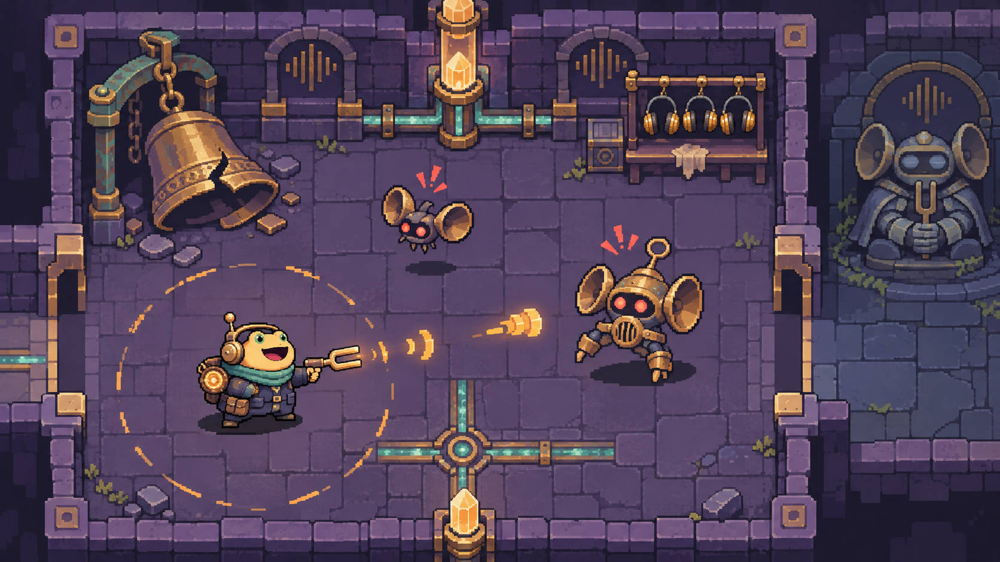
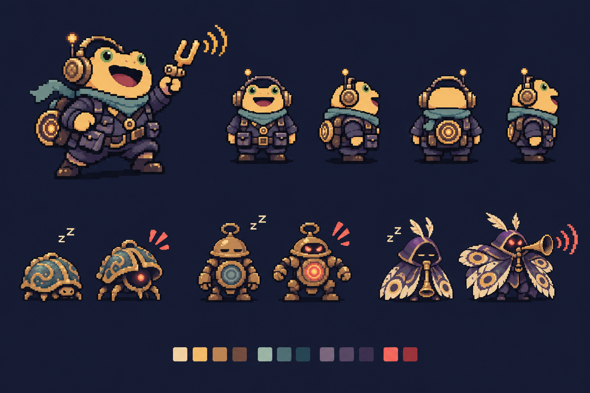
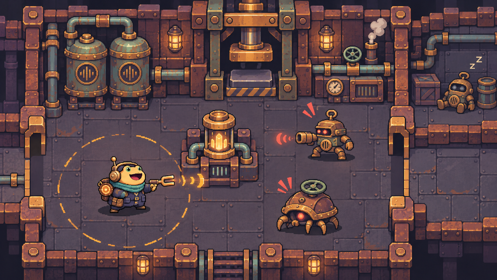
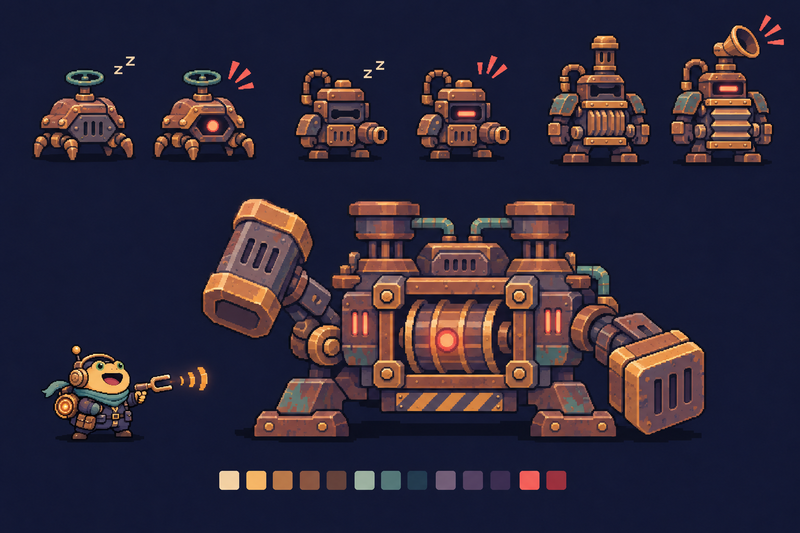
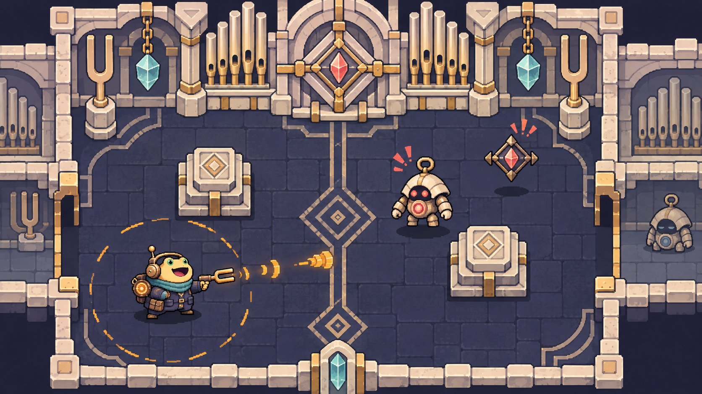
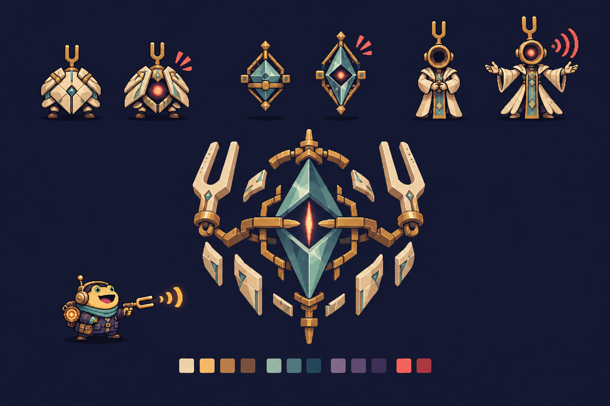

# 012-三层美术风格设计

## 本轮范围与状态

- 内容：将此前生成的遗迹美术确定为第一层，设计三层的场景、地图布置、普通怪、精英和 Boss 外观；为第二、三层各生成场景图与敌人设定板。
- 本文是美术设计提案与制作参考，不代表三层关卡、精英或新 Boss 行为已经实现。本轮没有修改 Unity 场景、脚本、配置或原有图片。
- 当前原型仍是固定七房间、单层地图，击败守关者立即通关。后续实施三层流程时，需要修改层间切换与最终胜利条件。
- 三层版叙事调整：第一层守钟者守护向下通行的入口；第二层守关机械守护核心升降通道；原音核位于第三层。原先单层版本中守钟者直接看守原音核的定位随之调整。
- 现有的声音惊醒、跨房间追击、近距离围攻加成、三选一升级与视觉提示规则继续沿用。本文中的材质、蒸汽、晶体和背景声音，不引入新的声音传播或地形伤害规则。

## 三层总览

三层属于同一座共鸣城：外层的生活与交通区域、维持城市运转的动力工坊、发生大共振的原音核心。

| 层数 | 名称 | 主视觉 | 形状语言 | 声音印象 | 环境叙事 |
| --- | --- | --- | --- | --- | --- |
| 第一层 | 静钟街区 | 灰紫石墙、旧黄铜、青绿铜锈 | 圆钟、拱门、圆形空腔 | 稀疏钟铃、短促回声 | 曾经有人生活的地下城，如今只剩巡逻守卫 |
| 第二层 | 锈鸣工坊 | 炭灰钢板、锈褐铁壳、氧化铜管 | 方壳、横向管道、活塞与铆钉 | 沉重敲击、压力释放、低沉机械节拍 | 城市的动力系统在事故后反复执行旧程序 |
| 第三层 | 原音圣所 | 深蓝地面、象牙白陶壳、冷青晶体、少量金边 | 音叉、竖柱、菱形与对称阵列 | 留白、清澈纯音、拉长的余响 | 城市最精密的核心已经封闭，设备仍保持异常整齐 |

递进关系：第一层有生活痕迹，第二层暴露运转结构，第三层接近声学技术的源头。三层通过材料、几何轮廓和布置共同区分，不只改变色相。

## 全局美术约定

### 视角与规格

- 沿用现有 2D 俯视角，墙体显示短正立面；不改为等距视角，不新增跳跃或多层平台。
- 项目现有基准为 16 PPU、480×270 参考分辨率、Point 过滤。正式资源继续按该基准制作与验证。
- 建议制作规格：地面格 16×16；主角约 32×32；普通怪约 24～32 像素；精英约 48 像素；Boss 约 64～96 像素。以上为待制作时验证的目标画布，不是概念图的实际精灵尺寸。
- 三层共享青蛙主角、武器、拾取物、声圈和界面外观；主角不因换层而更换身份或衣服。
- 概念图中的细纹、铆钉和高光在正式缩小时需要简化，优先保留轮廓、核心和动作方向。

### 提示与配色

- 琥珀色：玩家武器和共振背包能量；青色：响铃诱饵和可交互装置；珊瑚红：敌人警觉、攻击和召集预警。
- 环境中的灯与晶体使用较低饱和度、较低对比度；攻击和预警颜色更集中，不能被地板花纹淹没。
- 普通装饰不使用高亮珊瑚红。第三层场景概念图上方的红色核心图案，正式制作时改成暗青色，或只在遭遇激活后作为警告亮起。
- 沉睡时闭合、暗核、收拢；清醒时展开、亮核、朝向声源；召集时抬头或张开共鸣腔，并配合专用警示图形。不能只靠颜色区分状态。
- 普通怪攻击的声波图案仅为攻击表现，不触发召集。呼叫同伴只属于明确配置了该能力的精英和 Boss。
- 不用全屏雾、强泛光、闪烁地面或密集装饰遮挡弹幕。

## 第一层：静钟街区

### 定调与地图

保留已生成的场景、角色设定和守钟者大厅。它是玩家进入共鸣城后的外层街区，结合旧车站、钟匠铺和巡逻岗的形象。

- 地面：灰紫大石砖、少量裂缝与暗色导音沟槽。
- 墙体：矮石墙、圆拱门、黄铜包角，钟形装饰集中在墙边。
- 重点道具：破钟、旧护耳架、黄铜灯、长椅、维修箱、短段铜管。
- 房间布置：较开阔，少量石柱或维修台分割空间，便于玩家观察声圈与相邻房间。
- 七房间外观主题可对应：入口站台、换乘广场、钟匠铺、维修库、听音岗、废庭、守钟大厅。主题是装饰模块的组合，不需要七套独立地砖。
- 层间过渡：守钟大厅后方使用旧黄铜升降门与逐渐增多的管道，视觉上引向第二层。

### 怪物外观

| 类型 | 名称 | 关键轮廓 | 沉睡／清醒表现 | 设计中的职责 |
| --- | --- | --- | --- | --- |
| 普通 | 钟壳虫 | 圆拱钟壳、低矮短足 | 合壳暗核／抬壳露出红核 | 近距离追击者的外观 |
| 普通 | 空腔卫兵 | 圆盔、短肢、胸口共振腔 | 垂手暗核／举臂、眼与胸口亮起 | 常规机械守卫的外观 |
| 精英 | 鸣号使 | 蛾翼形披覆、号角口部 | 收拢／展开翅面、举号预告 | 保留此前呼叫同伴的设计方向 |
| Boss | 守钟者 | 破钟躯体、双钟槌、宽大足部 | 静止守门／钟槌抬起、核心点亮 | 第一层守关者，圆形声波预警视觉 |

第一层 Boss 图见 [守钟者大厅](../美术/世界观风格-20261113/03-守钟者大厅.png)。此前场景里的蝠形小怪可保留作造型备选，最小制作清单不额外增加一个物种。

## 第二层：锈鸣工坊

### 定调与地图

这里曾将共振能转成机械动力。它的造型应当厚重、有加工痕迹：成排铆钉、压力罐、横向管线和冲压设备。

- 地面：低饱和炭灰钢板、较粗接缝、少量暗色油迹；避免满地高亮黄黑条纹。
- 墙体：锈褐铆接铁壳、竖向支撑梁、嵌墙的大型压力表和活塞。
- 重点道具：阀门、压力罐、工具柜、废零件箱、管道弯头、嵌墙冲压机。
- 房间布置：长方形工作间、成组机器底座、绕大型设备的左右双路；门口保留宽度，避免跨房间追击时被小道具卡住。
- 七房间主题：检修入口、阀门间、压力罐间、装配间、货运廊、主冲压间、鼓压大厅。
- 蒸汽仅在墙边设备附近出现，保持地板和弹幕清楚；油迹、输送带造型与机器运转先作为装饰，不赋予伤害、滑行或强制移动效果。
- 层间过渡：末端机器正在为一座洁白的老式核心升降台供能；出口附近逐渐出现第三层的象牙白外壳与音叉符号。

### 怪物外观

| 类型 | 名称 | 关键轮廓 | 沉睡／清醒表现 | 美术动作方向 |
| --- | --- | --- | --- | --- |
| 普通 | 阀壳蟹 | 低矮锅炉壳、背部大阀轮、四条短足 | 前盖闭合／前盖张开、红核露出 | 短足推进、阀轮轻转，近战追击外观 |
| 普通 | 铆钉射手 | 方形铆钉壳、单侧短枪管、横向眼缝 | 枪口垂下／眼缝亮起、枪管前伸 | 枪管回缩再前推，清楚显示射击方向 |
| 精英 | 风箱督工 | 更高的方壳、折叠风箱胸、汽笛冠 | 风箱收拢／胸腔展开、汽笛抬起 | 汽笛预警与短促召集符号；不新增环境噪声规则 |
| Boss | 鼓压巨偶 | 横向方框躯干、胸口大鼓、两只活塞重锤 | 活塞压低／重锤举起、鼓芯亮起 | 按重击蓄力、落锤、复位设计动作；具体攻击尚待实现确认 |

普通怪以锈褐与灰铁为主，精英通过汽笛冠和体型识别，Boss 用横向宽体与双活塞形成独特剪影。与第一层共享机械关节和核心语言，但改变壳体结构。

## 第三层：原音圣所

### 定调与地图

核心区域保留着最早的声学技术。它比外层更加整洁、精密，以陶壳、晶体和少量黄铜连接件表现被长期封存的核心设施。

- 地面：深蓝灰石板，少量细几何嵌线；保持深色，衬托象牙白敌人与琥珀色主角攻击。
- 墙体：象牙白陶质包覆、金色细接头、竖向管风琴构件、音叉形柱顶。
- 重点道具：晶体悬架、封存匣、调律台、简洁白色基座、几何刻痕、关闭的核心支架。
- 房间布置：对称双列柱、宽中央通道、左右连通侧室、留白较多的核心前厅；仍使用同一套平面移动和格子碰撞。
- 七房间主题：净音前室、调律间、棱晶库、双列长廊、静默庭院、环声前厅、原音核心室。
- 晶体的悬浮仅是造型和轻微上下浮动；不代表可以穿墙、无视碰撞或让弹道反射。
- 用精密、安静、规律排列形成压迫感；不依靠满屏粒子、强闪光或不可见攻击制造难度。
- 终点构图：完整的原音核被一组音叉臂与分离陶壳包围。胜利演出可表现为外壳停止运转、核心稳定，呼应回收能源的目标。

### 怪物外观

| 类型 | 名称 | 关键轮廓 | 沉睡／清醒表现 | 美术动作方向 |
| --- | --- | --- | --- | --- |
| 普通 | 镜壳侍从 | 合拢的白色分瓣陶壳、短足、小音叉冠 | 陶壳紧闭／分瓣展开、中心红核亮起 | 开壳、靠近、收拢，沿用可读的近战轮廓 |
| 普通 | 棱晶浮游体 | 深色框架中的竖向菱晶，无腿 | 低垂暗芯／竖直悬浮、红芯亮起 | 小幅上下浮动、指向目标后攻击；不引入闪现或穿墙 |
| 精英 | 谱冠领唱者 | 修长白色机体、双叉冠、圆形发声腔 | 合手、暗腔／张臂、发声腔亮起 | 张臂蓄势后显示召集符号，与普通浮游体明显区分 |
| Boss | 原音之心 | 大型竖向菱形核心、两侧音叉臂、分离陶壳 | 陶壳锁合／护壳展开、核心警戒缝亮起 | 用音叉臂的准备动作表达攻击方向，具体招式待后续确认 |

这一层的识别重点是竖向、菱形、留白和精细连接件，避免把第二层机械简单涂成白色。危险提示仍为珊瑚红，冷青晶体不改变攻击阵营配色。

## 地图布置与制作优先级

### 先复用结构，再增加变化

1. 首轮可沿用当前七房间拓扑与跨房间通路，只替换每层地板、墙体、门框和房内掩体组合。
2. 第一层用分散石柱与维修台；第二层用居中机器岛和两侧绕路；第三层用两列基座和中央通道。房内布局应服务声音引敌与追击，不增加新的核心机制。
3. 不把装饰细管、细电缆、蒸汽或晶体光晕做成玩家看不清的碰撞体。碰撞区与可见实体底座对齐。
4. 层间升降入口外观可以变化，交互提示与操作方式保持一致。只在第三层最终 Boss 后触发整局胜利；这是后续流程实现要求。
5. 原先 5～8 分钟是单层体验目标，三层总时长需要重新试玩确定，本轮不直接把该目标套用到完整三层。

### 建议最小资源包

| 每层内容 | 首轮制作量 | 复用方式 |
| --- | --- | --- |
| 地面 | 基础格 1 款＋低对比变化 2 款 | 多房间混用，不给每间房单画一套 |
| 墙体 | 一套可拼接直墙、角、门口 | 相同拼装规格，改变材料与轮廓 |
| 装饰 | 5 个重点件 | 沿墙与房角布置，优先重复使用 |
| 普通怪 | 2 种 | 共用沉睡、调查、追击状态框架；保留外形区别 |
| 精英 | 1 种 | 优先基于本层普通怪或共用发令者骨架改造 |
| Boss | 1 种 | 先完成轮廓、预警姿态、攻击姿态、停机表现 |

以上为三层目标量。实际制作优先完成三套地面墙体及两种普通敌人的变体，确认三层视觉区分成立，再投入精英和 Boss 动画。共用程序或骨架不等于只做颜色替换。

## 相关资源与生成方式

- 第一层既有资源：`美术/世界观风格-20261113/`，保持原文件。
- 第二、三层新增资源：`美术/三层美术风格-20261113/`，四张 PNG。
- 完整生成提示词：[生成提示词.txt](../美术/三层美术风格-20261113/生成提示词.txt)。使用内置 `image_gen`，以前两张第一层图作为风格和主角参考。
- 提示词重点：保持青蛙主角与全局阵营配色，第二层采用方壳铁工结构，第三层采用象牙白音叉与菱晶结构；使用正交俯视角、清晰像素块与可通行留白。

## 编辑器配置、验证与限制

- 本轮无编辑器配置变更；后续正式导入时沿用 16 PPU、Point、无抗锯齿等现有约定，并按目标参考分辨率检查实际大小与轮廓。
- 验证：已视觉检查四张生成图的主题、主角一致性、地图留白与沉睡／清醒对比；文件落盘并检查文档引用与差异格式。
- 本轮只涉及设计文档和概念图，不运行 Unity 编译、游戏测试或构建。
- 四张图是带背景的概念展示，不是无缝地砖、透明精灵图集、比例严格一致的动画帧或可直接载入的地图。
- 场景图与怪物板之间有局部造型差异；正式怪物制作以对应怪物板的轮廓设计为准，再统一画布、像素尺寸和动作。
- 新增精英召集、Boss 招式与三层流程尚未实现；本轮没有将外观提案悄悄加入核心玩法。
