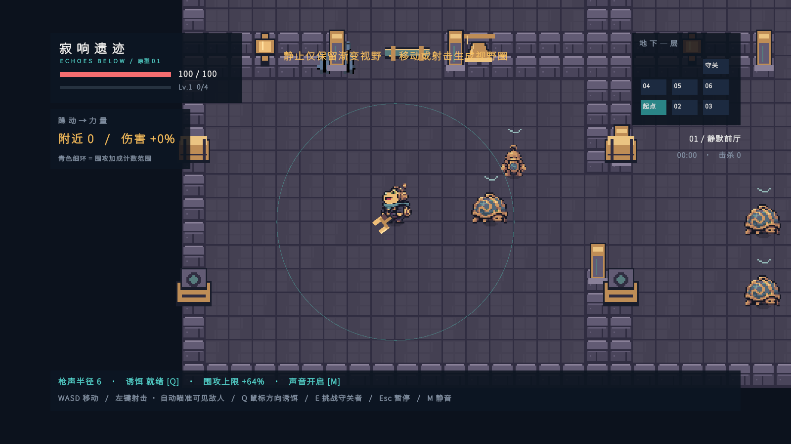
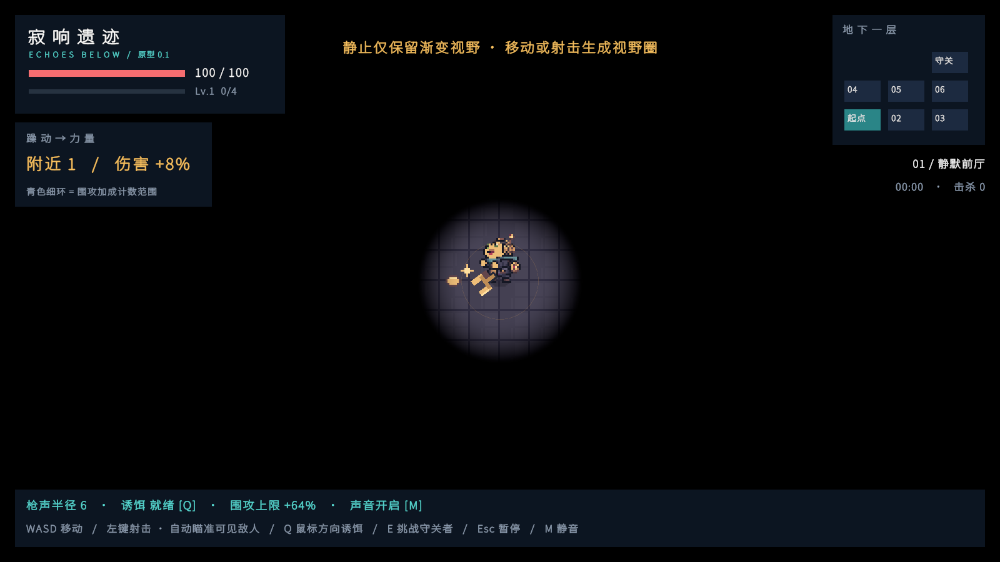
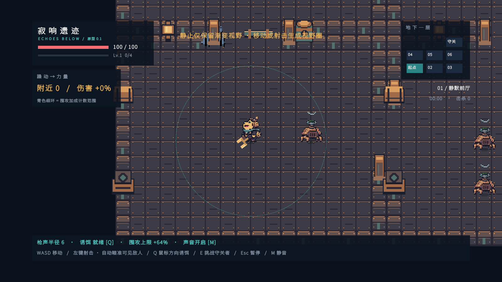
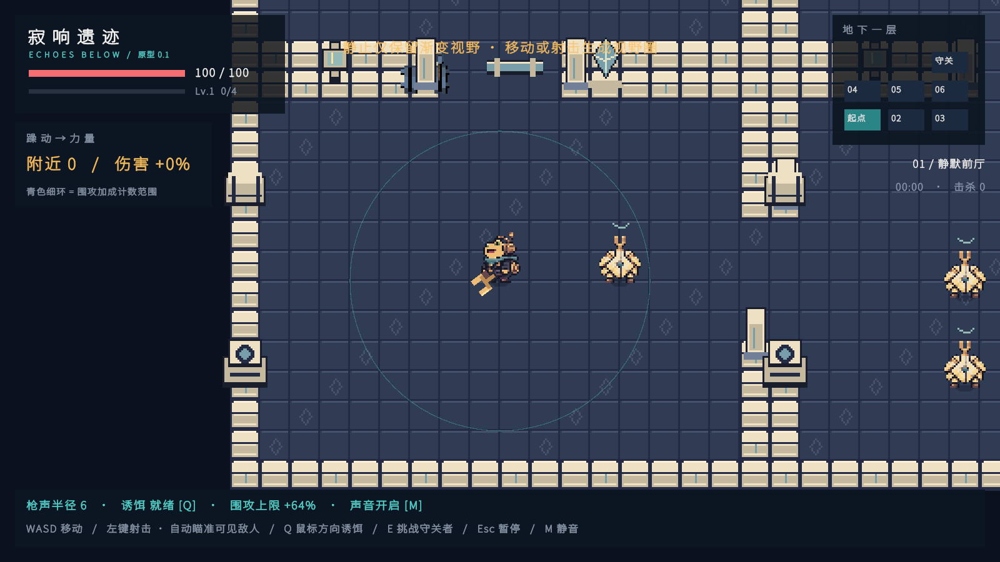
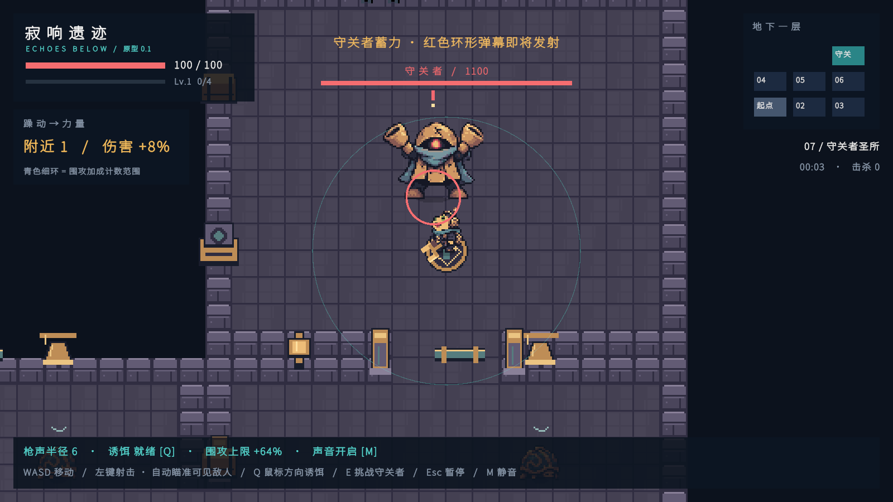

# 017-正式美术接入与三层资源验收

## 实装范围

本轮依据 `012-三层美术风格设计.md`，先完成 `013-正式美术资源盘点与制作规格.md`，再制作独立像素资源并接入现有运行时生成流程。没有将整张展示板、示意场景或色卡作为角色、精灵或背景导入。

正常进入 `Assets/Echoes/Scenes/Prototype.unity` 后，第一层会直接使用正式主角、两种普通怪外观、守钟者、墙地砖、门柱、装饰、音叉枪、铃铛、子弹与短特效。普通怪两种外观共用原有的近战调查／追击行为，不增加远程攻击或怪物数量。

第二、三层各自的墙地砖、道具、两种普通怪、精英与 Boss 已加工、导入和切片。可以在同一真实运行场景中切换美术主题检查。三层流程、精英召集、后续 Boss 招式仍未实现，不把主题预览当作关卡开发完成。

## 资源交付与规格

- 正式目录：`Assets/Echoes/Resources/Art/`，22 张 PNG 图集，合计 181 个切片，包括 92 个角色姿态帧。
- `Common/hero.png`：32×32，4 列×5 行，20 帧，依次为待机、移动、射击、受击、倒地，每组 4 帧。
- 每层的 `walker.png`、`guard.png`、`elite.png`：32×32，每种 6 姿态，依次为沉睡、清醒、移动 A、移动 B、攻击预备、停机／倒地。
- 每层的 `boss.png`：64×64，同样 6 姿态。当前正常关卡仅绑定第一层守钟者。
- 每层的 `tiles.png`：16×16，4 个地面变体、4 个墙体变体；同类地砖重复时边界一致，细节留在格内。
- 每层的 `props.png`：32×32，16 个独立物件，包括箱、灯、门柱、维修站、主题物、祭坛、柱、武器架、直管、弯管、长椅、音叉、晶体、面板、零件与导音槽。
- `Common/items.png`：16×16，音叉枪、响铃诱饵、双方子弹、阴影与三种状态标记。
- `Common/effects.png`：16×16，枪口／铃铛脉冲 4 帧、命中碎光 4 帧。
- `Common/solid.png`：白色几何蒙版，仅用于已有的血条和黑暗覆盖等程序图形，不作为角色或世界物件占位。

### 三层怪物资源对照

| 目录 | walker | guard | elite（仅备料） | boss |
| --- | --- | --- | --- | --- |
| Floor1 静钟街区 | 钟壳虫 | 空腔卫兵 | 鸣号使 | 守钟者（已实装） |
| Floor2 锈鸣工坊 | 阀壳蟹 | 铆钉射手 | 风箱督工 | 鼓压巨偶 |
| Floor3 原音圣所 | 镜壳侍从 | 棱晶浮游体 | 谱冠领唱者 | 原音之心 |

第二、三层的普通怪在美术预览中仍运行现有行为；名字与枪管、悬浮等造型不自动赋予射击、穿墙或召集能力。

## 加工、复用与源文件

- 青蛙身份与装备取自仓库参考：奶黄色面部、绿眼、青围巾、深色外套、黄铜护耳、背包共振线圈。武器与身体分离以支持现有瞄准旋转。
- 使用内置 `image_gen` 新生成用途明确的透明动作原稿，保存在 `美术/正式资源制作/原始帧图/`；完整提示词保存在该目录上级的 `生成提示词.txt`。
- `build_assets.py` 逐格提取新动作原稿：阈值清除半透明展示底色、连通域移除串入相邻格的细碎像素、按整套角色共用比例归入原生网格、固定调色板、统一脚底基线。不会按帧单独放大身体或自动改变装备比例。
- 第一层地面保留 Pixel Crawler 原生像素砖的结构并压低对比重调色；武器架直接提取其透明原生像素素材。其余地面、墙、装饰、武器和特效按本项目用途补绘。
- Pixel Crawler 作者 Anokolisa，条款与来源说明保存在正式资源目录的 `PixelCrawler-Terms.txt` 和 `Provenance.txt`；原素材包与概念参考保持原文件。
- 重现加工：`python 美术/正式资源制作/build_assets.py --floors 1`；扩展批次：`--floors 2 3`。依赖 Pillow，不调用收费外部 API。

## Unity 接入

### 导入与切片

`ProductionArtImporter.cs` 对正式目录执行 Sprite Multiple 固定格切片：16 PPU、Point、Clamp、无 mipmap、无有损压缩、保持透明通道；帧名固定编号，便于重导入后按名称加载。角色和底座物件的 Pivot 为 `(0.5, 0.125)`，地砖、武器、特效为中心 Pivot。

通过 `Echoes > Art > Import Formal Sprites` 可以重新导入。可站立的挑战铭牌与地面一样使用中心 Pivot，绘制在角色下方。必要 `.meta` 随正式资源、脚本与目录提交，图集没有被烘焙进示意图背景。

### 运行时引用

- `GameArt.cs` 从正式图集加载命名切片；缺少必要文件会报错，不静默回退到占位图。
- `PixelArt.cs` 保留统一创建 SpriteRenderer 与真实范围线圈的入口，移除旧版角色、敌人和地砖的代码像素占位生成。
- `DungeonMap.cs` 保留格子通行与原有七房间，替换墙地砖并在已有阻挡墙格上布置装饰和门柱，不添加不可见碰撞体。
- `PlayerController`、`EnemyController` 绑定 `CharacterArt`；枪口、命中、铃铛脉冲由已有游戏事件触发 `ArtEffect`。
- 不依赖额外 Animator 状态机；轻量逐帧组件直接读现有移动、沉睡、攻击、蓄力、受击与死亡状态，避免两套控制器争抢 Sprite。
- 主角四帧倒地序列和敌人停机→倒地表现，在游戏结束暂停后继续完成；存活时升级和暂停仍冻结视觉时钟。短动画对导入／CI 帧尖峰做限步，避免一次跳过整段受击或后坐。
- 角色、墙与装饰在现有 Default 排序层上按脚底／底座 Y 排序；子弹和状态标记单独排序，黑暗遮罩保持在世界对象上方。
- 移除旧主角 1.1 倍和 Boss 2 倍的整体缩放，源像素统一按 16 PPU 显示。脚底碰撞半径保持原先世界尺度：主角 0.33、普通怪 0.32、Boss 0.64。头部、翼面与装备属于视觉延伸。
- 显式将主角、普通怪与 Boss 的 CircleCollider2D offset 设为零，防止 Unity 根据底部 Pivot 自动将碰撞中心偏移到躯干上方。回归测试验证实际子弹命中，不能仅凭 Sprite 显示正常判定接入完成。
- 普通怪接近原有接触攻击距离前显示蓄势姿态，实际接触伤害时机与范围保持原规则；Boss 预警姿态直接绑定已有 warningTimer。主角受击反馈持续到现有无敌时间结束。

## 预览与复验

1. 打开 Prototype 场景进入 Play Mode，第一层直接加载正式资源。
2. 检查 WASD 移动、鼠标瞄准／射击、Q 铃铛、敌人沉睡和清醒、受击闪色、死亡、守钟者蓄力。
3. 用 `Echoes > Art > Preview Theme` 的 1、2、3 项切换主题。该菜单只换资源，不切关卡、不重刷敌人、不改通行与伤害规则；重开游戏回到第一层。
4. 正常黑暗视野与声音显形沿用当前项目逻辑。明亮美术检查截图临时关闭黑暗覆盖渲染器，用于检查砖缝、门口、透明边缘与遮挡，随后恢复；不更改配置资产或通关条件。

## 验证记录

- 第一批：第一层真实 PlayMode 验收已通过，检查正式图集引用、16 PPU、Point、沉睡／移动、真实射击换帧、受击换帧、倒地与暂停后的死亡序列。
- 视觉迭代：首次截图发现地面高频纹理过亮，已降低材质对比；逐帧检查发现相邻行天线碎片，已用连通域清理；64 像素 Boss 的基线按同一 Pivot 比例重新校准。
- PNG 检查：22 图集／181 切片尺寸正确；92 个角色姿态统一基线，角色与独立物件 alpha 为 0 或 255，仅独立阴影允许半透明。
- 最终完整 PlayMode 回归：17/17 通过，包含本轮 2 项正式美术验收，以及既有移动通路、真实子弹命中、自动瞄准、声音调查、固定种群、视野遮挡、经验升级和胜负状态测试。没有跳过或放宽两项最初暴露碰撞偏移的命中断言。
- 完整回归中的美术验收同时确认第二、三层切换后房间数、敌人数不变；所有普通怪、精英与 Boss 的备料图集均能加载；守钟者进入实际蓄力时使用预备帧。
- 运行时截图由真实场景相机与 HUD 渲染；验收断言确认模拟时间推进，主角死亡后序列完成。未生成 EXE。

### 游戏内截图

第一层全景与第二、三层主题预览临时关闭黑暗覆盖，以观察砖缝、透明边缘、比例与排序；正常声波战斗图保留黑暗玩法。后两层画面复用现有第一层地图和行为，HUD 仍显示当前原型的房间名称。

[主角倒地与失败界面](Images/正式美术-20261113/03-player-defeat.png)

## 仍未包含的内容

- 正式可游玩的第二、三层、相应层间切换与新敌人行为尚未实现。
- 后续敌人具备基础姿态资源；复杂专属攻击的完整动画时序需要在行为实现后对齐。
- 地图仍使用现有七房间碰撞结构，装饰密度与后续房内掩体变化尚未扩展。
- 本轮不会制作新音乐或改变声音玩法；声圈、血条、黑暗遮罩保持程序绘制，不将它们误列为尚未替换的角色占位。
- 没有生成 EXE。
