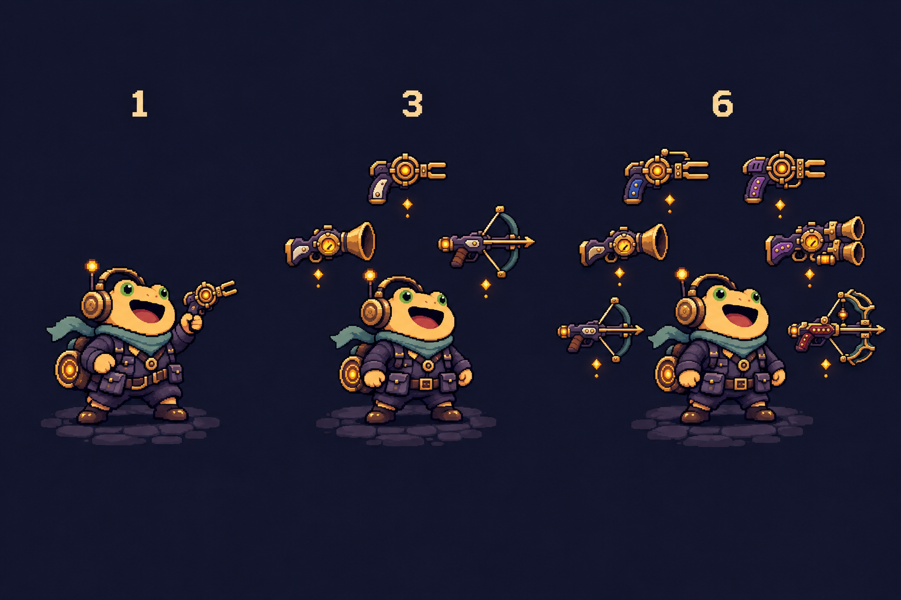
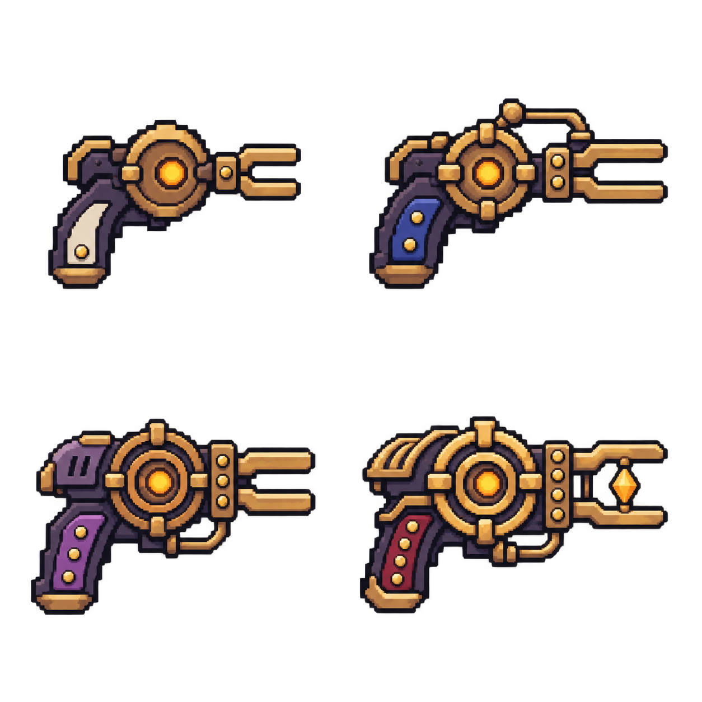
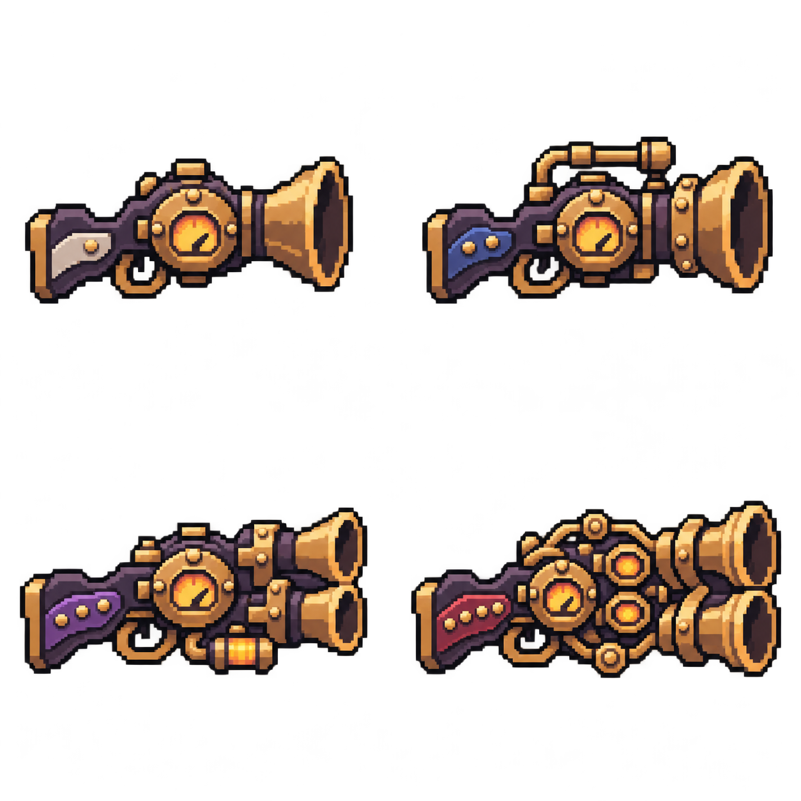
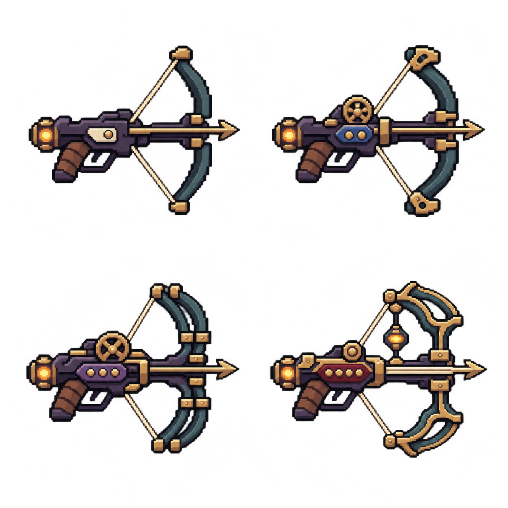

# 019-多武器系统设计与素材提案

## 本轮交付与确认范围

为《寂响遗迹》设计初始武器、购买、六槽悬浮攻击和四品质合成，并提供三种武器的四品质透明素材板及一张悬浮布局对照图。以下数值为第一版调参起点。

按用户“等我确认之后再放入游戏”的要求，本轮文件仅保存在 Docs 与美术目录，等待确认后再制作正式精灵和接入玩法。当前场景、战斗脚本、Unity 配置与 Assets 内的资源不在本轮修改范围。

## 初始装备与六槽武器

- 开局免费获得一把白色Ⅰ级“拾音手枪”；初始零件为 0。
- 最多装备六把武器，可重复装备同型号。装备槽就是当前持有列表，第一版不另设备用武器仓库。
- 只有一把时手持；两把及以上时，全部悬浮在共振背包周围，角色双手空出。合成或出售后只剩一把，恢复手持。
- 两把位于左右两侧，三把为三角分布，四把为四角分布，五至六把均匀分布。悬浮环半径建议 1.1 世界单位，中心略高于角色脚底；轻微上下浮动，不持续绕人高速旋转。
- 每把武器独立转向和攻击；武器没有额外碰撞体，不挡路，也不会因接触敌人造成伤害。
- 外圈武器不扩大围攻计数半径。悬浮提示使用少量琥珀色粒子，不增加与现有围攻圈、视野圈混淆的完整光环。

## 操作、瞄准与声音

按住左键时，全部武器按各自冷却攻击；松开左键即停火，保留玩家控制枪声的能力。各武器在自身有效射程内选择可见且无遮挡的最近敌人；没有合法自动目标时，朝鼠标方向射击。

武器朝向可以不同。瞄准检查包括玩家到目标的视线，以及合法发射点到目标的视线；枪口不能穿过墙体后在墙外生成子弹。靠墙造成某把武器的发射点不合法时，该把武器暂停开火。射程限制投射物的实际行进距离，穿透也不能越过墙体。

每把武器有一个噪声系数，角色保留上一版“枪声半径”属性：

```text
实际枪声半径 = 角色枪声半径 × 武器噪声系数
```

角色初始枪声半径为 6。手枪系数 1.0、霰弹枪 1.5、弩 0.5，对应初始实际半径 6、9、3。消声套管等道具先修改角色半径，再计算各武器结果。角色面板显示公共半径，武器详情显示该把武器的最终半径。

每次攻击从玩家所在位置发出一圈声音与对应主视野圈；多把武器的半径不相加。霰弹枪五粒弹丸属于一次攻击，只发一圈声音。品质不改变噪声系数，攻速增加会提高发声频率。现有渐变带宽度、步行圈与诱饵规则保持各自独立。

弩自身显形较小，其长射程需要步行留下的视野圈、诱饵或其他武器的声圈提供信息；不能凭长射程自动锁定黑暗中的敌人。

## 三种武器及品质数值

所有武器第一版均使用无限弹药，无独立弹药或手动换弹操作。所有品质都能从商店购买，也能合成。品质顺序为白色Ⅰ、蓝色Ⅱ、紫色Ⅲ、红色Ⅳ。

下列 DPS 是无角色加成、无暴击、无围攻时的理想单体值。霰弹枪按五粒全部命中计算；弩的贯穿不计入单体 DPS。

| 武器 | 品质 | 单发或单粒伤害 | 弹丸数 | 攻击间隔/秒 | 理想单体 DPS | 价格/零件 |
| --- | --- | ---: | ---: | ---: | ---: | ---: |
| 拾音手枪 | 白Ⅰ | 10 | 1 | 0.45 | 22.22 | 24 |
| 拾音手枪 | 蓝Ⅱ | 18 | 1 | 0.43 | 41.86 | 48 |
| 拾音手枪 | 紫Ⅲ | 32 | 1 | 0.40 | 80.00 | 96 |
| 拾音手枪 | 红Ⅳ | 58 | 1 | 0.37 | 156.76 | 192 |
| 轰鸣霰弹枪 | 白Ⅰ | 6 | 5 | 0.95 | 31.58 | 30 |
| 轰鸣霰弹枪 | 蓝Ⅱ | 10 | 5 | 0.90 | 55.56 | 60 |
| 轰鸣霰弹枪 | 紫Ⅲ | 18 | 5 | 0.85 | 105.88 | 120 |
| 轰鸣霰弹枪 | 红Ⅳ | 32 | 5 | 0.80 | 200.00 | 240 |
| 静弦弩 | 白Ⅰ | 24 | 1 | 1.10 | 21.82 | 30 |
| 静弦弩 | 蓝Ⅱ | 43 | 1 | 1.05 | 40.95 | 60 |
| 静弦弩 | 紫Ⅲ | 77 | 1 | 1.00 | 77.00 | 120 |
| 静弦弩 | 红Ⅳ | 138 | 1 | 0.95 | 145.26 | 240 |

### 拾音手枪

- 定位：默认初始武器，均衡、反应快，适合补刀和处理分散敌人。
- 射程 8，弹速 22，噪声系数 1.0；各品质不改变这些参数。
- 造型：短音叉枪口、圆形共振腔、暗紫握把。高品质增加稳固桥、同心共振环和琥珀晶体。
- 适合：攻速、通用伤害、暴击，以及与其他武器混搭。
- 单枪基础间隔由旧原型的 0.28 秒改为候选值 0.45 秒，为多武器保留输出空间；这是待确认数值，不是已应用配置。

### 轰鸣霰弹枪

- 定位：近距离爆发和贴身清群，主动惊醒更多敌人。
- 射程 4.5，弹速 18，噪声系数 1.5。
- 五粒弹丸分别朝 -16°、-8°、0°、8°、16° 发射；同一敌人可以被多粒命中，每粒对同一敌人最多结算一次。
- 一次攻击共用一次暴击判定；不按五粒弹丸重复产生声音。
- 造型：宽喇叭口、压力鼓、粗铜管；高品质采用强化双口结构，但仍然每轮发射五粒。
- 适合：围攻之心、承压线圈、扩音枪口，以及能维持近距离位置的生存配置。

### 静弦弩

- 定位：低声、慢射、高单发伤害，适合选择交战对象。
- 射程 10，弹速 26，噪声系数 0.5。
- 白Ⅰ、蓝Ⅱ命中首个敌人后停止；紫Ⅲ可额外贯穿一名敌人；红Ⅳ可额外贯穿两名敌人。
- 每次贯穿后保留上一段伤害的 75%；同一支弩箭不能重复击中同一敌人，墙体始终终止弩箭。
- 同一支箭共用一次暴击结果，贯穿不会产生新的枪声或自发扩散声圈。
- 造型：青黑色弩臂、细黄铜导轨、绷紧弦线；高品质增加分层弩臂和调律轮。
- 适合：低鸣猎手、暴击、诱饵提供视野，以及与大声武器分工。

## 与角色属性及上一版成长的衔接

```text
单粒伤害 = 该品质武器伤害
         × (1 + 角色总伤害加成)
         × (1 + 有效围攻人数 × 每敌加成)
         × 暴击系数
攻击间隔 = max(0.10 秒, 该品质基础间隔 / (1 + 角色攻速加成))
```

伤害、攻速、暴击率和暴击倍率对全部装备武器生效；每把武器仍有独立计时器。单次攻击锁定发射时的属性和围攻加成；霰弹与贯穿箭按上文规则共享该次暴击结果。

武器详情使用具体单发数值，角色面板的“伤害”使用公共伤害加成百分比，避免多把不同基础伤害的武器被误认为共用同一个单发伤害。

被动道具通过四个里程碑免费取得，武器通过本节零件商店购买，两者独立。完整属性、训练、核心技能、二十四件道具及奖励顺序见[技能升级与被动道具系统设计](021-技能升级与被动道具系统设计.md)；这些系统仍属待接入设计，实施前一并确认。

## 购买与经济闭环

普通敌人每只直接结算 6 零件，不增加地面货币拾取。当前 40 只普通敌人的总预算为 240 零件；初始武器免费，不计入预算。第一版没有局外零件、借贷或利息。

累计击杀 8、16、24、32、40 只时，依次开放一批补给商店。奖励暂停时先结算属性／被动道具选择，再进入该批商店；无被动奖励时直接进入商店。可连续买多件，再点击继续恢复战斗；离开后不重复开放该批次。提前挑战守关者仍然允许，会放弃尚未获得的后续购物机会。

商店每批四个武器栏，允许同型号同品质重复出现，方便只有三种武器时完成配对。首批固定为两把白手枪、一把白霰弹枪、一把白弩。此后先抽品质，再按 60% 概率从已持有型号中选取，否则从三种型号中等概率选取。

| 批次/累计击杀 | 白Ⅰ | 蓝Ⅱ | 紫Ⅲ | 红Ⅳ |
| --- | ---: | ---: | ---: | ---: |
| 1 / 8 | 固定首批 | — | — | — |
| 2 / 16 | 70% | 30% | 0% | 0% |
| 3 / 24 | 50% | 45% | 5% | 0% |
| 4 / 32 | 30% | 50% | 20% | 0% |
| 5 / 40 | 15% | 45% | 35% | 5% |

- 每批一次免费刷新；最多锁定一个商品，锁定商品保留到下一批且不参与本批刷新。锁定时提前展示会占用下一批一个货架栏。
- 首批的固定四件先生成，之后再保留上一批锁定商品；首批自然没有上一批锁定商品。
- 商品买走后不立即补货，免费刷新时可以补充已空栏位；刷新次数不因购买或合成恢复。
- 标价不随批次上涨，同型号下一品质价格恰为上一品质两倍。直接购买高品质节省找配对的过程，不额外收合成费。
- 出售所得为该型号该品质基价的 50%，向下取整；不使用曾支付价格，合成后转售也不能制造利润。
- 金额不够时按钮禁用并显示差额。满槽且不能原位合成时，需要先出售一把才能购买，商店不代替玩家自动出售。
- 为当前单层设计的 240 零件预算不能直接套用尚未实现的三层流程；届时需按每层敌人数和商店次数另定预算。

预算示例：首批 48 零件可以买两把白手枪，形成三把白手枪，也可以将其中两把合成，形成一把蓝手枪加一把白手枪。以初始白手枪为材料，另买七把白手枪共需 168 零件，可合成一把红手枪；预算允许，但获得配对仍需商店供给。红色霰弹枪和红弩各需 240 零件，属于几乎花光整局预算的路线。

## 合成规则与取舍

只有“同型号 + 同品质”的两把武器才能合成；不同型号不能混合。

```text
白Ⅰ + 白Ⅰ → 蓝Ⅱ
蓝Ⅱ + 蓝Ⅱ → 紫Ⅲ
紫Ⅲ + 紫Ⅲ → 红Ⅳ
红Ⅳ为最高品质，不继续合成
```

合成在补给界面进行，无手续费。两个已有槽位合成后减少一把武器并腾出一格；不会自动与第三把继续连锁合成。

购买栏同时提供“购买装备”和“购买并合成”：有空位时可选择增加一把，也可选择与已持有的同款同品质合成；满六槽时，只要有匹配武器，就能购买后直接替换为下一品质，不要求先腾出第七格。若没有匹配项，则不能购买。

合成预览显示输入两把、产出一把、单发伤害、攻击间隔、预计总输出变化、噪声频率及槽位变化。更换或合成不重置冷却获得额外瞬发，继承输入中较大的剩余冷却比例并映射到新周期。

以手枪为例：

- 两把白手枪的基础总 DPS 约 44.44。
- 合成后，一把蓝手枪约 41.86，单发更强、只占一格，发声频率也更低。
- 新买一把白枪并原位升级已有白枪时，装备数量不变，该槽 DPS 从 22.22 升至 41.86。

本表中手动二合一后的单体总 DPS 约为两把原武器的 88%～98%；用少量总射速换取槽位、单发突破和更低的发声频率。紫／红弩额外获得贯穿优势。这样早期补武器与后期合成都有选择价值。

## 推荐搭配

| 搭配 | 用途 | 需要接受的取舍 |
| --- | --- | --- |
| 三把手枪 | 低门槛、连续输出、快速补刀 | 单次爆发有限，持续射击会密集发声 |
| 两把霰弹枪 + 一把手枪 | 近距离围攻、转角清群 | 噪声大，远处目标处理较弱 |
| 两把弩 + 一把手枪 | 控制惊醒范围、选择目标 | 慢射，需要诱饵或其他声圈补充远处视野 |
| 手枪 + 霰弹枪 + 弩 | 体验三种定位与独立瞄准 | 发声和交战节奏由大声武器主导 |
| 高品质弩 + 多把低品质手枪 | 弩处理高血量目标，手枪补刀 | 需要在配对合成与补充数量之间分配零件 |

混装时，低声弩不能抵消同一轮霰弹枪的声圈；停火控制仍由玩家统一松开左键完成。

## 美术素材与后续制作规格

素材目录：[武器系统提案](../美术/武器系统提案-20261113/)。

| 文件 | 内容 | 本次实际规格 |
| --- | --- | --- |
| 01-拾音手枪-四品质.png | 四档手枪，2×2 排列 | 1254×1254，RGBA，透明背景 |
| 02-轰鸣霰弹枪-四品质.png | 四档霰弹枪，2×2 排列 | 1254×1254，RGBA，透明背景 |
| 03-静弦弩-四品质.png | 四档弩，2×2 排列 | 1254×1254，RGBA，透明背景 |
| 04-多武器悬浮示意.png | 一把手持、三把／六把悬浮 | 1536×1024，RGB，不透明展示背景 |
| 生成提示词.txt | 四张图的完整生成提示词和参考用途 | UTF-8 文本 |

三张品质板统一按左上白Ⅰ、右上蓝Ⅱ、左下紫Ⅲ、右下红Ⅳ阅读，全部朝右。旧黄铜与暗紫金属为共用材料；小块象牙白、蓝、紫、暗红镶嵌及一至四个铆钉区分品质。高品质同时增加机械结构，不仅换色。玩家攻击能量保持琥珀色，暗红品质镶嵌不使用敌方珊瑚红发光。









四张图使用内置 image_gen 生成。主角与世界材料参考既有“拾音者与敌人设定”图；悬浮图另参考本批三张武器板。完整原文见同目录生成提示词，生成时请求 1024 方图，三张武器板实际输出为 1254 方图，以实际尺寸为准。

确认后制作的世界精灵目标画布：手枪 16×16、霰弹枪 24×16、弩 24×24；商店图标 32×32。沿用项目 16 PPU、Point、关闭 mipmap 和有损压缩。武器以握把或悬浮支点旋转，枪口位置单独记录。悬浮示意展示数量与身份，不用其像素比例直接确定世界碰撞或环半径。

本次透明大图仍有半透明像素，主体与细节也不是严格的低分辨率原生像素网格。确认后需按目标画布重整轮廓、Alpha 和统一 Pivot；不能直接按 16 PPU 导入整张大图。枪口短动画、子弹、弩箭和命中特效在确认后的正式制作阶段补齐，本次四张图不包含已切片动画。

## 相关文件、编辑器配置与验证

- 本轮新增：本文、上述四张 PNG、生成提示词；均在 Assets 目录之外，无 Unity .meta 或编辑器配置变更。
- 后续接入点：PlayerController 的单枪射击与枪械显示、Projectile 的射程／贯穿、GameConfig 的可调武器数据、RunController 的零件和商店流程、GameHud 的六槽／购买／合成界面。现有 UpgradeDefinition 需要读取公共属性；接入工作等待用户确认。
- 算术核对：十二档基础 DPS、二合一总输出比、倍增价格及出售收益，商店品质概率各行合计 100%，40只普通敌人共240零件。
- 图片核对：三张品质板均为 RGBA、左上角 Alpha 为 0，32×32 采样网格下四象限均有非空内容；悬浮图为不透明 RGB。已视觉检查三种家族轮廓、品质顺序、主角一致性及 1／3／6 把数量。
- 本轮仅涉及设计和素材提案，不运行 Unity 编译、游戏测试或构建。确认后优先验证双枪和满六槽、两种合成入口、穿墙限制、霰弹单次声圈、弩贯穿和暂停恢复。

## 数值风险与验收目标

多武器会显著增加整局输出，旧单枪原型守关者 1100 生命值不能直接当成新系统的平衡基准。先把“有正常成长的三至六把武器，对守关者持续交战约15～25秒”作为试玩目标，再调敌人耐久和成长幅度；本轮不修改敌人配置。

需要在确认后的实际试玩中比较：先补六槽与早合成、纯霰弹与纯弩、同型号与混装、减少枪声与扩大显形范围。此稿给出可调起点，不宣称已经通过实战平衡。

## 设计参考

- [Brotato 武器规则](https://brotato.wiki.spellsandguns.com/Weapons)：多武器槽及同型号同品质合成的参考。
- [Brotato 商店规则](https://brotato.wiki.spellsandguns.com/Shop)：购买、刷新、锁定和品质推进的参考。

本作的里程碑商店、单层零件预算、武器数值、噪声系数和免费刷新规则采用上文方案，不直接沿用 Brotato 的波次经济。
