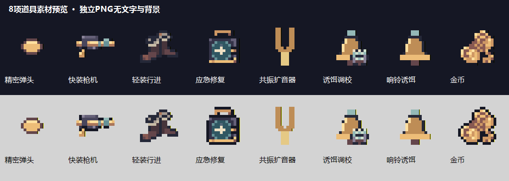

# 023-道具素材核对与独立图标交付

## 范围与结果

本轮核对并交付六种已实现升级、响铃诱饵和金币的美术，共八项。用户明确暂缓二十四件被动道具图片；本轮先不导入游戏。

六项通过已有素材切片、统一配色或组合复用完成；快装枪机和应急修复缺少适合直接复用的机械图标，已分别补绘。原图集已导入不代表升级卡已绑定：当前六种升级仍是文字卡，响铃地图精灵已正式接入，金币掉落仍使用solid染色方块。

完整逐项对应关系、用途、原路径／切片、当前接入状态及最终独立PNG见[道具素材对应清单](../美术/道具素材核对与交付-20261114/对应清单.md)。

| 名称 | 用途 | 本轮处理 |
| --- | --- | --- |
| 精密弹头 | 升级图标 | 复用正式琥珀弹丸 |
| 快装枪机 | 升级图标 | 补绘机械枪机／复进簧组件 |
| 轻装行进 | 升级图标 | 复用Raven长靴并调色 |
| 应急修复 | 升级图标 | 补绘青色机械修复盒 |
| 共振扩音器 | 升级图标 | 复用正式黄铜音叉，移除摆设底座 |
| 诱饵调校 | 升级图标 | 正式铃铛与Raven齿轮组合 |
| 响铃诱饵 | 地图放置实体／技能栏 | 切出原正式铃铛，界面版共用同一造型 |
| 金币 | 地图掉落／商店余额 | 复用Raven钱币堆，统一黄铜色阶 |

## 交付文件与规格

目录为美术/道具素材核对与交付-20261114：

- 界面图标/：八张独立32×32透明PNG，全部由16×16逻辑像素统一2倍最近邻放大。
- 地图实体/：响铃诱饵与金币两张原生16×16透明PNG。
- 生成原图/：两张缺失图标的生成来源，不作为最终游戏尺寸。
- 对应清单.md：逐项现有资源、接入状态、来源坐标、加工规则与使用范围。
- 生成提示词.txt：两次内置image_gen调用的完整提示词。
- 道具素材预览.png：深／浅底对照，仅供检查，不作为带背景的游戏贴图。

单独PNG不含文字、展示框、背景或水印；预览中的名称和底色仅用于查看。界面至少2像素透明边距，地图至少1像素。所有交付精灵Alpha为0或255，缩放不使用平滑滤镜。

## 素材来源与可用性

重点检查了美术目录的Raven总图／分离图、Pixel Crawler资源位置，以及Unity已导入的Common/items、Floor1/props和切片映射。正式铃铛、弹丸与音叉可以复用；概念场景、角色展示板和武器品质大图不作为独立道具精灵。

本轮Raven来源为Clockwork Raven Studios／Caio；本地为Free包，作者区分免费个人用途和付费商业授权，具体来源与商业使用条件记录在对应清单中。未把包名或感谢购买附注当成已取得商业授权。

界面与地图铃铛复用完全相同的逻辑像素，未重新设计一个不一致的地图版本。六种升级没有地图掉落实体，不新增无实际用途的掉落物图片。

## 相关文件与接入状态

- 当前功能依据：Assets/Echoes/Scripts/Core/UpgradeDefinition.cs、World/GameArt.cs、Combat/BellDecoy.cs、World/GoldPickup.cs、Core/RunController.cs、UI/GameHud.cs。
- 商店和金币的实际规则见[022-金币商店与多武器被动道具](022-金币商店与多武器被动道具.md)。
- 本轮仅新增美术目录文件和本文；没有写入Assets、没有新Unity.meta，也没有修改代码、场景或原始图集。
- 后续接入需要将升级图标关联到对应卡片，并给金币增加正式图片映射；这些步骤等待用户确认。
- 地图铃铛与金币未来按16 PPU、Point、无mipmap／有损压缩使用。界面32像素版按整数尺寸显示，保持每个逻辑像素的2×2块一致。

## 验证与已知限制

- 核对八项名称、用途与原素材来源；保留原文件，所有切片和改色另存。
- 检查独立PNG尺寸、内容非空、全透明边距、Alpha仅0／255、界面每个2×2块颜色一致。
- 地图铃铛与items_01逐像素一致，界面版与地图版为严格2倍关系；金币两版也使用同一份逻辑像素。
- 已在深／浅底预览中检查用途与轮廓。
- 本轮不导入游戏，不运行Unity编译、游戏测试或构建；尚未在真实UI尺寸／金币世界缩放下验证显示效果。
- 二十四件被动道具图片不包含在本次交付内，即使相关玩法在另一轮已接入，也不据此推定其图片已有正式素材。
