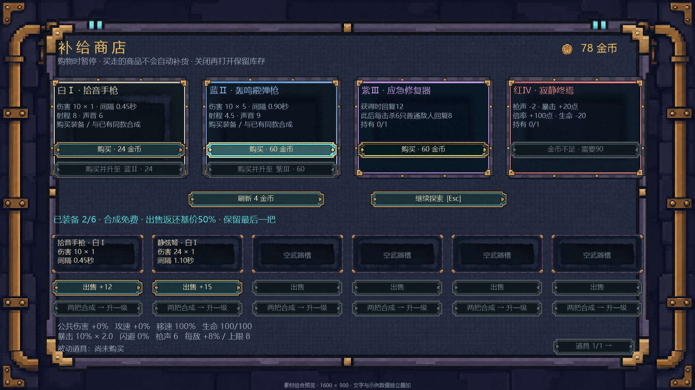

# 024-商店界面图片素材交付

## 功能与范围

先核对现有游戏截图、正式美术与项目结构，确认窗口及Canvas基准为1600×900、16:9；以现有金币商店的四格货架、六武器槽及购买、刷新、合成、出售、继续探索、道具翻页为用途依据。图片清单由用户明确确认为12张界面素材与组合预览。

交付背景1、主面板1、白蓝紫红商品卡底4、可复用武器槽底1、通用按钮普通/悬停/按下/禁用4、金币图标1。其余武器与道具图标、地图摊位和金币掉落实体没有扩展制作。素材沿用靛紫、青绿、黄铜与琥珀的像素美术风格，独立元素保留真实透明外缘；文字和价格保持独立。

## 相关文件

- `美术/商店界面素材-20261114/背景/`：1600×900背景。
- 同目录 `面板/`：1440×864主面板、334×250四品质卡底、218×100武器槽底。
- 同目录 `按钮/`：320×44四状态通用按钮。
- 同目录 `图标/`：32×32金币。
- 同目录 `预览/shop_composite_preview.png`：1600×900组合预览，由正式尺寸独立素材实际排版。
- 同目录 `素材清单与导入建议.md`：逐项路径、尺寸、用途、推荐导入设置与九宫格边距。
- 同目录 `源图/`、`生成提示词.txt`：选用原图和生成提示词；使用内置image_gen，未调用CLI/API备用方案。

## 编辑器配置建议

本轮没有执行Unity导入，也没有修改Assets、场景、Prefab或现有逻辑。后续使用专用UI目录，避免现有正式世界美术导入器自动按格切片。

建议Sprite (2D and UI)、Single、Full Rect、Center Pivot、100 PPU、Point、Clamp、无mipmap、无压缩、NPOT None、Max Size 2048、Input Texture Alpha及Alpha Is Transparency。Canvas沿用1600×900参考分辨率与Match 0.5。面板和按钮用Sliced，按钮用Sprite Swap，具体边距见素材清单。

## 验证方法

检查12张实际PNG的尺寸、可解码性与透明像素；验证除金币外的2×2像素网格、按钮四状态共用裁切区域及画布尺寸。按1600×900排版四张商品卡、六个复用武器槽与各种现有操作按钮，查看组合图，修正标题与底部文字的边框留白。

验证仅针对图片交付，没有运行游戏测试或生成EXE。生成原图、成品、预览与说明均在美术目录；本轮不产生Unity `.meta` 文件。

## 已知问题

尚未执行Unity中的锚点适配、九宫格渲染及按钮状态切换验收；这些属于后续界面接入。组合图为素材布局示例，文本与数值仅用于检查空间。原始生成图保留半透明边缘，使用时应保留Alpha并避免重复染色。

