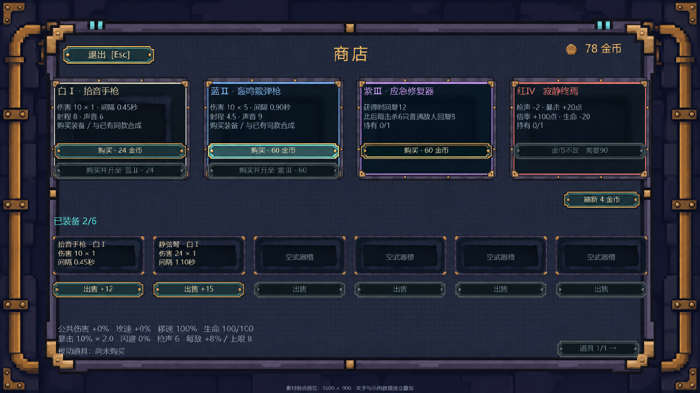

# 025-商店预览布局精简与按钮调整

## 调整内容

按用户标注修改商店组合预览：

- 删除顶部“购物时暂停 · 买走的商品不会自动补货 · 关闭再打开保留库存”。
- 装备标题只保留“已装备 2/6”，删除其后的合成、出售返还和保留武器说明。
- 移除红框圈出的整排“两把合成 → 升一级”提示按钮；商品卡内未圈出的购买升级按钮和六个出售按钮保留。
- 刷新按钮缩窄并移到四格货架下方右侧，对应绿色标记区域。
- 原继续探索按钮移到左上角，改为“退出 [Esc]”；指向退出商店。
- 标题改为“商店”，放在上部居中位置。

## 相关文件

- `美术/商店界面素材-20261114/预览/shop_composite_preview.png`：修订后的1600×900预览。
- 同目录上级 `素材清单与导入建议.md`：同步当前布局说明。
- 同目录上级 `生成提示词.txt`：记录内置image_gen的布局编辑提示词。

## 编辑器配置

本轮只修订美术预览与说明，12张独立背景、面板、按钮和金币图标继续复用。后续Unity接入仍按素材清单中的Sprite、Point、Sliced和Sprite Swap设置；标题和操作按钮分别摆放。

## 验证方法

确认修订PNG可解码、分辨率为1600×900且不透明；查看成品，核对红框区域已清理、刷新在右侧、退出在左上角及标题居中，保留四格商品、六武器槽、出售按钮与底部属性区域。

未修改Unity场景、Prefab或现有游戏逻辑，未执行导入；本轮无需游戏测试或EXE构建。

## 已知问题

布局尚未接入真实游戏，按钮位置与点击区域需在后续界面接入时验收；预览文字和数值仅用于排版检查。

