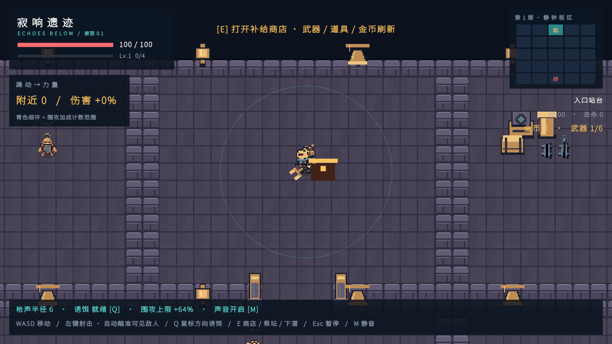
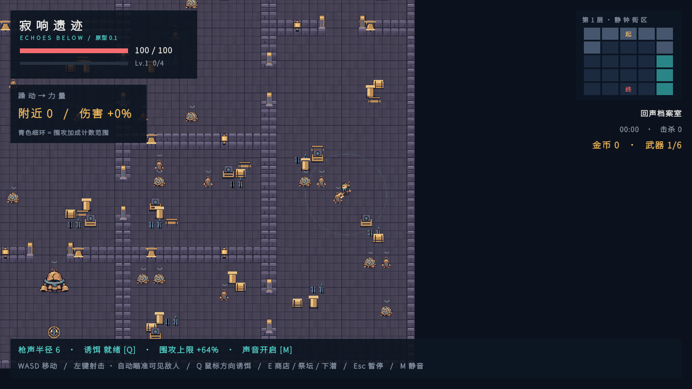
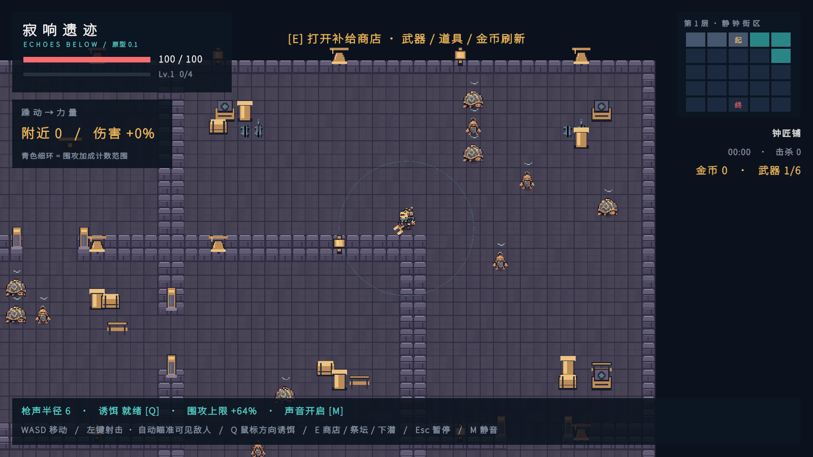
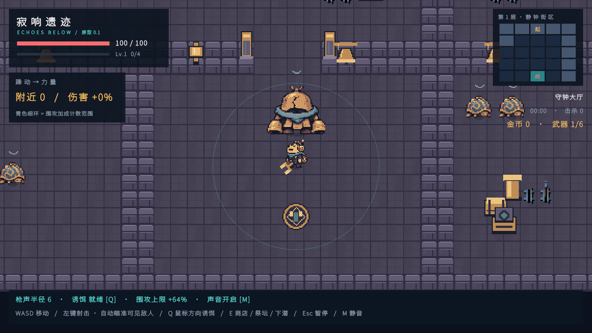
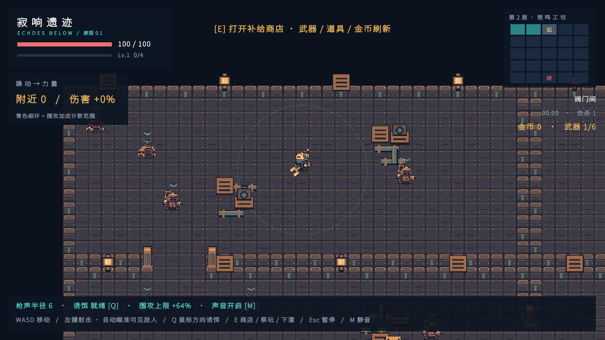
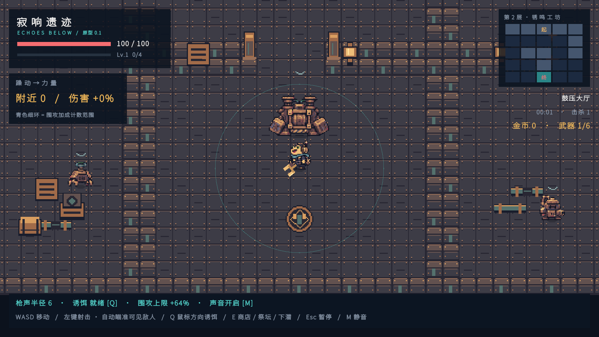
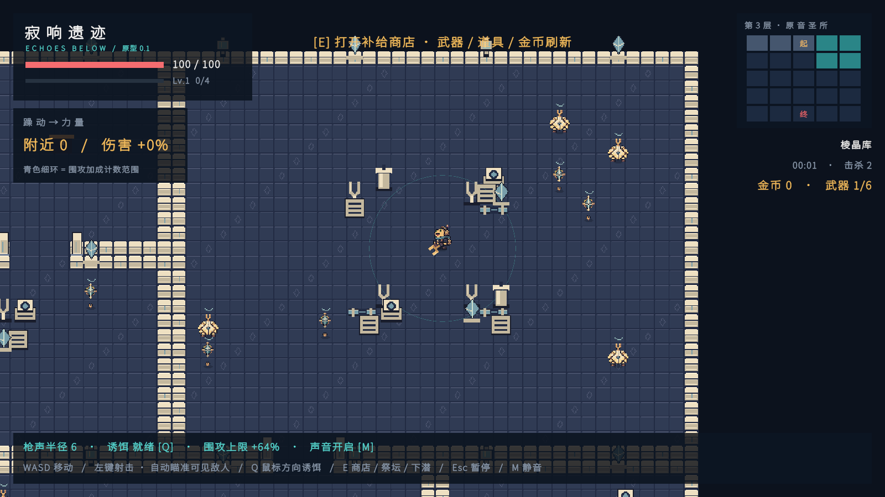
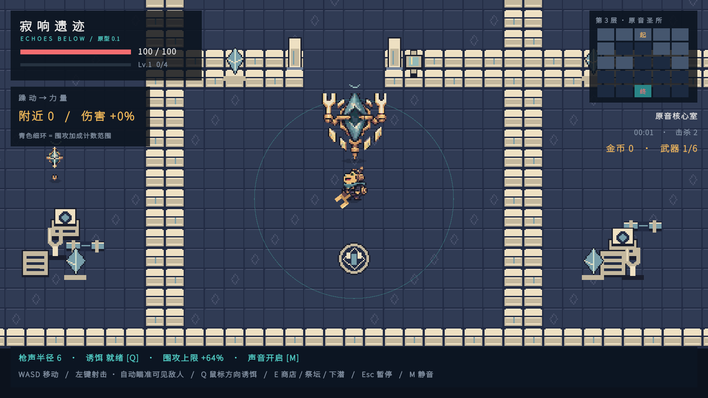
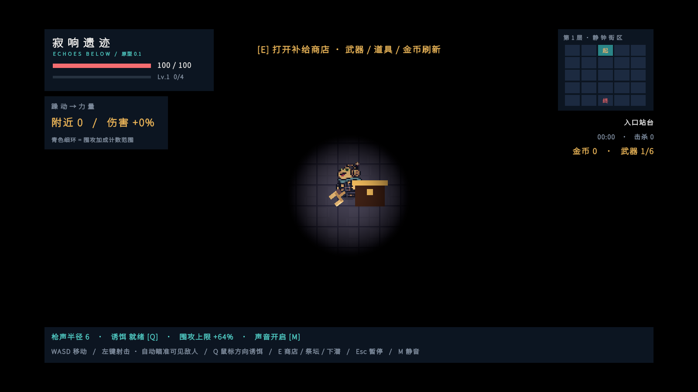
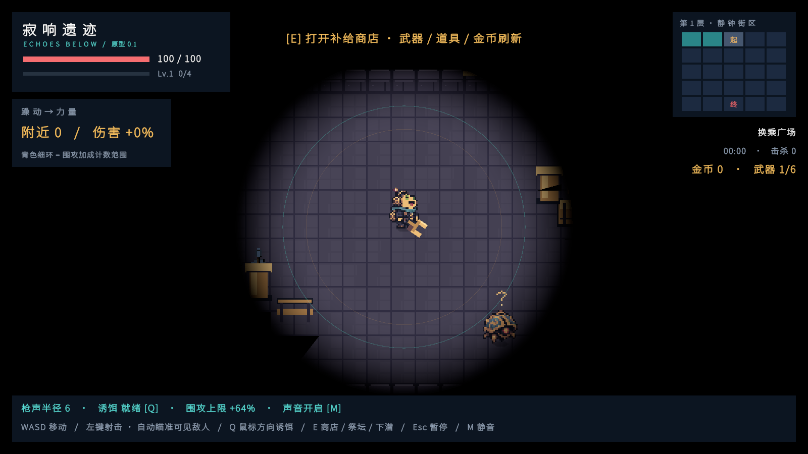

# 025-房间生成与三层地牢

## 功能与范围

本轮把固定七房间单层原型改为 **5×5 房间格、三层随机地牢**。房间形状、房间图、门、主题地形、每层商店与 Boss 流程均已接入实际 PlayMode 场景，而不是仅做美术预览。

- 每层固定 5×5 个房间格，全部铺满；起始房在顶排中央，Boss 房在底排中央。
- 中间房使用 1×1、1×2、1×3、2×2、L 形五种规格；多格房是一整块连续大房间，内部格线不砌墙。
- 三层主题依次为静钟街区、锈鸣工坊、原音圣所；房间、敌人与 Boss 使用对应的正式图集。
- 房间地形预设包含起始房、Boss 房与五种中间房型；道具、墙体装饰和碰撞均由程序拼装。
- Boss 击败后进入下一层；第三层 Boss 击败才最终通关。
- 小地图改为 5×5 房格，显示当前/已访问/未访问、起点与 Boss。
- 本轮**没有**新增外部生成美术；复用 `Assets/Echoes/Resources/Art/Floor1–3` 的正式资源。

## 网格与房间形状

| 项目 | 规则 |
| --- | --- |
| 房间格 | 18×14 世界格（含 1 格墙），整图 90×70 |
| 起始房 | 1×1，格坐标 (2,0)，顶排中央；只开 1 个门，优先朝南 |
| Boss 房 | 1×1，格坐标 (2,4)，底排中央；只开 1 个门，优先朝北 |
| 中间房 | 1×1、1×2、1×3、2×2、L；允许 90° 旋转 |
| L 形 | 2×2 去掉一个 1×1，占 3 格 |
| 铺满 | 25/25 格全部属于某个房间，不重叠、不留空格 |
| 多格房 | 占多个格，但内部是一整块连续地面；只在房间外圈砌墙 |
| 墙厚 | 两个相邻房间之间 2 格；地图外沿 1 格 |
| 门宽 | 4 格，开在共享格边中央，距房间角至少 2 格 |

`DungeonPlan` 先生成合法的房间铺法，再由 `DungeonMap` 栅格化为世界格子。2×2 房间中央原本会留下的 2×2 墙芯会在四格同属一个房间时打开，保证大房间内部无隔墙。

## 生成算法

### 铺房间

1. 固定起始房与 Boss 房两个 1×1 格。
2. 从左上到右下找第一个空格；枚举能覆盖该格的全部形状与旋转，按权重随机排序。
3. 权重：1×1 = 12、1×2 = 22、1×3 = 16、2×2 = 24、L = 20；1×1 始终可作为回退，因此不会因形状放不下而卡死。
4. 至少出现 2 种不同的多格房型，否则换随机种子重试。
5. 最多尝试 100 次；仍失败则使用确定性回退铺法（2×2 + 1×3 + 1×2 + 两侧 2×2），保证可玩。

### 房间图与门

- 每个相邻房间对只生成一条候选边；房间图先用随机 Kruskal 生成连通树，再以 15% 概率增加额外门形成少量环路。
- 起始房与 Boss 房强制为叶子：各只保留 1 条边；额外门不会加在它们身上。
- 每房最多 4 个门；起始/Boss 优先把门开在朝地图内部的一侧。
- 门洞会同时打穿相邻房间的两格墙；门柱使用正式 `doorpost` 贴图，门洞地面保持可走。

### 校验

每次生成都会检查：

- 25 格全部覆盖、无重叠；
- 房间形状、旋转、格数与外接矩形合法；
- 起始/Boss 各 1 门且为叶子；每个中间房至少 1 门；
- 所有房间从起始房可达；
- 同 seed 结果一致；不同 seed 产生变化。

## 地形预设与美术适配

- **起始房**：不放置实心掩体，保留商店站位；只放墙面灯/主题挂饰。
- **中间房**：按房型选择锚点。1×1 放 1–2 个角落掩体；1×2/1×3 沿长边交错布置；2×2 在中心四周放 4 个掩体；L 形在两条臂上布置。每个房间有 5–6 种主题实心道具可选。
- **Boss 房**：只有 Boss、祭坛、墙面装饰；不放普通怪或实心掩体，保证单入口战斗空间。
- 实心道具使用 `crate / pillar / station / rack / bench / pipe / pipeBend / panel / crystal / fork / conduit` 等正式贴图；碰撞体为道具脚底 1×1 或 2×1，木箱/柱等视觉上部可高于碰撞脚底。
- 实心道具必须离墙 1 格、离门洞 2 格，且不与其他掩体重叠；放置后逐房 BFS 校验，若切断房间则撤销该房的全部掩体。
- 墙面装饰只放在外墙格上，不产生额外碰撞；不堵门、不堵主路。
- 主题图集：第一层 Floor1 静钟街区、第二层 Floor2 锈鸣工坊、第三层 Floor3 原音圣所；敌人/Boss 外观随层切换。商店仍使用现有占位表现。

## 三层流程

| 状态 | 行为 |
| --- | --- |
| 第一层 | 主题 Floor1，起始房商店，Boss 房守钟者 |
| 第一层 Boss 击败 | `RunState.FloorCleared`，不直接通关；按 E 或点击“进入下一层”下潜 |
| 第二层 | 主题 Floor2，新地图、新敌人、新商店库存；Boss 房鼓压巨偶 |
| 第三层 | 主题 Floor3，原音圣所；Boss 房原音之心 |
| 第三层 Boss 击败 | `RunState.Won`，整局胜利 |

跨层保留：生命、最大生命、武器槽、被动道具、金币、等级、经验、击杀数、总用时。

每层重置：普通怪、Boss/祭坛状态、商店库存与刷新次数、范围声波/视野圈。

进入下一层时：

- 玩家回到新起始房中心；
- 生命恢复 30% 最大生命（`floorEntryHealFraction`）；
- 清空旧地图、敌人、Boss、子弹、诱饵、噪声波、命中特效、未拾取金币和视野圈；
- 重建 90×70 可见性纹理与 5×5 小地图。

## HUD 与视野

- 小地图由 25 个房格组成；同一多格房的所有格共用颜色。当前房青色，已访问灰蓝，未访问深色；起点/终点分别标“起/终”。
- 楼层标题显示“第 X 层 · 主题名”；当前房名来自 `FloorTheme`，起始/Boss 用固定名，中间房按确定性顺序从主题名池取名。
- 视野纹理宽高改为运行时读取 `DungeonMap.MapWidth/MapHeight`；`DungeonDarkness.shader` 的 DDA 上限从 96 提高到 256（90×70 足够）。
- 墙体对角墙角增加“透过斜向地板显形”的分支，消除墙角黑块；完整墙面扫描测试通过。

## 配置

`Assets/Echoes/Settings/DefaultGameConfig.asset`：

| 字段 | 默认值 | 说明 |
| --- | --- | --- |
| `generationAttempts` | 100 | 随机铺房间最多尝试次数 |
| `extraDoorChance` | 0.15 | 连通树之外额外开门的概率 |
| `enemiesPerCell` | 2 | 每个房间格的普通怪数量基数 |
| `minEnemiesPerRoom` | 3 | 单房普通怪下限 |
| `maxEnemiesPerRoom` | 12 | 单房普通怪上限 |
| `floorEnemyHealth` | 1 / 1.2 / 1.4 | 三层普通怪生命倍率 |
| `floorEnemyDamage` | 1 / 1.1 / 1.2 | 三层敌人伤害倍率 |
| `floorBossHealth` | 1 / 1.35 / 1.7 | 三层 Boss 生命倍率 |
| `floorEntryHealFraction` | 0.3 | 进入下一层回复最大生命比例 |
| `randomSeed` | 713 | 房间/地形生成种子；商店使用独立偏移 |

生成种子为 `randomSeed + floorIndex * 1009`；地形掩体使用独立 seed 偏移。同 seed 同层结果可复现。

## 相关文件

- `Assets/Echoes/Scripts/World/DungeonPlan.cs`：纯布局生成、形状旋转、铺满、房间图、门、回退布局。
- `Assets/Echoes/Scripts/World/DungeonMap.cs`：90×70 栅格化、多格房、门洞、地形预设、碰撞、中心/出生点、房间名、渲染。
- `Assets/Echoes/Scripts/World/FloorTheme.cs`：三层主题名、起始/Boss/中间房名池。
- `Assets/Echoes/Scripts/World/DungeonVisibility.cs`、`Assets/Echoes/Resources/DungeonDarkness.shader`：动态地图尺寸、切层重建、墙角显形。
- `Assets/Echoes/Scripts/Core/RunController.cs`：三层状态、层间切换、跨层保留、清场。
- `Assets/Echoes/Scripts/Core/GameConfig.cs`、`Assets/Echoes/Settings/DefaultGameConfig.asset`：生成/敌人/楼层配置。
- `Assets/Echoes/Scripts/Core/ShopController.cs`：每层起始房重新摆摊、保留金币。
- `Assets/Echoes/Scripts/UI/GameHud.cs`：5×5 小地图、层名、下潜界面。
- `Assets/Echoes/Scripts/Combat/EnemyController.cs`：普通怪/Boss 生命与伤害按层缩放。
- `Assets/Echoes/Scripts/Combat/PlayerController.cs`：切层落点、生命恢复。

测试：

- `Assets/Echoes/Tests/Editor/DungeonGenerationTests.cs`：300 个种子的覆盖/形状/门/可达性、同 seed 确定性、连通树、10 个回退布局。
- `Assets/Echoes/Tests/PlayMode/FloorGenerationTests.cs`：实际场景起始/Boss/房型/门/可达性、6 个种子的 90×70 连通地图、生成耗时、帧率、三层切换与状态保留。
- `Assets/Echoes/Tests/PlayMode/RoomArtAcceptanceTests.cs`：三层 × 房型明亮截图。
- `Assets/Echoes/Tests/PlayMode/ObstacleVisibilityTests.cs`、`DungeonTestGeometry.cs`：动态找门/门柱/墙角，验证声音穿墙、视野遮挡、子弹和自动瞄准。
- 既有商店、升级、正式美术、障碍视线测试已随新地图坐标更新。

## 验证结果

- **EditMode：29 / 29 通过**（含 300 seeds 布局规则、回退布局、既有战斗/商店/视线规则）。
- **PlayMode：28 / 28 通过**（含 6 seeds 实际场景、三层流程、商店、Boss、门、视野、墙体扫描、截图）。
- **生成耗时**：批处理实测每层约 290–306 ms（6 seeds），低于 2 秒目标。
- **帧率**：批处理无 VSync，测得约 2100 FPS；该数值只说明场景可运行，不作为 60 FPS 的替代验收，实际显示帧率仍需在编辑器/构建中人工确认。
- **截图**：`TestResults/Art/floor{1..3}-{start,shape,boss}.png`，本轮选取的验收图已复制到 `Docs/Images/房间生成-20261114/`。
- `PrototypeFont.asset` 已通过 `Echoes > Create or Update Prototype Scene` 重新预热新增中文房间名。
- 本轮未生成 Windows EXE。

## 已知限制

- 未实现 Fairy/Blood/Puzzle/Trap、钥匙、锁门或层间楼梯；当前下潜由 Boss 击败后的按钮触发。
- 未新增房间专属墙地砖/门框/掩体素材；全部使用现有正式资源与程序拼装。楼层 1、2 的随机样例没有出现 2×2 房，楼层 3 出现；跨 300 seeds 五种形状均会生成。
- 敌人数、每层强度倍率、金币与商店价格仍是初调值，未完成完整人工通关平衡验证。
- 房间截图为了看全房间临时放大了相机，HUD 会与房间边缘重叠；正常游戏相机仍为 480×270 像素基准。
- 商店、金币、墙体装饰仍沿用现有占位/正式资源组合，商店 UI 素材尚未导入。

## 验收截图

第一层起始房与 1×3 长条房：

第一层 L 形房与 Boss 房：

第二层 1×2 双格房与 Boss 房：

第三层 2×2 大房与 Boss 房：

正常黑暗视野与房间战斗：

