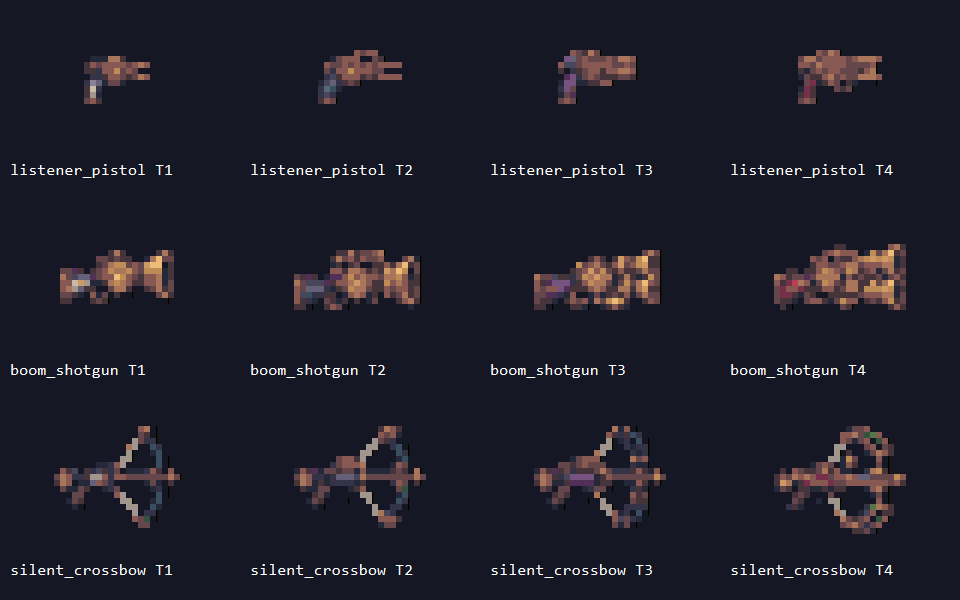

# 026-正式美术素材导入与配置

## 本轮结果

盘点此前生成的商店、武器、道具和角色／场景美术，新增导入30张贴图：商店UI十二张、升级图标五张、地图金币一张、三种武器各四品质共十二张。所有新素材仅完成资源导入与配置，尚未绑定到场景、Prefab、界面或运行逻辑。

用户已确认本轮切分并整理武器精灵后导入，并按用途同时保留商店音叉金币与地图钱币堆。原始素材完整保留；二十四件被动道具没有新增图片，不在本轮生成范围。

## 目录与去重决定

新增素材归入 Assets/Echoes/Art，避免现有 ProductionArtImporter 对 Resources/Art 下所有PNG进行固定格切片。原有导入器、GameArt映射及已导入的二十二张世界图集保持不变。

| 源目录／文件组 | 判定与本轮处理 |
| --- | --- |
| 美术/商店界面素材-20261114/背景、面板、按钮、图标 | 十二张最终独立PNG，导入UI/Shop对应分类 |
| 同目录源图、预览/shop_composite_preview.png | 生成来源与组合预览，保留源文件，不导入 |
| 美术/武器系统提案-20261113/前三张四品质板 | 按确认的品质顺序切分、统一像素规格，产出十二张独立世界精灵 |
| 同目录04-多武器悬浮示意.png | 带角色与布局的说明图，不导入 |
| 美术/道具素材核对与交付-20261114/界面图标 | 五张有独立用途的升级图标导入；弹丸、响铃和金币放大版不重复复制 |
| 同目录地图实体/金币.png | 钱币堆为地图掉落用途，与商店音叉币造型不同，按用户确认分别保留 |
| 同目录地图实体/响铃诱饵.png | 与既有items_01逐像素相同，复用原切片 |
| 同目录生成原图、道具素材预览.png | 大图来源与深浅底检查图，不导入 |
| 美术/正式资源制作/原始帧图 | 原帧已加工为现有Resources/Art世界素材，不重复导入原大图 |
| 世界观风格、三层美术风格各展示图 | 场景与敌人概念参考，不作为精灵／背景直接导入 |
| 美术/主角1.png、主角2.png | 带文字、场景和多姿态的西装／囚服角色概念板，不是当前拾音者的正式动作图 |
| Raven、Pixel Crawler完整素材包 | 保留素材来源，不批量导入未确定用途的全包；仅使用已确认成品中的加工来源 |

### 已有精灵的复用

- 精密弹头界面图为现有 [Common/items.png](../Assets/Echoes/Resources/Art/Common/items.png) 中 items_02 的严格2倍放大，直接复用该切片。
- 响铃界面图为同图集 items_01 的严格2倍放大，地图独立铃图与该切片原像素一致，均复用 items_01。
- 道具版金币界面图是地图钱币堆的严格2倍放大；本轮仅导入原生16像素版本，未来界面可直接复用该Sprite。
- 商店独立音叉金币不是钱币堆的重复文件，保留其32像素UI用途。
- 第二、三层正式世界图集已在Resources中，本轮不重复复制，也不增加关卡或主题引用。

## 新导入素材路径与用途

以下全部为Sprite Single，不包含预览、整张品质板或源图。路径均位于 Assets/Echoes/Art 下；所有新贴图及目录的 .meta 均由项目指定Unity生成并随提交保存。

### 商店UI 十二张

| 素材路径 | 尺寸 | 用途 |
| --- | --- | --- |
| [UI/Shop/Backgrounds/shop_background.png](../Assets/Echoes/Art/UI/Shop/Backgrounds/shop_background.png) | 1600×900 | 全屏商店静态背景 |
| [UI/Shop/Panels/shop_main_panel.png](../Assets/Echoes/Art/UI/Shop/Panels/shop_main_panel.png) | 1440×864 | 主面板背板 |
| [UI/Shop/Panels/shop_offer_tier1_white.png](../Assets/Echoes/Art/UI/Shop/Panels/shop_offer_tier1_white.png) | 334×250 | 白色商品卡底 |
| [UI/Shop/Panels/shop_offer_tier2_blue.png](../Assets/Echoes/Art/UI/Shop/Panels/shop_offer_tier2_blue.png) | 334×250 | 蓝色商品卡底 |
| [UI/Shop/Panels/shop_offer_tier3_purple.png](../Assets/Echoes/Art/UI/Shop/Panels/shop_offer_tier3_purple.png) | 334×250 | 紫色商品卡底 |
| [UI/Shop/Panels/shop_offer_tier4_red.png](../Assets/Echoes/Art/UI/Shop/Panels/shop_offer_tier4_red.png) | 334×250 | 红色商品卡底 |
| [UI/Shop/Panels/shop_weapon_slot.png](../Assets/Echoes/Art/UI/Shop/Panels/shop_weapon_slot.png) | 218×100 | 可复用武器槽底 |
| [UI/Shop/Buttons/shop_button_normal.png](../Assets/Echoes/Art/UI/Shop/Buttons/shop_button_normal.png) | 320×44 | 按钮普通状态 |
| [UI/Shop/Buttons/shop_button_hover.png](../Assets/Echoes/Art/UI/Shop/Buttons/shop_button_hover.png) | 320×44 | 按钮悬停状态 |
| [UI/Shop/Buttons/shop_button_pressed.png](../Assets/Echoes/Art/UI/Shop/Buttons/shop_button_pressed.png) | 320×44 | 按钮按下状态 |
| [UI/Shop/Buttons/shop_button_disabled.png](../Assets/Echoes/Art/UI/Shop/Buttons/shop_button_disabled.png) | 320×44 | 按钮禁用状态 |
| [UI/Shop/Icons/shop_gold_coin.png](../Assets/Echoes/Art/UI/Shop/Icons/shop_gold_coin.png) | 32×32 | 商店音叉金币图标 |

### 升级图标与地图金币 六张

| 素材路径 | 尺寸 | 用途 |
| --- | --- | --- |
| [UI/Upgrades/quick_bolt.png](../Assets/Echoes/Art/UI/Upgrades/quick_bolt.png) | 32×32 | 快装枪机升级图标 |
| [UI/Upgrades/light_step.png](../Assets/Echoes/Art/UI/Upgrades/light_step.png) | 32×32 | 轻装行进升级图标 |
| [UI/Upgrades/emergency_repair.png](../Assets/Echoes/Art/UI/Upgrades/emergency_repair.png) | 32×32 | 应急修复升级图标 |
| [UI/Upgrades/resonance_amplifier.png](../Assets/Echoes/Art/UI/Upgrades/resonance_amplifier.png) | 32×32 | 共振扩音器升级图标 |
| [UI/Upgrades/decoy_tuning.png](../Assets/Echoes/Art/UI/Upgrades/decoy_tuning.png) | 32×32 | 诱饵调校升级图标 |
| [Items/gold_pickup.png](../Assets/Echoes/Art/Items/gold_pickup.png) | 16×16 | 地图钱币堆，可供其他UI复用 |

### 武器 十二张

| 素材路径 | 尺寸 | 用途 |
| --- | --- | --- |
| [Weapons/listener_pistol_tier1.png](../Assets/Echoes/Art/Weapons/listener_pistol_tier1.png) | 16×16 | 白Ⅰ拾音手枪 |
| [Weapons/listener_pistol_tier2.png](../Assets/Echoes/Art/Weapons/listener_pistol_tier2.png) | 16×16 | 蓝Ⅱ拾音手枪 |
| [Weapons/listener_pistol_tier3.png](../Assets/Echoes/Art/Weapons/listener_pistol_tier3.png) | 16×16 | 紫Ⅲ拾音手枪 |
| [Weapons/listener_pistol_tier4.png](../Assets/Echoes/Art/Weapons/listener_pistol_tier4.png) | 16×16 | 红Ⅳ拾音手枪 |
| [Weapons/boom_shotgun_tier1.png](../Assets/Echoes/Art/Weapons/boom_shotgun_tier1.png) | 24×16 | 白Ⅰ轰鸣霰弹枪 |
| [Weapons/boom_shotgun_tier2.png](../Assets/Echoes/Art/Weapons/boom_shotgun_tier2.png) | 24×16 | 蓝Ⅱ轰鸣霰弹枪 |
| [Weapons/boom_shotgun_tier3.png](../Assets/Echoes/Art/Weapons/boom_shotgun_tier3.png) | 24×16 | 紫Ⅲ轰鸣霰弹枪 |
| [Weapons/boom_shotgun_tier4.png](../Assets/Echoes/Art/Weapons/boom_shotgun_tier4.png) | 24×16 | 红Ⅳ轰鸣霰弹枪 |
| [Weapons/silent_crossbow_tier1.png](../Assets/Echoes/Art/Weapons/silent_crossbow_tier1.png) | 24×24 | 白Ⅰ静弦弩 |
| [Weapons/silent_crossbow_tier2.png](../Assets/Echoes/Art/Weapons/silent_crossbow_tier2.png) | 24×24 | 蓝Ⅱ静弦弩 |
| [Weapons/silent_crossbow_tier3.png](../Assets/Echoes/Art/Weapons/silent_crossbow_tier3.png) | 24×24 | 紫Ⅲ静弦弩 |
| [Weapons/silent_crossbow_tier4.png](../Assets/Echoes/Art/Weapons/silent_crossbow_tier4.png) | 24×24 | 红Ⅳ静弦弩 |

武器源图均为1254×1254，按2×2分为627×627四格，依次左上白Ⅰ、右上蓝Ⅱ、左下紫Ⅲ、右下红Ⅳ。先按Alpha 210提取完整轮廓，再以同系列共同缩放比例适配固定画布；覆盖率采样保留细连接，统一为既有正式美术调色板和0／255硬透明。四品质保持相对尺寸，四周至少1原生像素留白。没有覆盖或修改三张原始品质板。

## 导入参数

| 参数 | 商店UI／升级图标 | 武器／地图金币 |
| --- | --- | --- |
| Texture Type／Sprite Mode | Sprite (2D and UI)／Single | 同左 |
| Mesh Type／Pivot | Full Rect／Center(0.5,0.5) | 同现有独立枪械和铃铛，Full Rect／Center |
| Pixels Per Unit | 100 | 16 |
| Filter／Wrap | Point／Clamp | Point／Clamp |
| Mipmap／Read Write | 关闭／关闭 | 关闭／关闭 |
| Compression／Crunch | None／关闭 | None／关闭 |
| Max Size／NPOT | 2048／None，保持实际尺寸 | 同左 |
| Alpha | Input Texture Alpha、Alpha Is Transparency开启，保留UI半透明边缘 | 同左；世界成品本身为硬透明 |
| Color Space | sRGB开启 | sRGB开启 |
| Physics Shape | 不自动生成回退物理轮廓 | 同左，本轮不添加碰撞或行为 |

### 已写入Sprite的九宫格边距

单位为原图像素，顺序L／B／R／T：

| Sprite组 | Border |
| --- | --- |
| 主面板 | 140／64／140／64 |
| 四品质商品卡底 | 24／24／24／24 |
| 武器槽底 | 14／14／14／14 |
| 按钮四状态 | 20／10／20／10 |
| 背景、金币、升级图标、武器 | 0／0／0／0 |

这里只配置Sprite Border，没有修改任何Image.Type、Button状态引用、锚点、场景或Prefab。Sliced显示和按钮Sprite Swap属于后续界面绑定工作。

## 验证结果

使用最新版Unity CLI 1.0.0及项目指定的Unity 2022.3.62f3c1执行一次批处理导入，读取真实AssetDatabase与TextureImporter校验：

- 三十张贴图全部成功加载；每张恰好一个Sprite，Full Rect网格四顶点，GUID非空且互不重复。
- 导入尺寸与源成品一致，无Max Size或NPOT造成的缩小。
- 十七张UI为100 PPU，十三张武器／地图图为16 PPU；轴心均为画布中心，九宫格边距与上表一致。
- Point、Clamp、无mipmap、无压缩、关闭Read Write、sRGB和Alpha设置均通过回读检查；实际格式为背景RGB24，其余二十九张RGBA32。
- 三十张贴图.meta中的GUID与Unity报告一致；目录.meta也由Unity生成。
- 保留原items_01与items_02；像素比对确认弹丸／响铃放大版与已有切片重复，金币界面放大版也与原生地图图重复。
- 检查武器像素成品，保留原始素材；预览保存在Docs/Images，不会作为游戏贴图导入。
- 一次性Editor导入脚本已移除，未提交本地工具或日志；没有运行游戏测试或生成EXE。

本轮没有保存场景、Prefab或界面对象，也没有修改游戏逻辑。用户原有的PrototypeFont.asset和SampleScene.unity未提交改动保留，不纳入本轮提交。

## 尚未使用及后续事项

本轮新增三十张Sprite均处于“已导入、未绑定”状态。游戏仍使用当前已存在的资源引用；武器、金币图片及商店界面需要后续单独授权接入，导入不会自动启用新表现。

预览／概念／源图继续保留在美术目录；二十四件被动道具没有正式图标可导入。本轮用途与版本问题已按用户答复解决，没有待确认后才能完成的导入项。

Raven衍生的长靴、齿轮组合和地图钱币堆承继原包授权；来源与商业使用条件见[道具素材对应清单](../美术/道具素材核对与交付-20261114/对应清单.md)。导入资源不表示另行取得商业授权。

## 相关记录

- [商店原始素材清单与参数建议](../美术/商店界面素材-20261114/素材清单与导入建议.md)
- [武器方案与原品质板](019-多武器系统设计与素材提案.md)
- [道具素材核对与交付](023-道具素材核对与独立图标交付.md)
- [既有正式世界美术](017-正式美术接入与三层资源验收.md)
