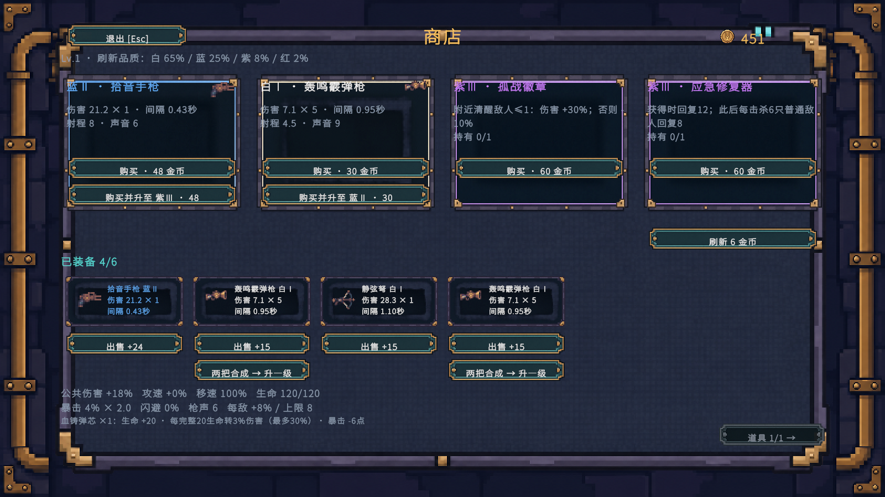
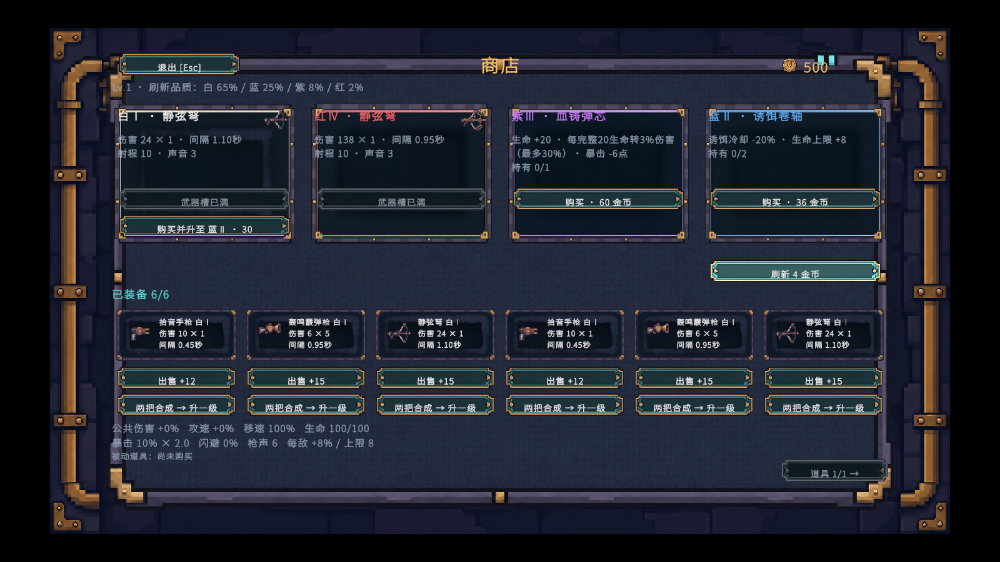
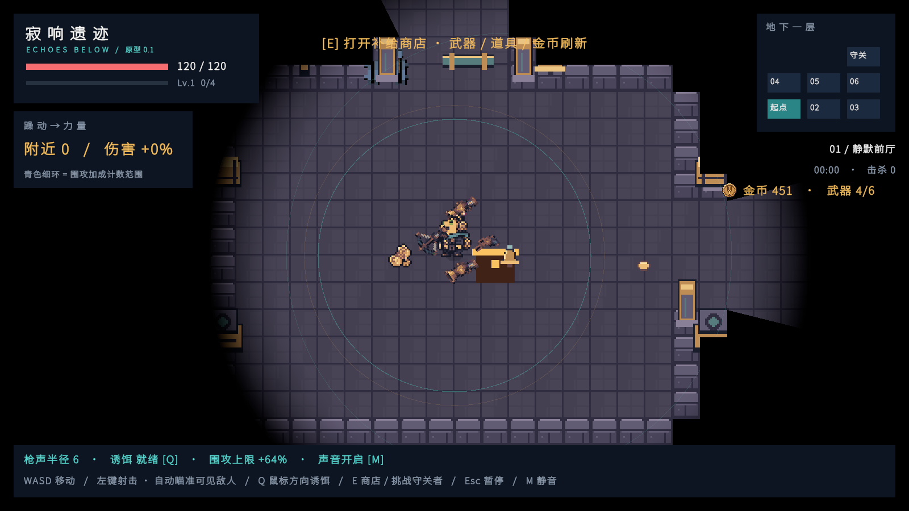
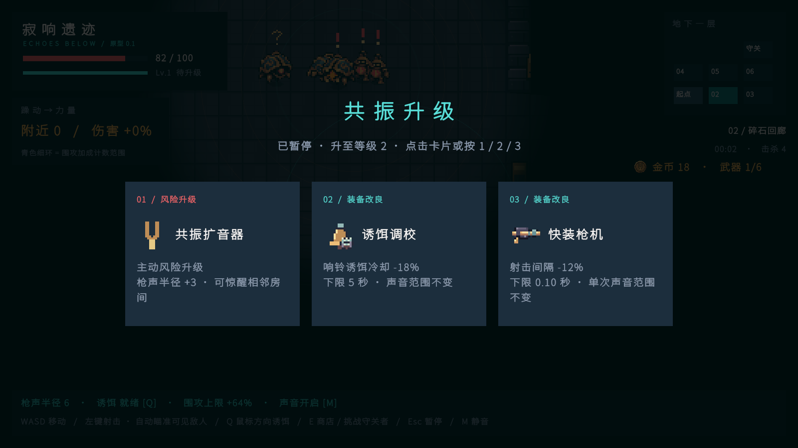

# 027-正式素材接入商店武器与道具

## 功能与范围

将026号记录中已导入的30张正式素材绑定到现有游戏位置：商店背景、面板、四品质商品卡、武器槽、四态按钮、音叉金币、三种武器的四品质精灵、五张升级图标和地图钱币堆。六种升级中的“精密弹头”继续复用已有弹丸切片；响铃诱饵继续使用已有铃铛切片。

启动场景仍为 `Assets/Echoes/Scenes/Prototype.unity`。界面和装备本来就由运行时代码创建，因此本轮通过现有工厂与数据引用接入，没有另外摆放展示物、复制场景或创建展示专用Prefab。商品、价格、品质概率、合成条件、射击轨迹、拾取判定和升级效果沿用现有实现。

用户确认：地图商店入口继续保留几何占位，等待专用素材；第二、三层图集留作后续关卡资源，本轮不启用。二十四件被动道具的正式图标仍按此前决定暂不制作，商店保持名称、描述、品质底图和持有数量。

## 素材与游戏元素对应关系

以下前两表中的路径均相对于 `Assets/Echoes/Art/`；30张贴图均已有运行时引用。原始素材、预览及重复图没有再次导入。

| 素材路径 | 数量 | 接入位置／用途 |
| --- | ---: | --- |
| `UI/Shop/Backgrounds/shop_background.png` | 1 | 打开商店后的全屏背景 |
| `UI/Shop/Panels/shop_main_panel.png` | 1 | 商店主面板背板 |
| `UI/Shop/Panels/shop_offer_tier1_white.png` | 1 | 白Ⅰ商品卡底，适用于武器与被动道具 |
| `UI/Shop/Panels/shop_offer_tier2_blue.png` | 1 | 蓝Ⅱ商品卡底 |
| `UI/Shop/Panels/shop_offer_tier3_purple.png` | 1 | 紫Ⅲ商品卡底 |
| `UI/Shop/Panels/shop_offer_tier4_red.png` | 1 | 红Ⅳ商品卡底 |
| `UI/Shop/Panels/shop_weapon_slot.png` | 1 | 商店已装备武器槽底，按实际持有数量显示 |
| `UI/Shop/Buttons/shop_button_normal.png` | 1 | 商店购买、出售、合成、刷新、翻页、退出按钮普通状态 |
| `UI/Shop/Buttons/shop_button_hover.png` | 1 | 同类按钮悬停／选中状态 |
| `UI/Shop/Buttons/shop_button_pressed.png` | 1 | 同类按钮按下状态 |
| `UI/Shop/Buttons/shop_button_disabled.png` | 1 | 余额不足、满槽、售出、不可合成等禁用状态 |
| `UI/Shop/Icons/shop_gold_coin.png` | 1 | 商店余额和探索HUD金币图标；不作为地图掉落物 |
| `UI/Upgrades/quick_bolt.png` | 1 | 快装枪机三选一升级卡图标 |
| `UI/Upgrades/light_step.png` | 1 | 轻装行进三选一升级卡图标 |
| `UI/Upgrades/emergency_repair.png` | 1 | 应急修复三选一升级卡图标 |
| `UI/Upgrades/resonance_amplifier.png` | 1 | 共振扩音器三选一升级卡图标 |
| `UI/Upgrades/decoy_tuning.png` | 1 | 诱饵调校三选一升级卡图标 |
| `Items/gold_pickup.png` | 1 | 普通怪死亡后的地图钱币堆，替换原金色方块 |

| 武器素材路径 | 数量 | 接入位置／触发方式 |
| --- | ---: | --- |
| `Weapons/listener_pistol_tier1.png` 至 `listener_pistol_tier4.png` | 4 | 拾音手枪；初始武器为白Ⅰ，商店商品图标、已装备图标和角色身旁实体共用对应品质Sprite |
| `Weapons/boom_shotgun_tier1.png` 至 `boom_shotgun_tier4.png` | 4 | 轰鸣霰弹枪；从商店购买后装备，图标与实体使用对应品质Sprite |
| `Weapons/silent_crossbow_tier1.png` 至 `silent_crossbow_tier4.png` | 4 | 静弦弩；从商店购买后装备，图标与实体使用对应品质Sprite |

已有资源复用情况：

| 已有资源路径 | 当前用途与状态 |
| --- | --- |
| `Assets/Echoes/Resources/Art/Common/items.png` → `items_01` | 响铃诱饵地图实体；原已接入，继续复用，不导入相同的独立铃图 |
| 同图集 → `items_02` | 精密弹头升级图标与玩家弹丸；升级图标本轮接入，弹丸原已接入 |
| 同图集其他切片 | 敌方弹丸、影子、敌人状态标记等已有用途继续保留 |
| `Assets/Echoes/Resources/Art/Common/hero.png`、`effects.png` | 原有角色动作及枪口／命中特效继续使用 |
| `Assets/Echoes/Resources/Art/Floor1/` | 原有地板、墙体、装饰、普通敌人与守关者继续使用 |
| `Assets/Echoes/Resources/Art/Floor2/`、`Floor3/` | 已导入并保留原美术验收切换入口，正常游戏流程暂不使用，详见未接入项 |

## 相关文件与引用配置

- [PresentationArt.asset](../Assets/Echoes/Resources/PresentationArt.asset)：新增集中引用配置，直接序列化引用全部30张Sprite。美术资源仍保留在 `Assets/Echoes/Art` 下；通过Resources中的配置引用随游戏加载，无需复制PNG到Resources。
- [PresentationArt.cs](../Assets/Echoes/Scripts/World/PresentationArt.cs)：加载配置，映射武器与六种升级图标。`weapons` 顺序为拾音手枪、轰鸣霰弹枪、静弦弩，各系列按白Ⅰ／蓝Ⅱ／紫Ⅲ／红Ⅳ排列；`offerPanels` 按同一品质顺序排列；`buttonStates` 为普通／悬停／按下／禁用。
- [GameArt.cs](../Assets/Echoes/Scripts/World/GameArt.cs)：将 `weapon_0` 至 `weapon_11` 和 `gold` 接到正式图片。武器ArtBinding在合成后同步更新，切换美术主题也不会恢复为旧图。
- [WeaponInventory.cs](../Assets/Echoes/Scripts/Combat/WeaponInventory.cs)：创建、合成后的武器实体按种类与品质选图，移除占位图的非等比缩放与整图品质染色，避免破坏正式像素与配色。
- [GoldPickup.cs](../Assets/Echoes/Scripts/World/GoldPickup.cs)：掉落实体改为钱币堆精灵。
- [GameHud.Art.cs](../Assets/Echoes/Scripts/UI/GameHud.Art.cs)：商店九宫格面板、等比图标与四态按钮共用配置。
- [GameHud.Shop.cs](../Assets/Echoes/Scripts/UI/GameHud.Shop.cs)：正式商店布局、商品与已装备武器图标；原有交易回调继续使用。
- [GameHud.cs](../Assets/Echoes/Scripts/UI/GameHud.cs)：探索HUD金币图标、三选一升级图标。
- [PresentationArtTests.cs](../Assets/Echoes/Tests/PlayMode/PresentationArtTests.cs)：正式素材显示与界面交互验证。

新增配置、脚本、测试的 `.meta` 随提交保存。贴图及其导入 `.meta` 已在上一轮提交，本轮没有重复复制素材。原有 `PrototypeFont.asset` 与 `SampleScene.unity` 的本地改动不纳入本轮提交。

## 编辑器与显示配置

Unity版本为 `2022.3.62f3c1`，沿用现有uGUI运行时Canvas与1600×900参考分辨率、`Scale With Screen Size`。打开Prototype后直接Play即可，不需要手动拖拽引用或重新生成场景。

- 商店全屏背景按16:9等比覆盖；主面板、商品卡、武器槽与按钮使用已导入的九宫格边距，边框不会随宽高整体拉伸。
- 商品卡按品质独立换底图；装备槽中的图标与文字各自留出区域。最多六槽保持在同一行，合成按钮只在满足已有合成条件时显示。
- 武器图标48×48、升级图标64×64、音叉金币32×32，`preserveAspect` 开启。装饰图和图标不接收射线，按钮仍由原Image接收点击。
- 武器与金币继续使用16 PPU、Point过滤、透明通道、无压缩与无mipmap。实体使用原生等比缩放 `Vector3.one`，品质通过不同Sprite表现。
- 武器保留中心轴心；渲染位置按图片宽度校准到原逻辑枪口，瞄准、子弹起点和命中逻辑不变。朝左时翻转Y避免武器上下颠倒，角色后方的武器绘制在角色后，前方绘制在角色前。
- 钱币堆按脚点排序绘制在地面上、角色下方；拾取距离、穿墙限制与金币数值沿用原配置。
- 响铃诱饵继续复用原实体，无新增诱饵掉落、背包或主动技能功能。

## 正常流程查看方式

1. 打开 `Assets/Echoes/Scenes/Prototype.unity` 并Play，出生即能看到白Ⅰ拾音手枪与HUD音叉金币。
2. 出生房间靠近现有商店入口按 **E**，查看背景、主面板、四个商品卡、武器图标、装备槽与按钮状态。入口本身仍为用户选择保留的占位图形。
3. 进入普通怪房间，左键射击。怪物死亡掉落钱币堆，走近拾取后HUD与商店余额更新。
4. 经验满足时出现三选一升级，查看图标并点击卡片或按 **1／2／3** 选择。六种升级图标按实际抽取出现，不增加展示专用选项。
5. 返回商店购买霰弹枪或静弦弩；关闭商店后能看到对应武器悬浮并参与原有攻击。购买同款同品质武器后，可在商店合成升级；图标与实体立即换成新品质。
6. 在地图上按 **Q** 投掷响铃，查看原有铃铛实体；商店中可继续出售、合成、付费刷新、翻页或退出。

商店抽取与金币仍按原玩法获得；高品质和满六槽画面无需新增专用展示模式。

## 验证与实际截图

按用户确认，在关闭交互式Editor后使用Unity CLI驱动2022版Editor进行批处理PlayMode验证，保留图形设备渲染，不生成EXE。针对性测试共 **10项通过、0项失败**：

- 正式素材：完整配置、12张不同武器图、六种升级图标均能加载；初始武器、合成后Sprite和ArtBinding映射正确。
- 实际运行：模拟时间推进，玩家真实弹丸击杀敌人，钱币堆使用正式图片并可拾取；升级暂停、点击选择、退出商店恢复探索。
- uGUI交互：用EventSystem射线检查目标按钮可达、无遮挡，再触发购买武器、购买被动道具、六槽合成、出售、付费刷新和退出；检查金币／槽数／品质／持有数量变化及按钮四态。
- 现有回归：5项ShopTests与3项VisibilityAndUpgradeTests通过，覆盖满槽、冷却继承、品质概率、被动效果、霰弹／穿透、自动瞄准、黑暗显形与经验溢出。

测试快速布置使用瞬移、加金币、填充六槽与调用已有实体工厂，不写回场景或GameConfig；第一项正式素材测试同时包含真实射击、掉落、拾取、升级选择、返回商店购买流程。截图使用真实游戏相机与HUD离屏渲染，未将概念图或合成预览作为运行效果。

复现命令（测试报告和日志留在被忽略的TestResults目录）：

```powershell
unity test D:\NGJ --mode PlayMode --editor-path D:\unity\Editor\Unity.exe `
  --filter 'Echoes.Tests.PresentationArtTests;Echoes.Tests.ShopTests;Echoes.Tests.VisibilityAndUpgradeTests' `
  --output D:\NGJ\TestResults\PresentationArt-20261114\verified.xml --timeout 300 --format json `
  -- -logFile D:\NGJ\TestResults\PresentationArt-20261114\verified.log
```









另有 [射击与掉落](Images/正式素材接入-20261114/01-loot-and-weapon.png)、[正常购买后界面](Images/正式素材接入-20261114/03-shop-purchase.png)。显示验收以现有16:9桌面画面为准，没有扩展其他宽高比的界面适配。

## 未接入项与原因

| 资源／元素 | 处理与原因 |
| --- | --- |
| 地图商店专用摊位图 | 缺少正式专用素材；用户确认保留入口占位，不借用工作台冒充摊位 |
| 二十四件被动道具的独立图标 | 尚无已确认成品；用户此前确认暂不制作。道具功能与文字卡片保留，不以升级图标替代不同道具 |
| `Resources/Art/Floor2`、`Floor3` | 用户确认等待后续关卡流程，本轮不启用，不新增下楼或关卡切换机制 |
| `Common/items.png` 的旧枪切片 `items_00` | 三种武器已改用独立正式Sprite；该切片与仍在用的铃、弹丸等共处同一图集，不删除图集 |
| 美术目录中的概念图、品质提案板、角色多姿态展示图、组合预览、重复放大版 | 仅作来源／参考，不作为游戏正式图片接入。来源与去重清单详见026号文档 |
| 未选择的Raven／Pixel Crawler全包资源 | 没有新增对应游戏元素，不为展示资源而追加物件或功能 |

本轮已确认范围内的30张正式素材均已绑定。没有尚未确认、会阻止本轮接入完成的版本或用途问题。
