# 025-房间生成与三层地牢

## 功能与范围

本轮把固定七房间单层原型改为 **5×5 房间格、三层随机地牢**，并按后续密度方案把房间格放大为正方形。

- 每层 5×5 个房间格，全部铺满；起始房顶排中央，Boss 房底排中央。
- 房间格 **36×36**（内部约 34×34），整图 **180×180**；门宽 **6 格**。
- 中间房使用 1×1、1×2、1×3、2×2、L 形；多格房是一整块连续大房间。
- 三层主题：静钟街区、锈鸣工坊、原音圣所；房间、敌人与 Boss 使用对应正式图集。
- P0 房间布局库：donut、柱厅、货箱 S 路、断角、长厅、庭院、L 转角、Boss 四角柱、起始集市；使用现有 16 种道具。
- 新增地板贴花、墙面装饰、非碰撞杂物三层装饰。
- 相机参考分辨率 **640×360**，视野约 40×22.5 格；大房间仍会跨屏。
- 地面改用 Tilemap 渲染，墙体保留逐格 Y 排序；避免 32,400 个独立地面对象。
- 房间美术仍复用现有正式资源；P1 新素材清单见 `Docs/031-房间障碍与装饰扩展报告.md`。

## 网格与房间

| 项目 | 规则 |
| --- | --- |
| 房间格 | 36×36 世界格（含 1 格墙），内部 34×34 |
| 地图 | 180×180，共 32,400 格 |
| 起始房 | 1×1，格坐标 (2,0)，顶排中央；1 个门，优先朝南 |
| Boss 房 | 1×1，格坐标 (2,4)，底排中央；1 个门，优先朝北 |
| 中间房 | 1×1、1×2、1×3、2×2、L；允许 90° 旋转 |
| L 形 | 2×2 去掉一个 1×1，占 3 格 |
| 铺满 | 25/25 格全部属于某个房间，不重叠、不留空格 |
| 多格房 | 整块连续地面；内部格线不砌墙 |
| 墙厚 | 相邻房间之间 2 格；地图外沿 1 格 |
| 门宽 | 6 格，居中，距房间角至少 2 格 |

`DungeonPlan` 生成合法铺法；`DungeonMap` 栅格化为世界格子。2×2 房中央的 2×2 墙芯会打开，保证大房间内部无隔墙。

## 生成算法

### 铺房间

1. 固定起始/Boss 两个 1×1 格。
2. 从左上到右下找第一个空格，枚举可覆盖该格的形状与旋转，按权重随机排序。
3. 权重：1×1=12、1×2=22、1×3=16、2×2=24、L=20；1×1 始终可回退。
4. 至少出现 2 种多格房型，否则换随机种子重试。
5. 最多 100 次；失败使用确定性回退铺法。

### 房间图与门

- 每个相邻房间对一条候选边；随机 Kruskal 连通树 + 15% 额外门形成环路。
- 起始/Boss 强制为叶子，各只保留 1 条边；每房最多 4 门。
- 门洞打穿两侧各 1 格墙；门柱使用正式 `doorpost` 贴图。

### 校验

- 25 格全覆盖、无重叠；
- 形状/旋转/格数合法；
- 起始/Boss 各 1 门且为叶子；每中间房至少 1 门；
- 所有房间从起始可达；
- 同 seed 结果一致。

## 房间布局与装饰（P0）

`RoomLayouts.cs` 用现有 16 种道具拼装以下原型：

| 房型 | 主要原型 |
| --- | --- |
| 1×1 | 中央机岛 donut、货箱 S 路、断柱四角 + 不对称碎石 |
| 1×2 | 双厅机库、柱厅、货箱车道 |
| 1×3 | 长列圣堂、侧龛、坍塌长厅 |
| 2×2 | 四方庭院、十字路口、环形机岛 |
| L | 角室神龛、柱臂、货箱 L |
| Boss | 四角柱竞技场，中央 16×16 以上开放 |
| Start | 站台集市：商店、箱堆、灯、招牌；中央无实心物 |

装饰层：

- **实心物**：箱子、柱、工作台、长椅、管道、晶体、音叉等；碰撞脚底与 footprint 一致，离墙 1 格、离门 3 格。
- **地板贴花**：使用 `floorAlt`/`floorDetail` 贴图叠加低透明度主题色，作为 P0 占位。
- **非碰撞杂物**：`spares`、`pipeBend`、`crystal`、`fork` 等，散布在房间内部；不进入 walkable。
- **墙面装饰**：`lamp`、`signature`、`panel` 沿四边墙布置；不产生额外碰撞。
- Boss 房不放普通地板杂物；起始房保留商店净空。

实际密度（seed 713 第一层）：中间房 **9–22 个实心物，覆盖率约 6.7–10.2%**；P0 目标为“明显优于旧版”，P1 目标 10–18% 需要新的大件素材。

### 密度与通路

- 主通路净宽目标 4 格；门内 3 格不放实心物。
- 每个实心物周围保留 1 格地板；房间内 BFS 校验，切断房间则撤销该房实心物。
- 敌人：6 只/房间格，单房 6–28；起始/Boss 不放普通怪。
- 第一层 seed 713 约 139 只普通怪 + 1 只 Boss。

## 三层流程

| 状态 | 行为 |
| --- | --- |
| 第一层 | 主题 Floor1，起始房商店，Boss 房守钟者 |
| 第一层 Boss 击败 | `RunState.FloorCleared`，按 E/按钮下潜 |
| 第二层 | 主题 Floor2，新地图/敌人/商店库存；Boss 鼓压巨偶 |
| 第三层 | 主题 Floor3，原音圣所；Boss 原音之心 |
| 第三层 Boss 击败 | `RunState.Won`，整局胜利 |

跨层保留生命、最大生命、武器、被动、金币、等级、经验、击杀、用时；每层重置敌人/Boss/商店库存/刷新次数，清理旧地图、子弹、诱饵、声波、特效、未拾取金币和视野圈；进入下一层回复 30% 最大生命并回到起始房中心。

## HUD 与视野

- 5×5 小地图：当前房青色、已访问灰蓝、未访问深色；起点/终点标“起/终”。
- 楼层标题“第 X 层 · 主题名”；当前房名来自 `FloorTheme`。
- 视野纹理 180×180；`DungeonDarkness.shader` DDA 上限 512；墙角增加斜向地板显形，消除墙角黑块。
- 地面 Tilemap 排序 `-1000`，地板贴花 `-900`，墙体/道具继续按 Y 排序，避免大坐标下墙体被地面盖住。

## 配置

`DefaultGameConfig.asset`：

| 字段 | 当前值 | 说明 |
| --- | ---: | --- |
| `generationAttempts` | 100 | 随机铺房间尝试次数 |
| `extraDoorChance` | 0.15 | 额外环路概率 |
| `enemiesPerCell` | 6 | 每房间格普通怪基数 |
| `minEnemiesPerRoom` | 6 | 单房下限 |
| `maxEnemiesPerRoom` | 28 | 单房上限 |
| `floorEnemyHealth` | 1 / 1.2 / 1.4 | 三层普通怪生命倍率 |
| `floorEnemyDamage` | 1 / 1.1 / 1.2 | 三层敌人伤害倍率 |
| `floorBossHealth` | 1 / 1.35 / 1.7 | 三层 Boss 生命倍率 |
| `floorEntryHealFraction` | 0.3 | 进层回复比例 |
| `randomSeed` | 713 | 房间/地形种子 |

生成种子：`randomSeed + floorIndex*1009`；地形掩体使用独立偏移。

## 相关文件

- `Assets/Echoes/Scripts/World/DungeonPlan.cs`：布局铺满、形状旋转、房间图、门、回退。
- `Assets/Echoes/Scripts/World/DungeonMap.cs`：180×180 栅格化、Tilemap 地面、墙体、门、掩体、装饰、密度/中心/出生点。
- `Assets/Echoes/Scripts/World/RoomLayouts.cs`：P0 布局原型、实心集群、地板/墙面/杂物装饰。
- `Assets/Echoes/Scripts/World/FloorTheme.cs`：三层名称池。
- `Assets/Echoes/Scripts/World/DungeonVisibility.cs`、`Assets/Echoes/Resources/DungeonDarkness.shader`：动态视野、墙角显形。
- `Assets/Echoes/Scripts/Core/RunController.cs`：三层状态/清场/保留。
- `Assets/Echoes/Scripts/Core/GameConfig.cs`、`Assets/Echoes/Settings/DefaultGameConfig.asset`：配置。
- `Assets/Echoes/Scripts/Core/ShopController.cs`：每层起始房商店。
- `Assets/Echoes/Scripts/UI/GameHud.cs`：5×5 小地图/层名/下潜。
- `Assets/Echoes/Scripts/Combat/EnemyController.cs`、`PlayerController.cs`：楼层强度/落点。
- `Assets/Echoes/Editor/PrototypeBuilder.cs`、`Assets/Echoes/Scenes/Prototype.unity`：640×360 相机。

测试：

- `Assets/Echoes/Tests/Editor/DungeonGenerationTests.cs`：300 seeds 覆盖/形状/门/可达性、确定性、回退布局。
- `Assets/Echoes/Tests/PlayMode/FloorGenerationTests.cs`：实际场景起始/Boss/房型/门/密度/出生点、6 个 seeds、生成耗时、帧率、三层流程与状态保留。
- `Assets/Echoes/Tests/PlayMode/RoomArtAcceptanceTests.cs`：三层 × 房型截图。
- `Assets/Echoes/Tests/PlayMode/ObstacleVisibilityTests.cs`、`DungeonTestGeometry.cs`：动态门/墙角、声音穿墙、视野/子弹/自动瞄准。

## 验证结果

- **EditMode：29 / 29 通过**
- **PlayMode：38 / 38 通过**（含合并后的商店正式美术、敌人近战/远程分工与房间战斗回归）。
- 生成耗时：每层约 271–308 ms（6 seeds）。
- 批处理 FPS：约 1020（无 VSync，仅说明场景可运行；实际显示帧率需人工确认）。
- 第一层 seed 713：约 139 只普通怪 + 1 Boss；中间房实心覆盖 6.7–10.2%。
- 截图：`TestResults/Art/floor{1..3}-{start,shape,boss}.png`；验收图见 `Docs/Images/房间生成-20261114/`。
- 本轮未生成 EXE。

## 已知限制

- P0 仍复用 32×32 旧道具；36×36 房间中单件偏小，覆盖率低于报告目标的 10–18%。P1 需要大件/贴花/墙饰，见 `Docs/031`。
- 未实现 Fairy/Blood/Puzzle/Trap、钥匙锁门、层间楼梯；下潜由 Boss 后按钮触发。
- 敌人密度、伤害/生命倍率、金币与商店价格仍是初调值，未完成完整人工平衡。
- 房间截图为了看全房间临时放大相机，HUD 会压住房间边缘；正常游戏相机为 640×360。
- 商店 UI 素材尚未导入。

## 验收截图

第一层起始房、1×1 单格房、1×3 长条房：

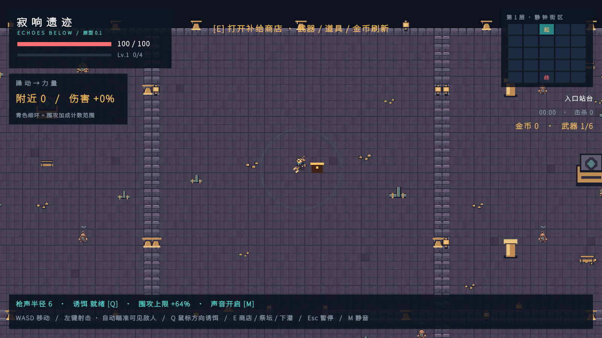

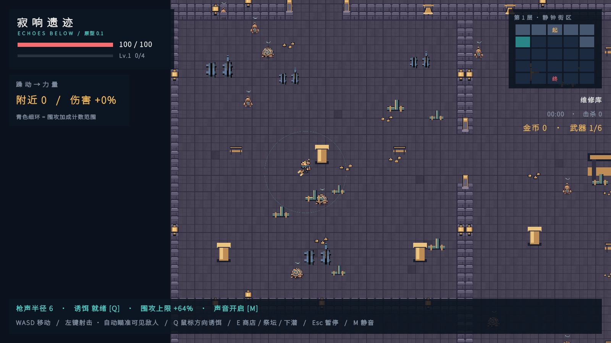

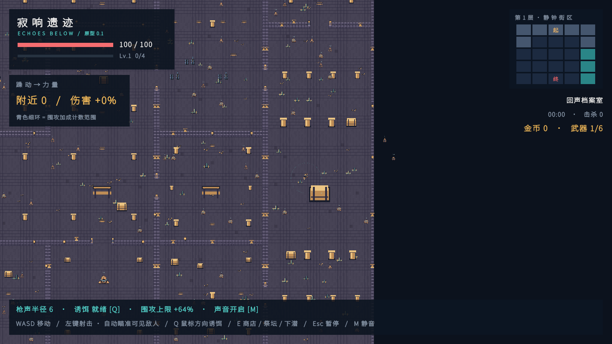

第一层 L 形房与 Boss 房：

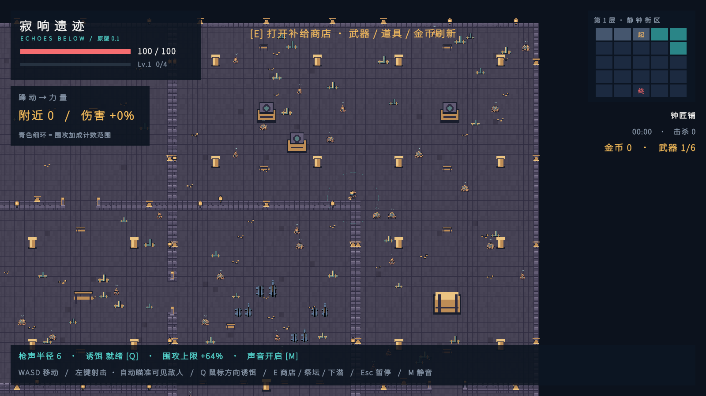

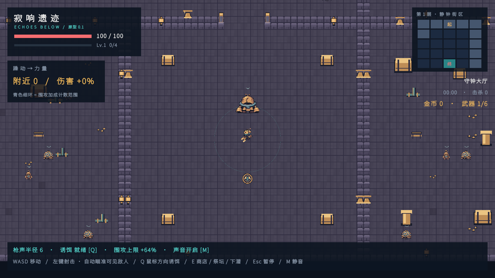

第二层 1×2 双格房与 Boss 房：

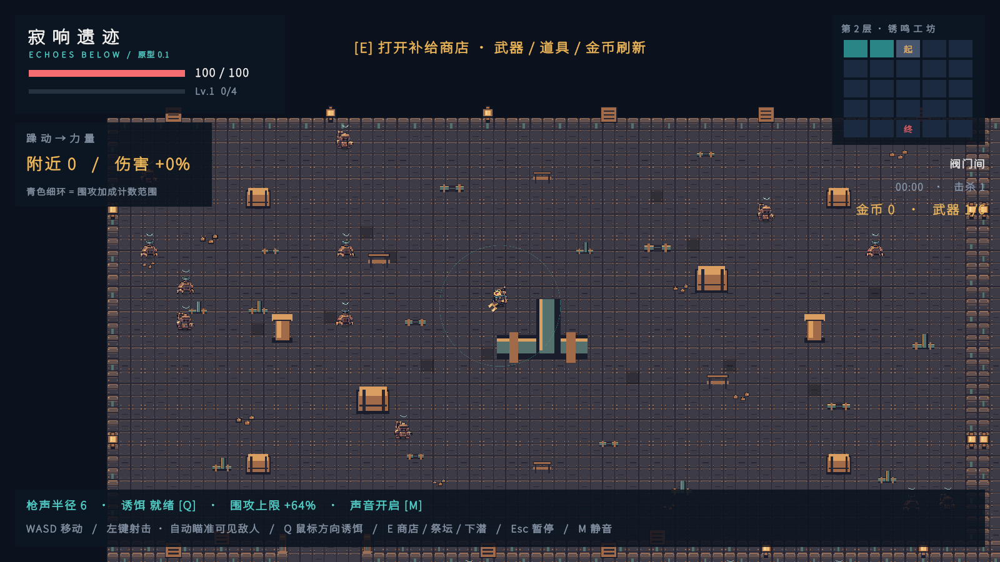

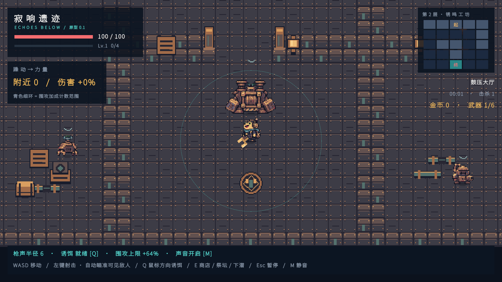

第三层 2×2 大房与 Boss 房：

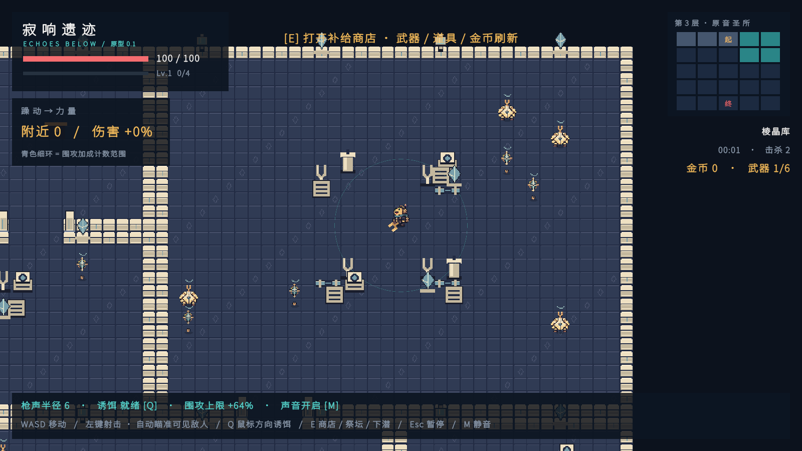

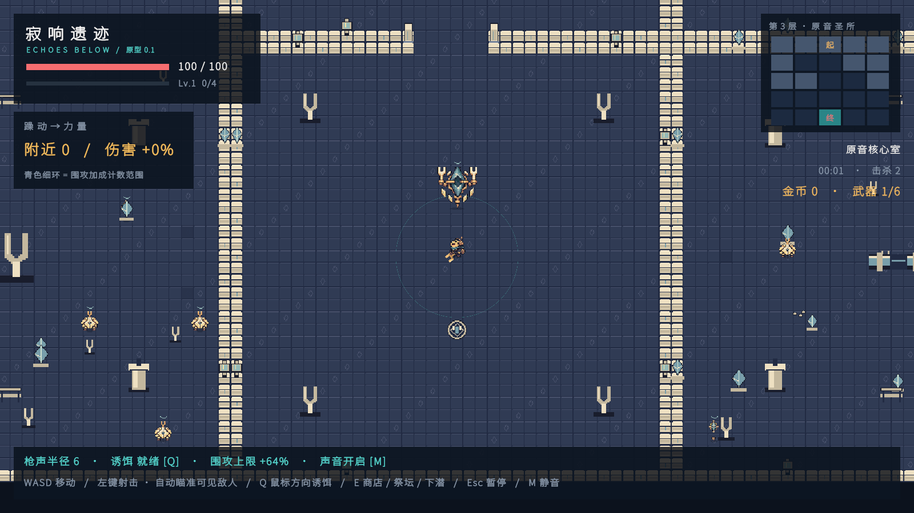

正常黑暗视野与房间战斗：

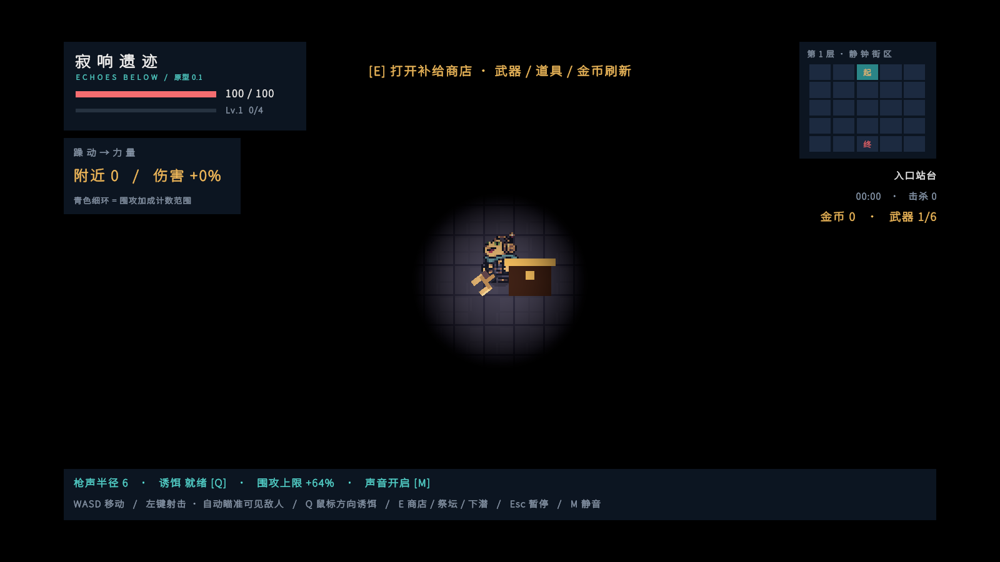

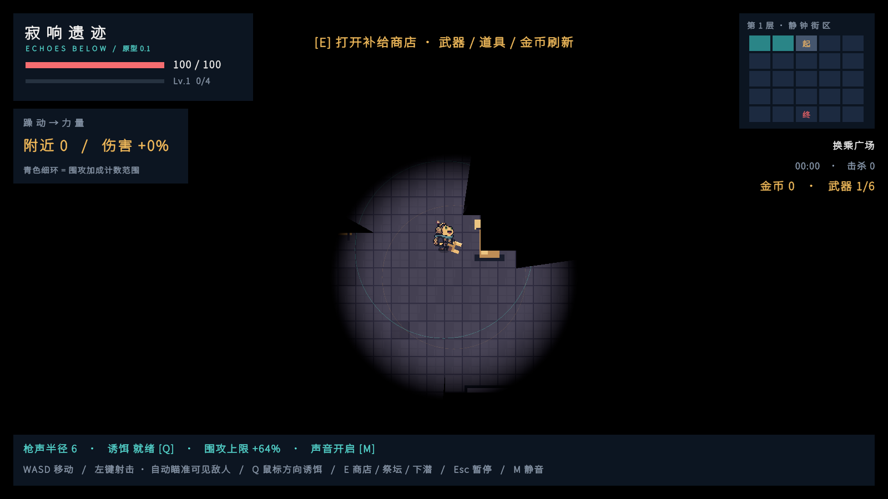
