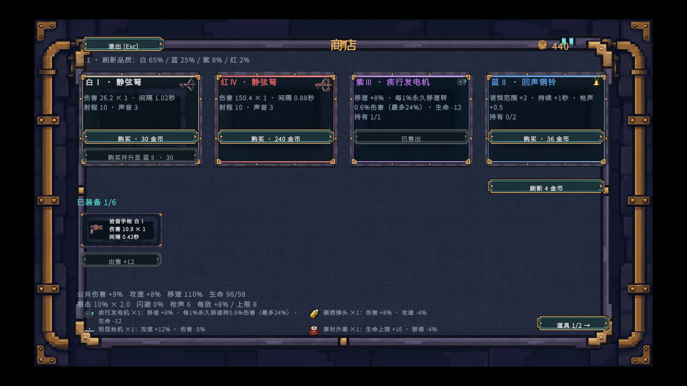

# 商店被动道具图标接入

## 正常流程

运行启动场景 `Assets/Echoes/Scenes/Prototype.unity`，在每层出生点附近靠近商店入口，按 **E** 开店。被动商品在品质卡右上角显示图标。击败普通敌人并拾取金币后可购买，底部持有栏显示同一图标、名称、数量和效果。每页容纳四种，超过四种时使用右侧翻页按钮。刷新、换层和等级会影响实际看到的货品。

## 美术与数据对应

| 用途 | 运行时来源 | 查看位置 |
| --- | --- | --- |
| 白色被动 | 硬质弹头、轻型枪机、厚衬外套、软底长靴 | 商品卡及持有栏 |
| 蓝色被动 | 消声套管、扩音枪口、承压线圈、回声铜铃 | 商品卡及持有栏 |
| 紫色被动 | 疾行发电机、应急修复器 | 商品卡及持有栏 |
| 红色被动 | 遗迹扩声阵列、寂静终焉 | 商品卡及持有栏 |
| 商店界面 | 正式背景、九宫格面板、四品质卡底、武器槽、四态按钮、余额金币 | 开店、购买、刷新时 |
| 三种武器各四品质 | 拾音手枪、轰鸣霰弹枪、静弦弩 | 商品卡、装备槽、角色身旁，购买或合成后按品质切换 |
| 掉落、诱饵和升级 | 地图钱币堆、已有铃铛切片与六种升级图标 | 普通敌人掉落、投出响铃、升级三选一 |
| 楼层主题 | 三层环境、敌人与 Boss 的对应图集 | 击败本层 Boss 后进入下一层 |

## 文件与配置

- [道具 Sprite](../Assets/Echoes/Art/UI/Passives/) 取自 [12 件交付图标](../美术/商店被动道具图标-12件/图标/)。每张 32×32，单 Sprite、中心轴心、100 PPU、Point 过滤、Clamp、透明、无压缩、关闭 mipmap，与现有 UI 图标导入设置一致。
- [PresentationArt.asset](../Assets/Echoes/Resources/PresentationArt.asset) 的 `passiveIcons` 保存直接引用。[PresentationArt.cs](../Assets/Echoes/Scripts/World/PresentationArt.cs) 按商品名匹配同名 Sprite。调整商品目录顺序不会改变图标；改名时须同步对应 Sprite 名称。
- [GameHud.Shop.cs](../Assets/Echoes/Scripts/UI/GameHud.Shop.cs) 通过现有 uGUI 工厂生成商品与持有图标，使用 32×32 参考尺寸、保持比例、关闭射线命中。持有区两列两行，图标和说明文字各占独立区域。

## 验证与范围

[PlayMode 验证](../Assets/Echoes/Tests/PlayMode/PresentationArtTests.cs) 在启动场景核对目录中的十二张 Sprite、商品和购买后持有区的引用，并用 UI 射线点击购买、翻页与退出。为覆盖四件以上的库存，翻页测试额外授予四种道具。正式流程的战斗、拾金、升级、购枪、合成、出售与刷新由同组现有用例覆盖。

Unity 2022.3.62f3c1 的 7 项商店测试通过。首次导入的临时副本在一项画面测试中记录了 URP 着色器为空；完成导入并调整卡片边距后，重新运行 3 项画面与交互测试，全部通过。截图为 1600×900 游戏画面。

地图商店入口目前使用已有几何摊位，仍缺专用场景 Sprite。概念图、图集原稿、组合预览和第三方素材包里的未选变体只用作美术来源。十二件被动均有明确商店用途，当前没有对应的独立地图掉落或角色挂件。
