# 035-当前房间示意图

由当前实际生成数据导出的 P0 房间示意图；**不是正式美术**，只表示墙体、门、实心物、装饰和房间形状。

- 数据来源：`RoomSchematicExportTests`，seed 713，第 1–3 层；JSON 保存在 `美术/房间示意图制作/room-schematics.json`。
- 图例：深色=墙，紫色/灰色=地面，橙色块=实心物（字母为道具类型），金色=门，小点=非碰撞装饰。
- 类型缩写：C 箱、P 柱、S 工作台、R 武器架、B 长椅、I 直管、b 弯管、N 面板、Y 晶体、F 音叉、D 导管、s 零件。
- 房间覆盖率按当前 `SolidCoverage` 计算；P0 使用现有 32×32 道具，部分大件是放大占位。

## 第 1 层 · 静 钟 街 区

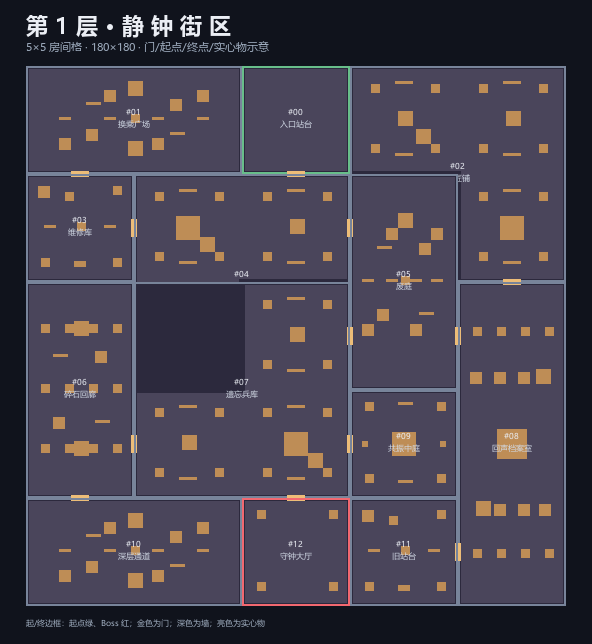

| # | 房间 | 角色 / 房型 | 门 | 实心物 / 覆盖率 | 示意图 |
| ---: | --- | --- | ---: | ---: | --- |
| 00 | 入口站台 | 起始 / 1×1 | 1 | 0 / 0.0% | [打开](Images/房间示意图-20261114/floor1-room00-start-single.png) |
| 01 | 换乘广场 | 中间 / 1×2 | 1 | 15 / 7.8% | [打开](Images/房间示意图-20261114/floor1-room01-middle-line2.png) |
| 02 | 钟匠铺 | 中间 / L 形 | 1 | 22 / 8.2% | [打开](Images/房间示意图-20261114/floor1-room02-middle-l.png) |
| 03 | 维修库 | 中间 / 1×1 | 2 | 9 / 6.7% | [打开](Images/房间示意图-20261114/floor1-room03-middle-single.png) |
| 04 | 听音岗 | 中间 / L 形 | 3 | 22 / 8.2% | [打开](Images/房间示意图-20261114/floor1-room04-middle-l.png) |
| 05 | 废庭 | 中间 / 1×2 | 3 | 14 / 6.7% | [打开](Images/房间示意图-20261114/floor1-room05-middle-line2.png) |
| 06 | 碎石回廊 | 中间 / 1×2 | 2 | 18 / 8.7% | [打开](Images/房间示意图-20261114/floor1-room06-middle-line2.png) |
| 07 | 遗忘兵库 | 中间 / L 形 | 4 | 22 / 8.2% | [打开](Images/房间示意图-20261114/floor1-room07-middle-l.png) |
| 08 | 回声档案室 | 中间 / 1×3 | 3 | 17 / 9.2% | [打开](Images/房间示意图-20261114/floor1-room08-middle-line3.png) |
| 09 | 共振中庭 | 中间 / 1×1 | 1 | 9 / 10.2% | [打开](Images/房间示意图-20261114/floor1-room09-middle-single.png) |
| 10 | 深层通道 | 中间 / 1×2 | 1 | 15 / 7.8% | [打开](Images/房间示意图-20261114/floor1-room10-middle-line2.png) |
| 11 | 旧站台 | 中间 / 1×1 | 1 | 9 / 6.7% | [打开](Images/房间示意图-20261114/floor1-room11-middle-single.png) |
| 12 | 守钟大厅 | Boss / 1×1 | 1 | 4 / 3.1% | [打开](Images/房间示意图-20261114/floor1-room12-boss-single.png) |

### #00 入口站台

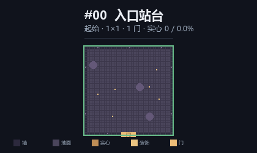

### #01 换乘广场

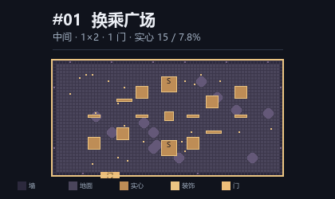

### #02 钟匠铺

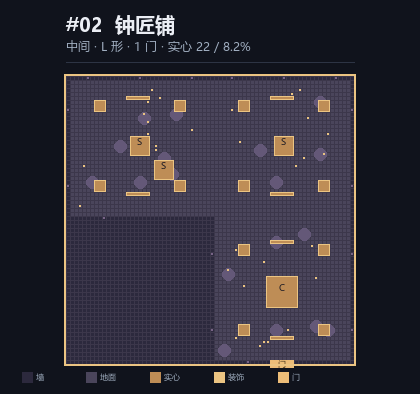

### #03 维修库

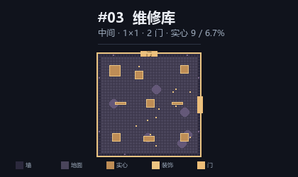

### #04 听音岗

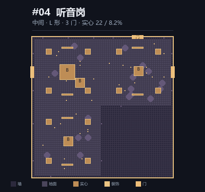

### #05 废庭

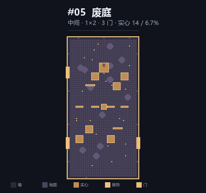

### #06 碎石回廊

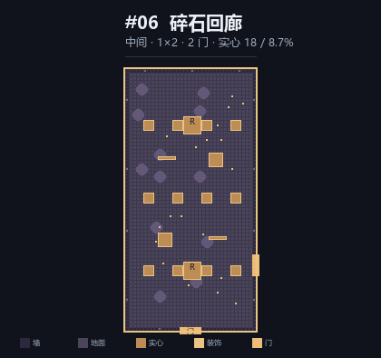

### #07 遗忘兵库

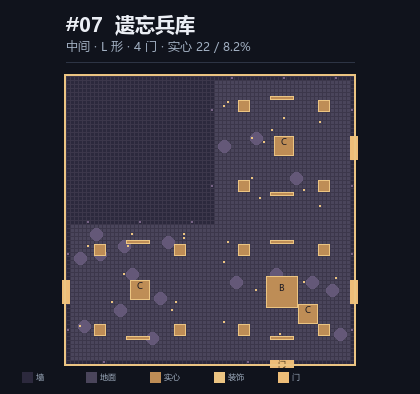

### #08 回声档案室

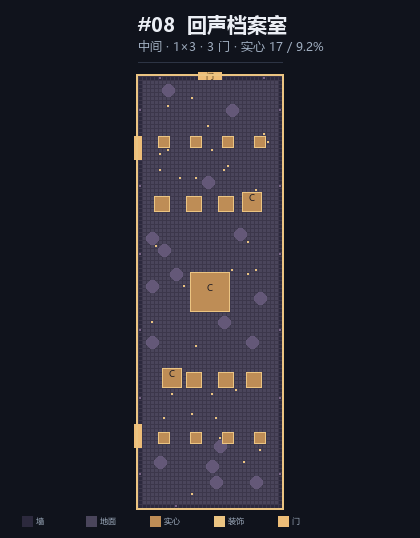

### #09 共振中庭

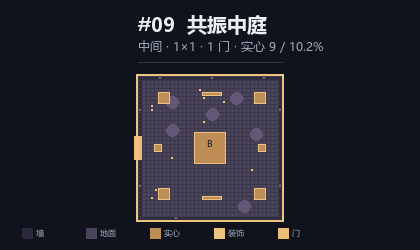

### #10 深层通道

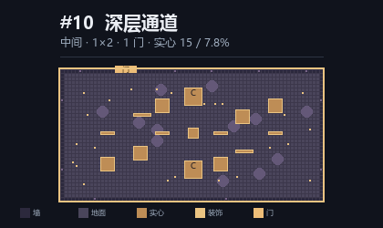

### #11 旧站台

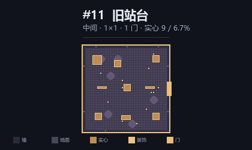

### #12 守钟大厅

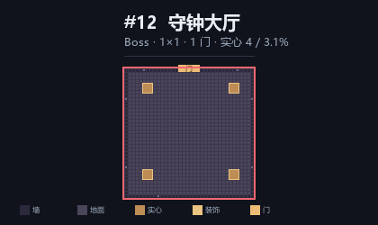

## 第 2 层 · 锈 鸣 工 坊

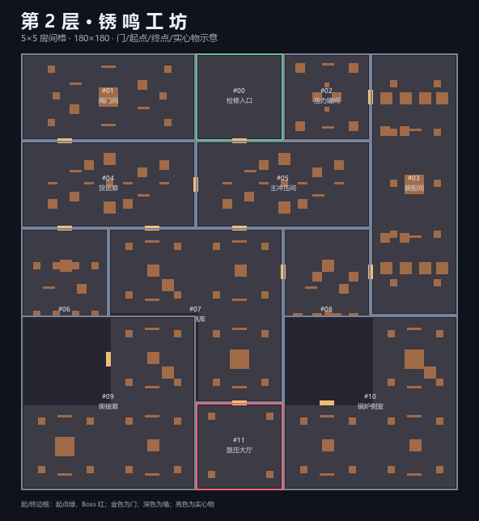

| # | 房间 | 角色 / 房型 | 门 | 实心物 / 覆盖率 | 示意图 |
| ---: | --- | --- | ---: | ---: | --- |
| 00 | 检修入口 | 起始 / 1×1 | 1 | 0 / 0.0% | [打开](Images/房间示意图-20261114/floor2-room00-start-single.png) |
| 01 | 阀门间 | 中间 / 1×2 | 1 | 13 / 7.4% | [打开](Images/房间示意图-20261114/floor2-room01-middle-line2.png) |
| 02 | 压力罐间 | 中间 / 1×1 | 1 | 10 / 9.9% | [打开](Images/房间示意图-20261114/floor2-room02-middle-single.png) |
| 03 | 装配间 | 中间 / 1×3 | 2 | 25 / 12.3% | [打开](Images/房间示意图-20261114/floor2-room03-middle-line3.png) |
| 04 | 货运廊 | 中间 / 1×2 | 4 | 15 / 7.8% | [打开](Images/房间示意图-20261114/floor2-room04-middle-line2.png) |
| 05 | 主冲压间 | 中间 / 1×2 | 3 | 15 / 7.8% | [打开](Images/房间示意图-20261114/floor2-room05-middle-line2.png) |
| 06 | 蒸汽回廊 | 中间 / 1×2 | 2 | 18 / 8.7% | [打开](Images/房间示意图-20261114/floor2-room06-middle-line2.png) |
| 07 | 工具库 | 中间 / L 形 | 4 | 22 / 8.2% | [打开](Images/房间示意图-20261114/floor2-room07-middle-l.png) |
| 08 | 活塞庭 | 中间 / 1×2 | 3 | 14 / 6.7% | [打开](Images/房间示意图-20261114/floor2-room08-middle-line2.png) |
| 09 | 铆接廊 | 中间 / L 形 | 1 | 22 / 8.2% | [打开](Images/房间示意图-20261114/floor2-room09-middle-l.png) |
| 10 | 锅炉侧室 | 中间 / L 形 | 1 | 22 / 8.2% | [打开](Images/房间示意图-20261114/floor2-room10-middle-l.png) |
| 11 | 鼓压大厅 | Boss / 1×1 | 1 | 4 / 3.1% | [打开](Images/房间示意图-20261114/floor2-room11-boss-single.png) |

### #00 检修入口

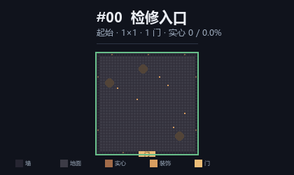

### #01 阀门间

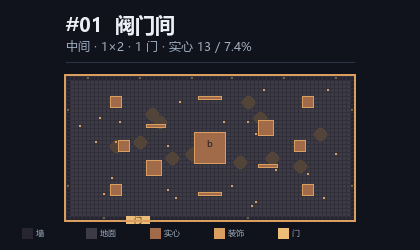

### #02 压力罐间

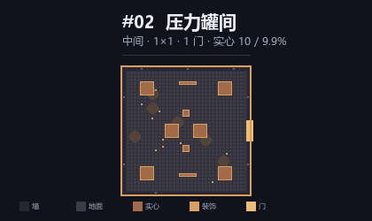

### #03 装配间

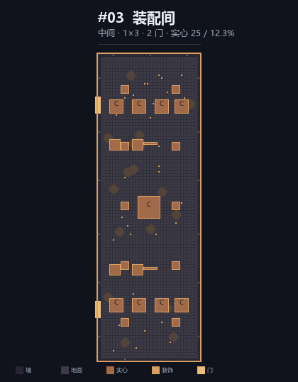

### #04 货运廊

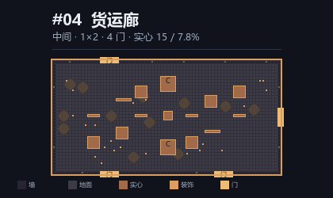

### #05 主冲压间

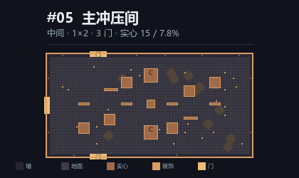

### #06 蒸汽回廊

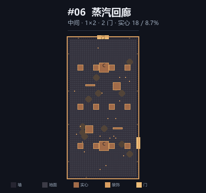

### #07 工具库

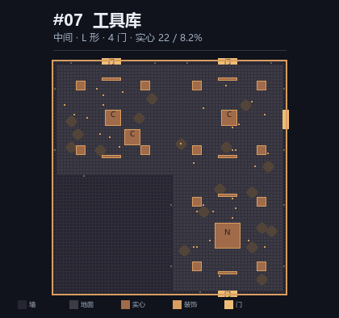

### #08 活塞庭

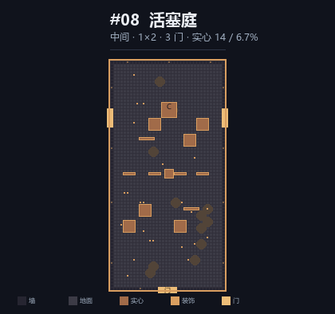

### #09 铆接廊

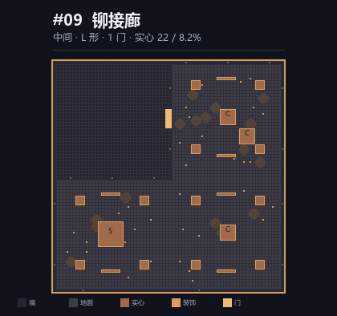

### #10 锅炉侧室

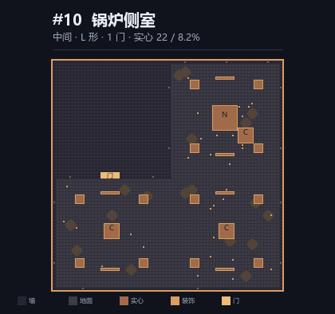

### #11 鼓压大厅

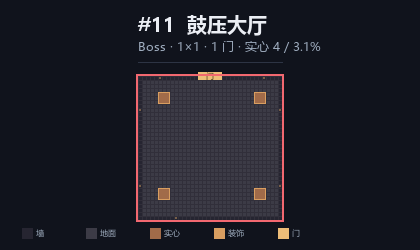

## 第 3 层 · 原 音 圣 所

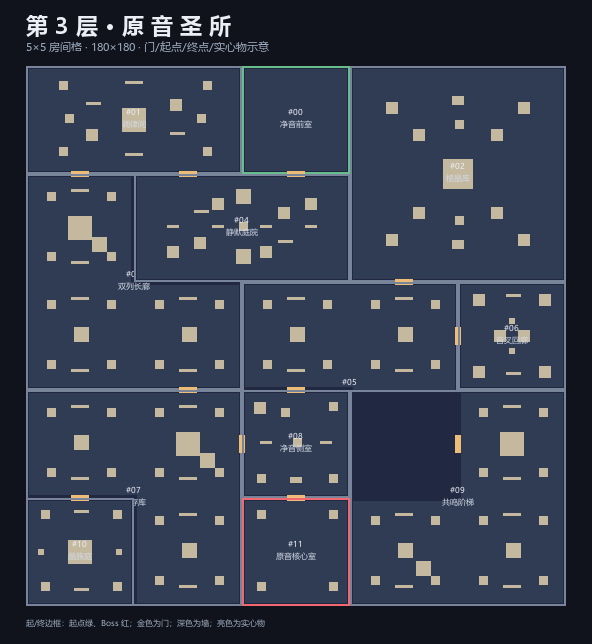

| # | 房间 | 角色 / 房型 | 门 | 实心物 / 覆盖率 | 示意图 |
| ---: | --- | --- | ---: | ---: | --- |
| 00 | 净音前室 | 起始 / 1×1 | 1 | 0 / 0.0% | [打开](Images/房间示意图-20261114/floor3-room00-start-single.png) |
| 01 | 调律间 | 中间 / 1×2 | 2 | 13 / 7.4% | [打开](Images/房间示意图-20261114/floor3-room01-middle-line2.png) |
| 02 | 棱晶库 | 中间 / 2×2 | 1 | 13 / 5.8% | [打开](Images/房间示意图-20261114/floor3-room02-middle-square2.png) |
| 03 | 双列长廊 | 中间 / L 形 | 2 | 22 / 8.2% | [打开](Images/房间示意图-20261114/floor3-room03-middle-l.png) |
| 04 | 静默庭院 | 中间 / 1×2 | 2 | 15 / 7.8% | [打开](Images/房间示意图-20261114/floor3-room04-middle-line2.png) |
| 05 | 环声前厅 | 中间 / L 形 | 4 | 22 / 8.2% | [打开](Images/房间示意图-20261114/floor3-room05-middle-l.png) |
| 06 | 音叉回廊 | 中间 / 1×1 | 1 | 10 / 9.9% | [打开](Images/房间示意图-20261114/floor3-room06-middle-single.png) |
| 07 | 封存库 | 中间 / L 形 | 3 | 22 / 8.2% | [打开](Images/房间示意图-20261114/floor3-room07-middle-l.png) |
| 08 | 净音侧室 | 中间 / 1×1 | 3 | 9 / 6.7% | [打开](Images/房间示意图-20261114/floor3-room08-middle-single.png) |
| 09 | 共鸣阶梯 | 中间 / L 形 | 1 | 22 / 8.2% | [打开](Images/房间示意图-20261114/floor3-room09-middle-l.png) |
| 10 | 晶簇庭 | 中间 / 1×1 | 1 | 9 / 10.2% | [打开](Images/房间示意图-20261114/floor3-room10-middle-single.png) |
| 11 | 原音核心室 | Boss / 1×1 | 1 | 4 / 3.1% | [打开](Images/房间示意图-20261114/floor3-room11-boss-single.png) |

### #00 净音前室

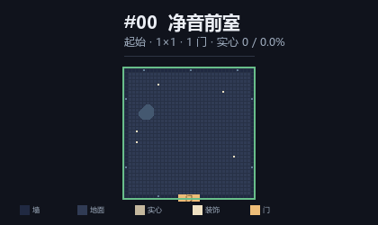

### #01 调律间

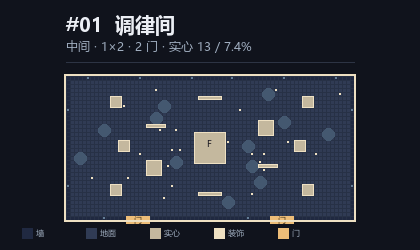

### #02 棱晶库

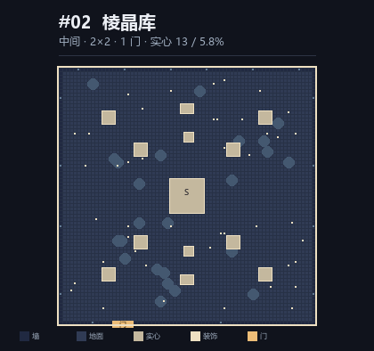

### #03 双列长廊

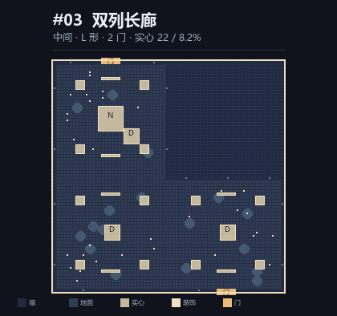

### #04 静默庭院

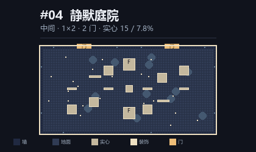

### #05 环声前厅

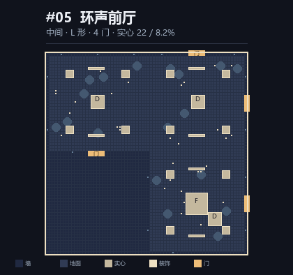

### #06 音叉回廊

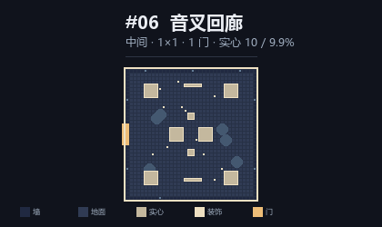

### #07 封存库

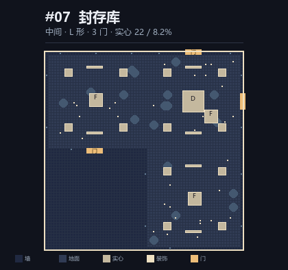

### #08 净音侧室

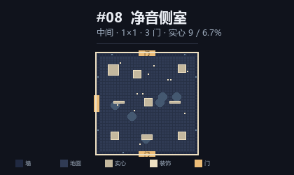

### #09 共鸣阶梯

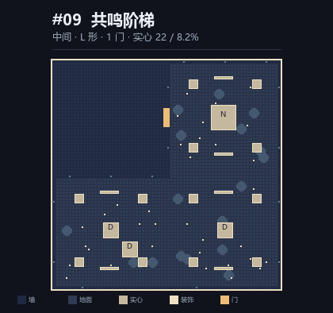

### #10 晶簇庭

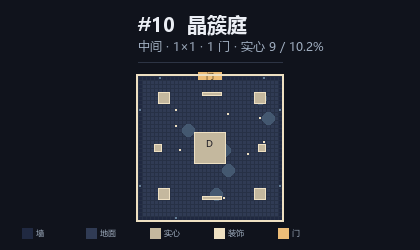

### #11 原音核心室

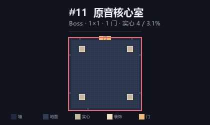

