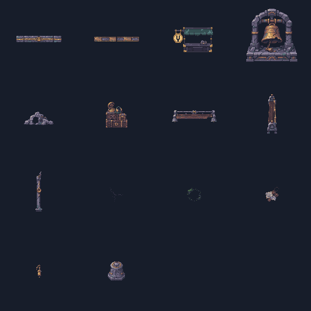
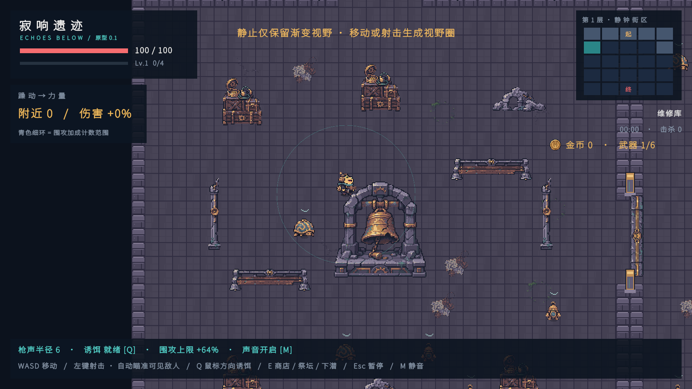
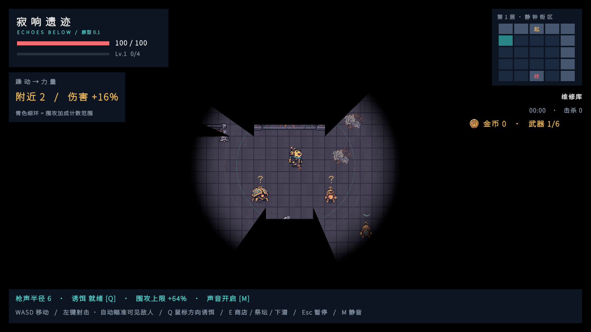

# 第一层房间美术与碰撞接入

## 功能与交付

修复 P0 图片缩放重复乘入碰撞的问题；第一层接入 13 类房间资产，另含一张纵向长椅，共 14 张游戏 PNG。共用 3 类、第一层 9 类、第一层 Boss 柱 1 类；第二、三层主题大件仍保留 P0。

- 静钟街区使用破钟拱架、维修货箱、石腿木座候车椅、带铜管的断柱、低矮碎石与钟形竞技场柱。材质与轮廓分别设计，房间组合区分钟架庭院、货箱通道与断柱场地。
- 贴花为裂缝、潮湿苔藓、旧站票据与暗铜代币，不使用亮金拾取色。壁灯保持低亮度，地面装饰没有碰撞。
- 门楣为纯顶视低矮石梁顶盖、门槛为平面金属条，两者可旋转用于横竖门洞；立体物保持直立；长椅横纵分别绘制；壁灯本批仅挂北墙。
- 摊位与并行完成的三层共用摊位接入共用同一路径，图形与 5×3 占地由 `StartStall` 统一；它的正式来源及柜台交互见 `036-三层出生房正式补给摊位.md`。本目录的另一张摊位原图只作设计备选，导出工具不会覆盖正式共用图。

## 素材与参考

- 原图、逐张完整提示词与预览：`美术/房间资源-第一层-20261114/`。使用内置 `image_gen`，每张独立生成，保留原始透明图。`sources.json` 记录提示词；`RoomArtPreparation` 仅做透明边界裁切、最近邻取样、固定画布与有限调色板的技术导出。
- 风格参考：仓库 `美术/世界观风格-20261113/01-共鸣遗城-战斗场景.png` 的破钟、铜锈和维修用品；检视了本地 Pixel Crawler 的 `Furniture.png`、`Rocks.png`、`Dungeon_Props.png`，本批主题大件单独新绘。
- 外部参考仅用于类目与陈设思路：[Anokolisa 原生 16 像素环境包](https://anokolisa.itch.io/free-pixel-art-asset-pack-topdown-tileset-rpg-16x16-sprites)、[车站候车室道具](https://falvey.itch.io/railway-waiting-room-10-32x32-pixel-waiting-room-props)。没有下载外部资产加入项目。

## 相关文件与编辑器配置

- `Assets/Echoes/Scripts/World/RoomArt.cs`：14 张资源的路径、原生画布与碰撞脚底；`GameArt.cs` 对房间图片严格加载，缺图报错。
- `RoomLayouts.cs`：第一层原生布局、贴花与北墙壁灯；`DungeonMap.cs`：门结构、占地与物理碰撞。碰撞尺寸和偏移都除以精灵缩放，世界碰撞始终保持配置格数。
- `Assets/Echoes/Editor/ProductionArtImporter.cs`：独立 Single Sprite，16 PPU、Point、Clamp、无 mipmap、无压缩。普通实体 pivot 为 `(0.5,0.125)`，摊位为 `(0.5,0)`，平面门结构/贴花为中心。
- `Assets/Echoes/Editor/RoomArtPreparation.cs`：菜单 **Echoes > Art > Prepare First Floor Room Sprites**；运行后生成原生 PNG 和预览。三层共用摊位由它的专用流程维护。
- `Assets/Echoes/Resources/Art/Room/`：正式图片及 Unity `.meta`，原 `props.png` 切片保持兼容。
- `Docs/033` 不再保留与执行表冲突的小尺寸提案；`Docs/034` 为唯一清单，补齐朝向、变体及漏算的 3 件中型资产。

## 验证方法

Unity 2022.3.62f3c1，原生导出编译与导入；PlayMode 定向检查 `RoomPropPhysicsTests`、`FirstFloorRoomArtTests`、`FloorGenerationTests`、`ShopTests` 和 `ObstacleVisibilityTests`。

- 碰撞检查比较真实 BoxCollider2D 世界范围与地图阻挡格，覆盖第一层 Scale=1 和第二层 P0 缩放。
- 美术检查确认每张原生尺寸、16 PPU、Point、实际使用、直立朝向、门结构数量及唯一摊位；场景截图来自推进中的真实游戏。
- 商店回归从正式柜台前操作；空矩形墙面测试显式清除测试夹具内家具的遮挡，保留原有墙角断缝断言，实际掩体遮挡另测。
- 连通性测试覆盖多种种子、三层过渡与玩家状态保留；原生大件占地、出生点和门口按实际布局校验。

19 项相关用例已分次通过：碰撞/地图/遮挡的 11 项通过后，商店与美术 8/8 通过；补齐 Square2 截图后的最新美术用例 1/1 通过。没有重复运行未受影响的 EditMode 全套。原生资源导出编译与导入通过，`git diff --check` 通过。

seed 713 的已截图中间房样本：Single 12.46%、Line2/Line3 10.73%、L 10.38%。Square2 使用另一个实际生成种子单独补图，空场景用于检查美术摆放；这些数据不是完整人工战斗平衡结论。

截图目录：`Docs/Images/第一层房间美术-20261114/`，包含起始房、Single、Line2、Line3、L、Square2、Boss 与正常视野共 8 张。

## 已知边界

- 13 是资产类别数，方向变体另外计数；第一层 14 张，后续另外两层尚未制作。
- 壁灯未制作南/东/西墙版本；不能将当前正面灯直接侧倒贴墙。
- 第一层布局密度属于初调，图片本身不会提高碰撞覆盖率；完整人工战斗节奏仍需试玩。
- 明亮截图仅用于材质与摆放检查；另附正常黑暗视野截图，正式游戏保留声音与遮挡规则。本轮不生成 EXE。
