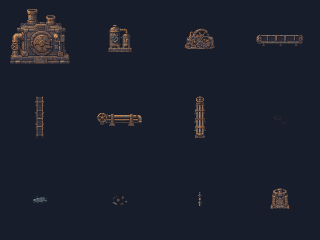
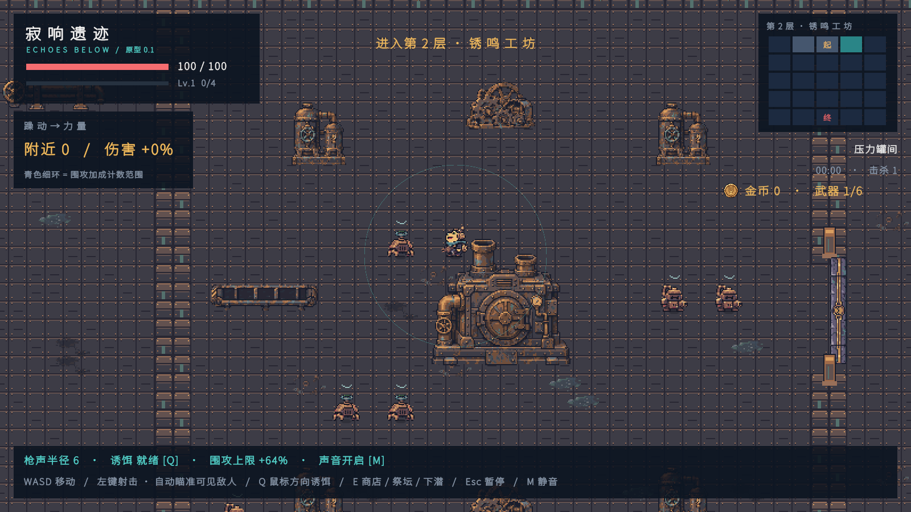
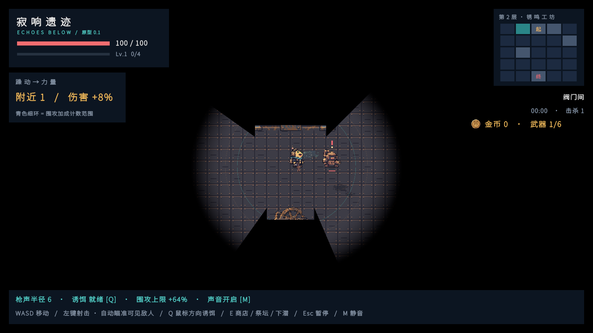

# 第二层工坊美术资源接入

## 功能与交付

锈鸣工坊的 10 类主题资产全部制作并接入；传送带、管道组各附独立纵向图，共 12 张原生 PNG。复用已有共用门楣、门槛和正式摊位；第三层主题道具仍是 P0。

| 内容 | 原生画布 | 实心脚底 |
| --- | --- | --- |
| 方壳锅炉机岛 | 128×128 | 6×6 |
| 双压力罐 | 64×64 | 4×4 |
| 齿轮废堆 | 64×48 | 4×3 |
| 横/纵传送带 | 96×32 / 32×96 | 6×1 / 1×6 |
| 横/纵铜管组 | 96×32 / 32×96 | 5×1 / 1×5 |
| 油迹、冷却液、金属屑 | 各 32×32 | 无 |
| 墙管与压力表 | 16×32 | 无 |
| Boss 房铸铁支柱 | 48×48 | 3×3 |

造型参考仓库 `美术/三层美术风格-20261113/01-第二层-锈鸣工坊-场景.png`，使用炭灰方壳、铆钉、锈褐铁件、氧化铜管和低亮度表盘。锅炉、圆罐、废齿轮与低矮带式生产线分别设计剪影；沿用左上光源与固定俯视 3/4 视角。

中间房使用锅炉机岛、双罐工位与破损传动组，沿房间长轴选横/纵生产线；Boss 房仅放四角支柱，中央保持开放。油迹与冷却液只是装饰，传送带为静态实心掩体。

## 资源与相关文件

- 正式 PNG：`Assets/Echoes/Resources/Art/Room/Floor2/`，支柱在 `Room/Boss/f2_boss_pillar_48x48.png`，均包含 Unity `.meta`。
- 生成原图、完整逐张提示词、原生尺寸预览：`美术/房间资源-第二层-20261114/`。使用内置 `image_gen`，每张独立生成透明图；`sources.json` 为完整提示词集。原图保留，技术导出使用现有 Unity 工具完成。
- `RoomArt.cs`：12 张图的资源路径、原生画布和碰撞配置，新增按楼层筛选，避免第一层预览混入其他层资源。
- `RoomArtPreparation.cs`：共用技术导出流程，第二层使用独立铁锈/钢板调色板；先裁透明边界，再最近邻取样、硬透明与固定画布，不重绘第一层图片。
- `RoomLayouts.cs`：第二层原生布局，所有实体保持 Scale=1；北墙管线和低对比地面贴花独立布置。`DungeonMap.cs` 让第二层复用已交付的共用门结构。
- `SecondFloorRoomArtTests.cs`：通过正常击败第一层 Boss 并下潜进入第二层，验证实际使用、碰撞、挡弹、柜台路径及截图。
- `RoomPropPhysicsTests.cs`：剩余 P0 缩放回归移到第三层；`FirstFloorRoomArtTests.cs` 只枚举第一层目录。

## 编辑器配置与朝向

- 菜单 **Echoes > Art > Prepare Second Floor Room Sprites** 导出并导入本层 12 张图，同时生成预览；完整三层制作清单仍以 Docs/034 为准。
- 沿用 Single Sprite、16 PPU、Point、Clamp、无压缩、无 mipmap。实心道具和墙管 pivot 为 `(0.5,0.125)`，贴花为中心；实体和原生 PNG 均硬透明。
- 机器、罐、齿轮和支柱保持直立；横竖传送带/管组分别绘制，不旋转立体精灵。墙管本批只挂北墙；共用门顶盖和门槛是平面图，按原规则旋转适配门洞。

## 验证与截图

Unity 2022.3.62f3c1，原生导出编译和导入通过。PlayMode 定向运行第二层美术、第一层美术、物理占格与地图生成/切层，共 **9 项通过、0 失败**，结果为 `TestResults/floor2-art.xml`（不提交测试日志）。

- 12 张图均由正常第二层地图实际加载，尺寸/PPU/过滤正确，实体全部 Scale=1 且直立。
- 真正的 BoxCollider2D 世界范围与阻挡格一致；压力罐遮挡视线并拦下实际 Projectile；柜台与房间之间有可行路径。
- seed 713 第二层 10 个中间房实心覆盖率约 **10.76%–11.74%**；六个种子的地图生成耗时 **121–162 ms**，含三层主题混合检查。
- 第一层资源回归、第三层 P0 缩放和三层切换检查通过；五种第二层房型、起始/Boss 与正常黑暗视野共 8 张截图来自推进中的实际运行。

## 已知边界

壁挂管线未制作其他墙向；传送带、油迹和冷却液没有新增运动或伤害机制。明亮截图用于美术摆放核对，正式游戏仍启用黑暗遮罩与声音视野。本轮没有生成 EXE；完整人工战斗平衡尚需试玩。
