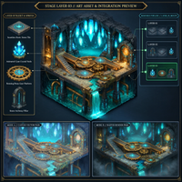
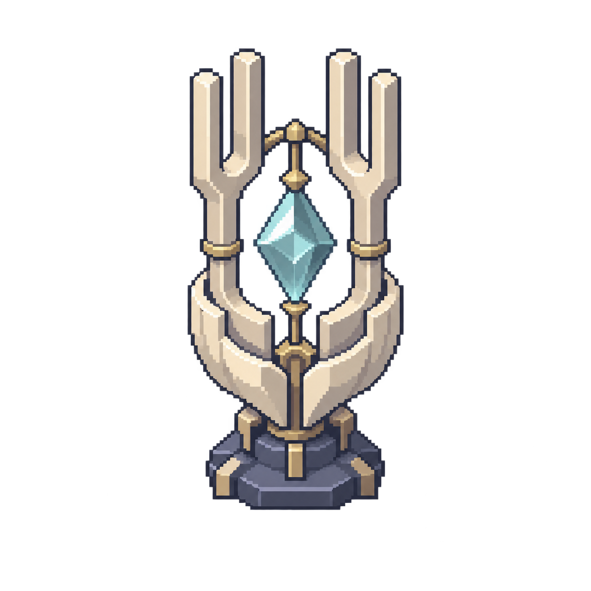

# 第三层主景双工具样图对比

本轮按用户要求先比较 Canva 与内置 image_gen 的一张主景样图，主体为第三层原音圣所的音叉神龛。第三层整套制作与接入待用户选定效果后继续。

## 共用美术规格

象牙白分瓣陶壳、双音叉臂、冷青菱晶、少量暗金连接件及深蓝灰基座；目标 128×128 原生像素、16 PPU，预留 6×6 格碰撞底座和底边 16 像素脚底基准。固定俯视 3/4、非等距、左上光源、透明背景，单体居中。

## 两版结果

- A：Canva 两次均返回带场景、文字与界面的展示板，未满足独立透明物件要求。[首版](https://www.canva.com/M/MAHa3cXo7vc?utm_source=OC-AaBlKrqBJJNF&utm_campaign=agent_connector_create_image_asset_opened)；[第二版原图](https://www.canva.com/M/MAHa3Wsr-qA?utm_source=OC-AaBlKrqBJJNF&utm_campaign=agent_connector_create_image_asset_opened)。本地 A 图为插件返回的预览图，原图通过 Canva 链接查看。
- B：内置 image_gen 返回独立透明神龛，保留直立双音叉、菱晶与陶壳轮廓。原始生成图已保存，后续选定后再进行原生尺寸技术导出与脚底校正。
- 就本轮输出而言，B 更接近当前游戏单体资源的用途；最终风格由用户选择。

## 文件与验证

图片与完整生成规格保存在 `美术/第三层方案对比-20261114/`，Canva 的原始用户请求、两次 user_intent 与结果链接，以及 image_gen 提示词记录在 `生成规格与结果.json`。

已视觉核对两版输出的主体、构图和单体资源适用性。本轮为样图比较，没有 Unity 编辑器配置变更，不运行游戏测试。
