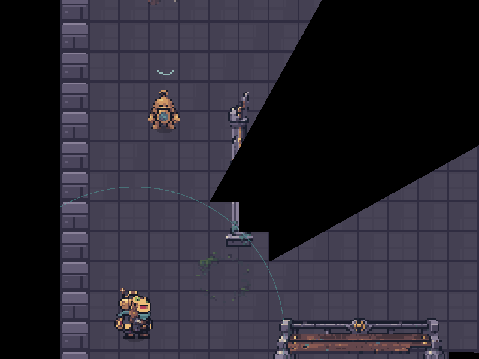
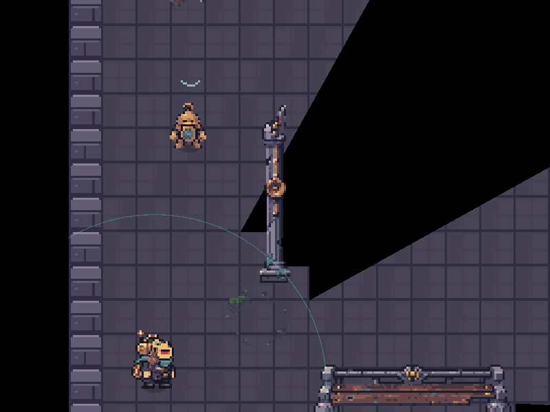
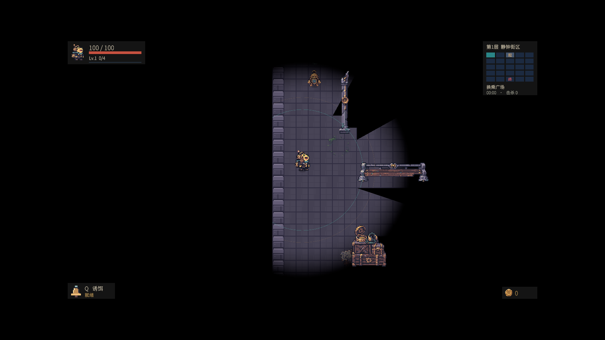
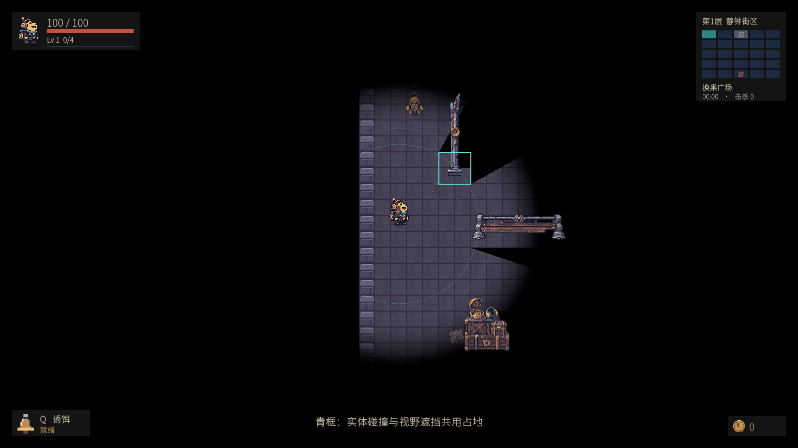
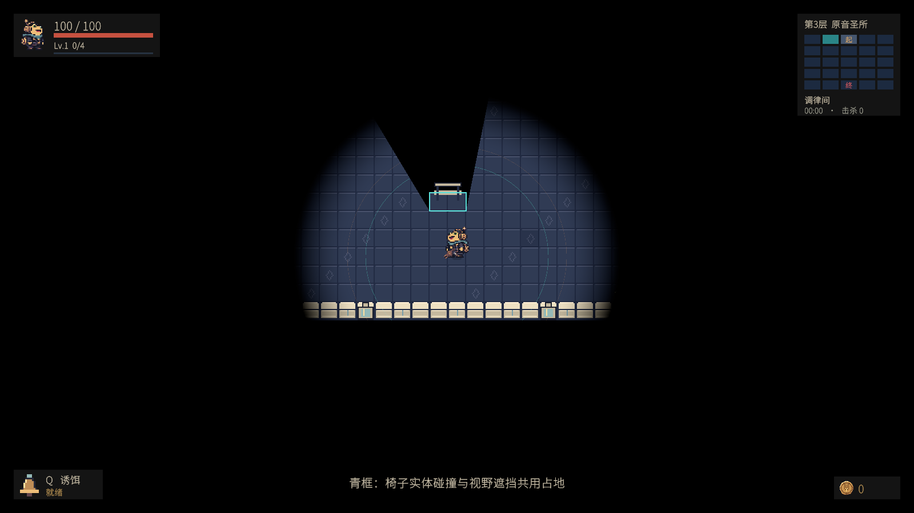

# 障碍占地与精灵遮挡一致性修复

## 原因

- 移动碰撞的 `BoxCollider2D` 与视野遮挡网格都来自 `RoomPropSpec.Width/Height`，二者使用相同占地。
- 旧 P0 椅子图片画布宽 2 单位，但部分布局预留了 4～6 单位；空白来自布局尺寸超过图片尺寸。正式 P1 长椅图片宽 6 单位，对应的 6 单位占地合理。
- 红框中的截断属于另一处问题：高物体的上半部高于脚底占地，黑幕把图片所在位置当作地面位置，导致物体被自身脚底投射的阴影裁掉。之前只检查墙面连通性，遗漏了高物体的实际图片像素。

## 修改

- 旧椅子占地宽度限制为图片画布宽度向上取整：默认 2 单位，1.2 倍缩放为 3 单位；物理碰撞与视野网格同步使用修正后的布局尺寸。
- 为静态障碍生成透明度精确到图片像素的表面占地映射。可见物体的不透明像素依据其真实脚底占地判断视线，不再被自己的地面阴影裁切；透明孔隙及后方地面继续使用原有遮挡。
- 映射直接读取当前生成楼层的根节点，避免连续换层时误读等待销毁的旧楼层，或把黑幕本身写入映射。
- 保留原有墙面、门洞的视线算法以及正式长椅尺寸。

## 相关文件

- `Assets/Echoes/Scripts/World/RoomLayouts.cs`：旧椅子尺寸修正。
- `Assets/Echoes/Scripts/World/DungeonMap.cs`：向映射生成器提供当前楼层根节点。
- `Assets/Echoes/Scripts/World/PropSurfaceMap.cs`、`Assets/Echoes/Resources/PropSurfaceMap.shader`：静态精灵表面与真实碰撞占地的映射。
- `Assets/Echoes/Scripts/World/DungeonVisibility.cs`、`Assets/Echoes/Resources/DungeonDarkness.shader`：按表面归属计算物体可见性，并管理映射生命周期。
- `Assets/Echoes/Tests/PlayMode/PropOcclusionTests.cs`：实际场景、连续换层与图片像素回归检查。

## 编辑器配置

无需修改场景或 Inspector。映射随楼层自动重建并释放，分辨率为每单位 16 像素；180×180 地图对应约 32 MiB 的单张 GPU 映射。占地仍使用整数网格，图片与占地间可能保留不足一格的取整余量。

## 验证

在 Unity PlayMode 中加载实际 `Prototype` 场景，使用真实美术、碰撞器和黑幕进行截图与像素对照；青框仅由验收测试临时绘制，表示物理碰撞和视野遮挡共用的占地。

- 修复前：高柱 173 个有效不透明采样点中，74 个被错误裁黑。
- 修复后：高柱 173 个采样点错误裁黑 0 个；133 个处于地面阴影内的透明采样点漏光 0 个。
- 连续两次实际换层后，旧椅子 56 个有效采样点错误裁黑 0 个；布局占地不再超过图片画布向上取整后的宽度。
- 本轮覆盖 10 个相关用例：物体碰撞、墙面/门洞视线、实机场景截图与两项新增回归检查。修复过程中分批通过，最后一次运行的两项新增回归均通过。没有生成可执行文件。

截图直接来自游戏渲染，未修改图片内容。旧椅子截图记录了本轮验收时仍使用 P0 布局的第三层；其他任务后续替换该层美术时，应同步调整对应测试夹具。

## 截图

修复前的高柱截断：

同位置修复后的像素检查：

正常视野范围下的实机画面：

高柱的共用占地：

旧椅子收窄后的共用占地，椅背仍完整显示：

