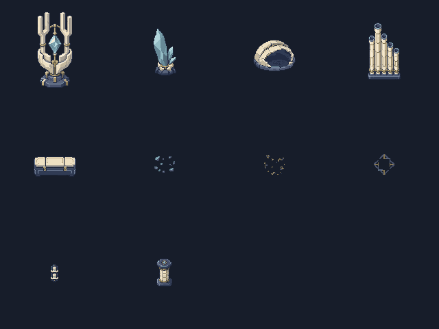
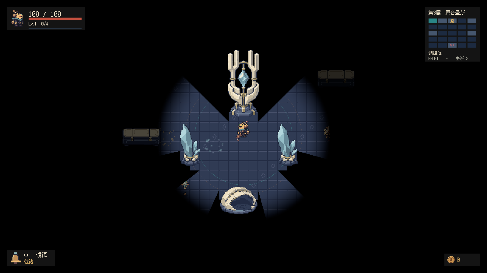

# 第三层原音圣所美术接入

## 交付与风格

第三层 10 类 P1 资源全部制作、按原生画布导出并接入。音叉神龛直接沿用 `美术/第三层方案对比-20261114/B-imagegen-音叉神龛.png`，仅裁透明边界、缩小和限色，不重新生成或改变比例。其余九类由内置 **image_gen** 独立生成；每件原图和完整提示词保存在 `美术/房间资源-第三层-20261114/原始图/` 与 `sources.json`。

材质统一为象牙白分瓣陶壳、冷青晶体、少量暗金连接件、深蓝灰底座。晶簇为尖锐不对称轮廓，陶壳为低矮中空曲面，管风琴为阶梯式直立管列，封存匣为扁平封闭箱体，支柱为短柱；三种贴花保持稀疏低对比，壁架只挂北墙。固定俯视 3/4、左上光源，不旋转或镜像立体素材；本批不需要其他墙向或管列朝向。

| 类别 | 原生画布 | 实心脚底 |
| --- | --- | --- |
| 音叉神龛（选定 B 图） | 128×128 | 3×2 |
| 晶簇 | 64×80 | 2×2 |
| 白瓷壳 | 64×64 | 4×3 |
| 管风琴管组 | 64×96 | 3×1 |
| 封存匣 | 64×48 | 4×2 |
| 晶屑 / 金屑 / 几何嵌线 | 各 32×32 | 无 |
| 墙面封存架 | 16×32 | 无 |
| Boss 房支柱 | 48×48 | 1×1 |

画布尺寸遵循 Docs/034；碰撞从前期估计值改为成图的实际底座。尤其 B 图是高窄立物，不把 128×128 画布或整幅高处轮廓作为 6×6 实心区域。密度通过中型物件补足，所有实体保持 Scale=1。

## 相关文件与编辑器配置

- 正式资源：`Assets/Echoes/Resources/Art/Room/Floor3/` 的九张 PNG，以及 `Room/Boss/f3_boss_pillar_48x48.png`；均包含 Unity `.meta`。
- `RoomArt.cs`：十件资源的路径、画布与脚底配置。既有 `ProductionArtImporter` 自动按 Single Sprite、16 PPU、Point、Clamp、无压缩/无 mipmap 导入；实体与壁架 pivot `(0.5,0.125)`，贴花中心。
- `RoomArtPreparation.cs`：菜单 **Echoes > Art > Prepare Third Floor Room Sprites**。最近邻缩小、第三层有限调色板、Alpha 180 阈值；细线贴花按源像素覆盖补齐漏采样，最终 Alpha 仅 0/255。
- `RoomLayouts.ThirdFloor.cs`：五种房型的圣所布局。每个中间房一个神龛焦点，其余格使用陶壳、封存匣、晶簇与独立管列；起始房保留共用摊位，Boss 房仅四角支柱与原祭坛。
- `RoomLayouts.cs`、`DungeonMap.cs`：第三层分支与共用门结构接入。既有占格、门口净空和连通检查继续生效。
- `PropSurfaceMap` 与 `DungeonDarkness`：复用已有的逐像素道具归属与脚底视线规则；神龛和管列的高处不被自身压黑，透明空隙不泄露背后地面。没有修改这两套渲染实现。
- `ThirdFloorRoomArtTests.cs`：正常入口连续击败前两层 Boss 后下潜，验证资源、格子/物理、路径、挡弹、五种房型与最终胜利，保存实际游戏画面。
- `RoomPropPhysicsTests.cs`、`PropOcclusionTests.cs`：更新已经不存在的第三层 P0 假设，覆盖三层原生物件及管列上部显示。

## 验证与截图

Unity 2022.3.62f3c1 编译、导出和导入通过。PlayMode 定向测试 **7 项通过、0 失败**：第三层美术 2 项、三层物理占格 1 项、道具遮挡 2 项、多种子连通 1 项、三层状态保留与最终胜利 1 项。报告 `TestResults/floor3-art.xml`（不提交）。

完整房型全景和结算演出结束后的截图，另由同一截图用例补拍，结果 `TestResults/floor3-captures.xml`，1 项通过、0 失败。

- 实际地图使用全部 10 类，尺寸/PPU/pivot/Point/无 mipmap/硬透明正确，实体均不旋转、不放大。
- 所有实体脚底与不可走格匹配，全部房间和柜台有路径。白瓷壳挡住视线、实际 Raycast 和 Projectile；四根 Boss 柱全部存在。
- 默认 seed 713 中间房实心覆盖率 **10.03%–10.94%**；六个混合楼层种子的生成用时 **125–153 ms**。
- 管风琴 705 个不透明采样点没有被自身裁黑；既有高柱回归 173 点无裁切、133 个阴影空隙无漏光。
- 三层切换保留原角色、武器和金币，第三层 Boss 受伤死亡后进入 `Won`。这是自动流程验收，通过调用现有伤害入口击败 Boss，不代表人工战斗平衡试玩。
- 截图来自正在推进的正常入口场景，1600×900。五种房型和 Boss 图临时关闭黑暗、缩放同一游戏相机以显示完整布局；起始房与正常视野图使用原相机缩放和真实黑暗，最终胜利图等待现有结算演出完成。缺失房型由另外的第三层种子补拍。

[起始房](Images/第三层原音圣所-20261114/01-start.png) · [1×1](Images/第三层原音圣所-20261114/02-Single.png) · [1×2](Images/第三层原音圣所-20261114/02-Line2.png) · [1×3](Images/第三层原音圣所-20261114/02-Line3.png) · [2×2](Images/第三层原音圣所-20261114/02-Square2.png) · [L 形](Images/第三层原音圣所-20261114/02-L.png) · [Boss 房](Images/第三层原音圣所-20261114/03-boss.png) · [最终通关](Images/第三层原音圣所-20261114/05-victory.png)

## 已知边界

本轮只制作场景素材、布局与对应验收，不新增机制、角色或怪物资源。壁架只支持北墙；管列全部保持正立。没有生成 EXE，工作区其他任务的 HUD、地图探索历史、字体与场景改动保留。
