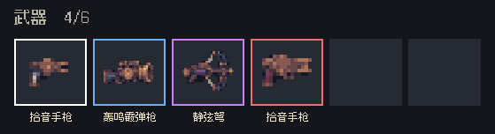

# 045 结算武器品质框

胜利与失败结算中的武器槽采用 2 像素直角边框。白、蓝、紫、红分别对应Ⅰ至Ⅳ档品质。图标在框内居中，名称位于框下，空槽呈深灰底。设计参考了《魔兽世界》用物品图标边框表示品质的做法。[暴雪官方界面说明](https://worldofwarcraft.blizzard.com/en-gb/news/16279304/the-iron-tide-602-patch-notes)

## 实现与编辑器配置

`Assets/Echoes/Scripts/UI/GameHud.Result.cs` 中的 `DrawResultEquipment` 运行时构建边框，并通过 `ShopController.TierColor` 读取武器品质色。无需配置场景或导入美术素材。

## 验证与已知限制

在 Unity PlayMode 中带上四档武器、留出两个空槽，分别进入失败和胜利结算，检查边框颜色、四边宽度、图标居中与空槽状态。已在 1600 × 900 验证通过。其他分辨率的实际线宽随 Canvas 缩放。
