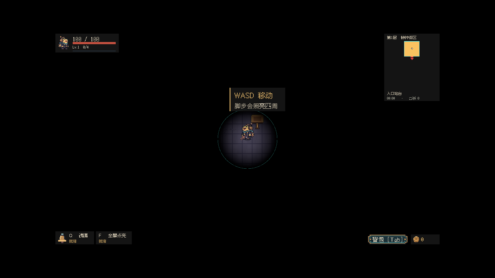
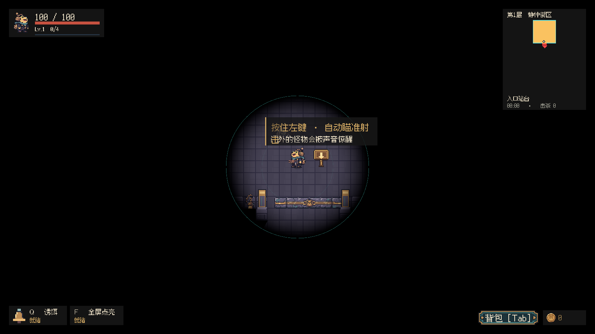

# 第一关出生房路牌

出生点旁的木牌提示 WASD 移动和脚步照明。出口牌位于门内侧，保留方向箭头，提示左键自动瞄准射击与声音惊醒敌人。两处文字显示在木牌上方。玩家靠近即可阅读，走远自动收起，商店继续使用 E 键交互。

## 相关文件与配置

- `Assets/Echoes/Scripts/World/DungeonMap.cs` 根据第一关出生位置和门洞生成两块无碰撞路牌。
- `Assets/Echoes/Scripts/UI/GameHud.cs` 管理显示距离、文案及世界空间面板。场景和 Inspector 无需额外配置。

## 验证

Unity 2022.3.62f3c1 的 PlayMode 用例 `RuntimeSmokeTests.FirstFloorSignsFollowPlayerProximity` 已通过，覆盖出生静止、靠近出口和离开房间。下图取自该用例中的游戏相机，出口画面包含一次脚步声波。

## 已知限制

此次截图使用默认地图种子，其他出口朝向未逐一截图。
