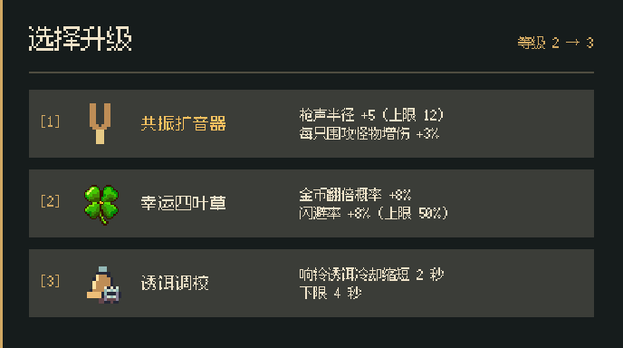

# 升级卡百分比文案

共振扩音器的围攻增伤显示为「每只围攻怪物增伤 +3%」。幸运四叶草分两行显示「金币翻倍概率 +8%」和「闪避率 +8%（上限 50%）」。

文案位于 `Assets/Echoes/Scripts/Progression/UpgradeDefinition.cs`，沿用升级面板的文本框和字号，无需编辑器配置。在 Unity PlayMode 进入等级 2 升 3 的面板，固定与参考图相同的三张卡截图；两行说明均完整显示。

