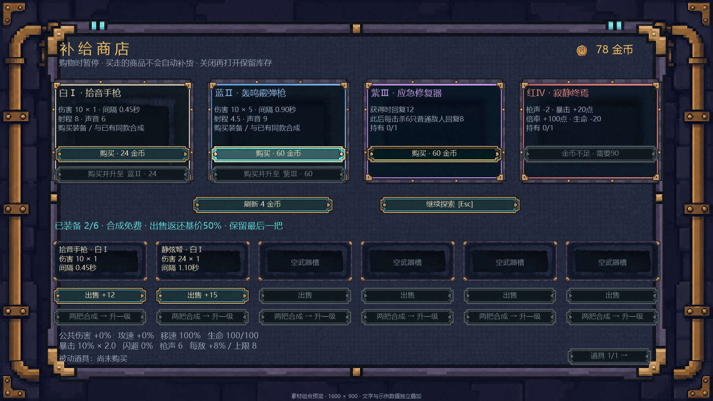

# 商店界面素材清单与导入建议

本轮清单经用户确认：背景1张、主面板1张、四品质商品卡底4张、可复用武器槽底1张、通用按钮四状态4张、金币图标1张，共12张游戏用PNG，另附1张组合预览。三种武器、24件被动道具、地图摊位与金币掉落实体不在本次制作范围。

风格依据：项目现有第一层正式美术、世界观参考、`TestResults/22-shop.png` 与 `GameHud.Shop.cs`。沿用靛紫石材、氧化青绿、黄铜、琥珀与青色指示灯；四品质依次白Ⅰ、蓝Ⅱ、紫Ⅲ、红Ⅳ。界面基准为1600×900、16:9，对应现有CanvasScaler和窗口设置。

## 成品清单

以下路径相对于 `D:\NGJ\美术\商店界面素材-20261114\`。所有尺寸均为实际PNG画布像素。

| 文件路径 | 尺寸 | 建议用途 |
| --- | --- | --- |
| `背景/shop_background.png` | 1600×900 | 全屏静态商店背景；石墙、边缘管道和灯属于固定背景装饰 |
| `面板/shop_main_panel.png` | 1440×864 | 主容器背板；保留四周边框与上缘青色指示灯，中央低对比织纹供文字叠加 |
| `面板/shop_offer_tier1_white.png` | 334×250 | 白Ⅰ商品卡底 |
| `面板/shop_offer_tier2_blue.png` | 334×250 | 蓝Ⅱ商品卡底 |
| `面板/shop_offer_tier3_purple.png` | 334×250 | 紫Ⅲ商品卡底 |
| `面板/shop_offer_tier4_red.png` | 334×250 | 红Ⅳ商品卡底 |
| `面板/shop_weapon_slot.png` | 218×100 | 六个武器栏共用的底图；武器名、属性、空槽提示分别叠加 |
| `按钮/shop_button_normal.png` | 320×44 | 购买、购买合成、刷新、继续、出售、合成、翻页等已有操作的普通底图 |
| `按钮/shop_button_hover.png` | 320×44 | 同一按钮的悬停状态，青色内边缘高亮 |
| `按钮/shop_button_pressed.png` | 320×44 | 同一按钮的按下状态，深色凹面与下缘高光 |
| `按钮/shop_button_disabled.png` | 320×44 | 余额不足、已售出、不能合成等情况下的禁用底图 |
| `图标/shop_gold_coin.png` | 32×32 | 商店余额、价格旁的独立音叉金币图标 |
| `预览/shop_composite_preview.png` | 1600×900 | 组合检查图；使用上述成品实际排版，文字与示例数值仅叠加在预览中 |

背景与组合预览不透明；其余11张有真实Alpha透明外缘，无棋盘格底色。保留生成素材的半透明边缘。除32×32金币外，成品经半尺寸逻辑网格采样并按2倍最近邻导出，保持2×2像素块；金币使用原生32×32采样。按钮四状态使用同一源图裁切区域 `(36,214,2101,296)`，统一最终画布和中心位置。

文字、价格、货物图标与操作按钮没有烘焙进商品卡和主面板。卡底可以单独摆放或替换品质；按钮可单独响应交互。`源图/` 保存12张选用原图；`生成提示词.txt` 记录各项提示词和主面板最终修订。源图用于后续修改，不作为游戏导入版本。

## 后续Unity导入建议

本轮文件全部位于美术目录，未执行导入。后续人工接入时，可为界面新建专用目录，例如 `Assets/Echoes/Art/UI/Shop/`。现有 `ProductionArtImporter` 会将 `Assets/Echoes/Resources/Art/` 下的图片按16/32/64格自动切片，不适合直接存放这批独立UI图。

| 设置 | 推荐值 |
| --- | --- |
| Texture Type / Sprite Mode | Sprite (2D and UI) / Single |
| Mesh Type / Pivot | Full Rect / Center (0.5,0.5) |
| Pixels Per Unit | UI统一100，与Canvas的Reference Pixels Per Unit 100配合；世界精灵的16 PPU不直接套用到此批UI |
| Filter Mode / Wrap Mode | Point (no filter) / Clamp |
| Generate Mip Maps | 关闭 |
| Compression / Crunch | None / 关闭 |
| Max Size | 2048，避免1600宽背景或1440宽面板被缩小 |
| Non Power of 2 | None，保持334×250等原始画布 |
| Alpha Source / Alpha Is Transparency | Input Texture Alpha / 开启；保留原始Alpha，不额外做预乘Alpha |
| sRGB (Color Texture) | 开启 |
| Read/Write | 关闭 |

建议Canvas继续使用Screen Space Overlay、Scale With Screen Size、Reference Resolution 1600×900、Match 0.5；位置尽量对齐整数屏幕像素。文字由TextMeshPro单独渲染。背景Image关闭Raycast Target，交互由独立Button响应。

### 九宫格与显示方式

九宫格边距单位为成品像素，顺序为 Left / Bottom / Right / Top。在Sprite Editor中设置后，将uGUI Image Type设为Sliced。以下值用于保护边角，可作为首次接入值。

| 对象 | Border（L/B/R/T） | 使用方式 |
| --- | --- | --- |
| 主面板 | 140 / 64 / 140 / 64 | 默认1440×864，中心文字留出左右约52、顶部72、底部56像素；背景透出外缘 |
| 四种商品卡底 | 24 / 24 / 24 / 24 | 默认334×250；标题建议从卡片左上 `(22,26)` 开始，按钮另叠加 |
| 武器槽底 | 14 / 14 / 14 / 14 | 默认218×100，文字内缩14像素 |
| 四种按钮底 | 20 / 10 / 20 / 10 | 默认320×44；高度44、宽度可按现有UI使用308、215、195等；边角保持尺寸，仅拉伸中段 |

背景与金币使用Simple；金币勾选Preserve Aspect并以32×32显示。按钮Button Transition建议Sprite Swap，Normal使用普通底图，Highlighted使用hover，Pressed使用pressed，Disabled使用disabled，Selected可复用hover；Image Color保持白色，避免再叠加Color Tint导致高亮和禁用状态重复变色。

组合预览在 `(80,18)` 放置原生1440×864主面板，四张商品卡的左上角依次为 `(108,170)`、`(458,170)`、`(808,170)`、`(1158,170)`。现有代码布局需在将来接入时为主面板边框留白，不应把整张预览当作运行时界面导入。

## 验证与已知问题

- 已检查12张成品的实际尺寸、PNG可读性、11张独立元素的透明像素、背景不透明性、2×2采样网格与按钮状态统一画布。
- 已用真实成品排版并查看1600×900预览，检查四品质、四按钮状态、六武器槽、动态文字空间与边框留白。
- 主面板使用最后选定的完整织纹背板，避免初稿中的局部透景区域影响文字阅读。
- 未接入Unity，因此最终锚点、Sprite Swap、九宫格边距以及其他宽高比的适配，需在后续界面接入时验收。预览中的数值和状态是排版示例。

